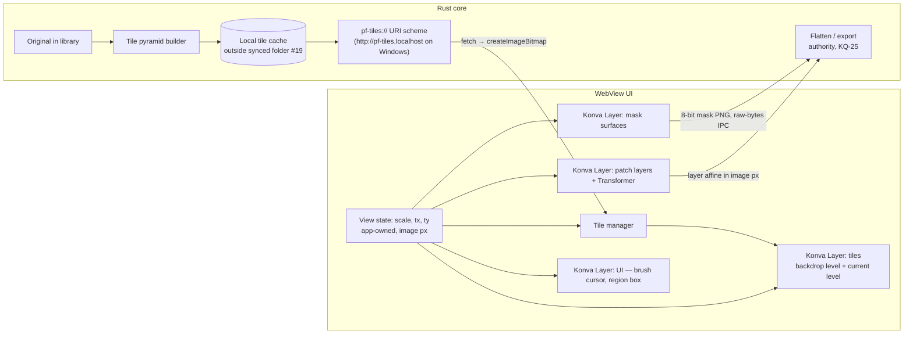

# ADR 0003: Canvas library and rendering architecture

> Status: **accepted** 2026-11-07 (#33): option A, with all OQ-CNV picks as written. Input: KQ-32, the [canvas research](../../research/canvas-library.md), the [spike prototype](../../../spikes/canvas/README.md), #3, #11, #16, #19, KQ-25, KQ-30, [ADR 0001](0001-provider-integration.md).
> The stack is fixed by [ADR 0002](0002-desktop-stack.md).

## Context

- The editor must display **originals** at full fidelity and zoom and pan them (MVP scenario step 1). Most maps are about 2.1k–5.6k px per side, and 16k is the supported upper bound (#11, #30).
- On top of the image it needs a **mask** painted at full resolution over a **region** (step 2) and positioned **patch layers** (step 5, tier S). Free-form move/scale/rotate/opacity/visibility of layers is tier A.
- Rust is the authority for flatten and export, and the canvas is a preview (KQ-25). The canvas must therefore use the same image-px transform model as the Rust composite.
- Chromium caps a 2D canvas at 268,435,456 px and WebGL textures at 16384 px per side. A 16k image is already at both limits.

## Options

| Option | For | Against |
|---|---|---|
| **A. Konva + react-konva** | Built-in `Transformer` for patch handles. Layers are separate canvases, so tiles, patches, mask and UI redraw independently. Draws a live mask canvas with no upload. Official, current React binding. Smallest bundle (63 KB gzip). Very active. Can run in Node for unit tests. | Canvas2D: a single huge bitmap hitches (we don't use one). Redraws a whole layer per change. |
| B. Fabric.js | Richest built-in object controls. Ties on tile and mask performance. | No official React binding. Its own selection and interaction model competes with our tools and view. v7 changed defaults (centre origin). 462 open issues, last release May 2026. 93 KB gzip. |
| C. PixiJS | WebGL: smooth on a single ≤ 16k texture. Strong renderer. | No transform handles (we build them). A mask canvas must be re-uploaded whole on every stroke (139 fps at 4096²), so masks must be tiled. `@pixi/react` stalled since Dec 2025. Hard 16384 px texture cap. 164 KB gzip. Visual tests need WebGL. |

**Pick: A (Konva + react-konva).** With tiles, performance is equal across all three. Konva needs the least custom code for the MVP loop and fits the React stack.

## Rendering architecture (sketch)

- **Coordinate system.** There is one view transform, `screen = image × scale + (tx, ty)`, owned by app state and copied into the Konva Stage. Konva never accumulates its own view state. Image space is the original's integer pixel grid: pixel *(i, j)* covers [i, i+1) × [j, j+1). Wheel zoom is recomputed from the anchor point each step, so it has zero drift. Pure functions with unit tests (`core/view.ts` in the spike).
- **Tiles.** 512 px tiles in a power-of-two pyramid. The visible level is the smallest one at or above the screen scale. The single-tile level stays loaded as a backdrop, so the view is never blank and sub-pixel seams can't show through. Decoding happens off the main thread (`createImageBitmap`) with an LRU of bitmaps (~384 MB budget). Tiles are delivered over a **custom URI scheme, not IPC**: 0.62 ms/tile vs 2.9 ms/tile for base64 IPC.
- **Mask storage.** One region-sized offscreen canvas at full resolution, up to 4096² (64 MB). The canvas alpha is the mask value, and it's shown tinted at 50 %. The brush is a soft round stamp (hardness → feather), and the eraser uses `destination-out`. On submit, the UI reads the region back as an 8-bit mask (≤ 0.27 s at 4096²) in the app-canonical form (white = editable, [ADR 0001](0001-provider-integration.md)) and hands it to Rust.
- **Layer model.** A patch layer is an image plus `{cx, cy, scale, rotation°, opacity, visible}` in image px, rotating about its centre. That maps 1:1 to a Konva `Image` (offset at the centre) and to the 2D affine Rust composites. The spike's read-back corners match the affine to 4.5e-13 px. The Transformer edits these props, and the asset project stores the props, never Konva JSON.

## Consequences

- New production dependencies: **`konva` and `react-konva`** (both MIT). No new Rust crate: the URI scheme is built into Tauri. The pyramid builder belongs to the large-image ADR (`spike/rust-imaging`).
- There's no full-image canvas anywhere in the UI. Flatten and export happen only in Rust.
- Golden-image tests compare the canvas preview with the Rust export for patch blending (KQ-25).
- Playwright tests read app state and the Konva node tree (`stage.find`) through a test hook, never canvas pixels, except for a few probe tests like the spike's.

## Open questions

All picks below were accepted as written (#33).

All picks below were accepted as written (#33).

| ID | Question | Options (pick in **bold**) | Tradeoff |
|---|---|---|---|
| OQ-CNV-01 | Tile encoding in the cache | **JPEG q90 for downsampled levels; lossless (PNG or lossless WebP) for the 1:1 level** / all JPEG / all lossless | Fidelity at 100 % (vision: review at display size) vs cache size and build time. Needs `spike/rust-imaging` numbers. |
| OQ-CNV-02 | When the pyramid is built | **On import/open, in the background in the Rust core; show the backdrop level first** / on demand per tile | Upfront CPU and disk vs first-zoom latency. Needs `spike/rust-imaging` timings. |
| OQ-CNV-03 | Force the discrete GPU on hybrid laptops (`--force_high_performance_gpu`)? | **No, keep the WebView2 default (iGPU)** / yes | The iGPU met every target at 240 Hz. Forcing the dGPU costs battery. |
| OQ-CNV-04 | Maximum region and mask size | **4096² (provider masks go up to 3840 px per ADR 0001 research)** / 8192² with tiled mask storage | 64 MB per mask and simple storage vs larger edits. Konva showed no gain from tiling masks. |
| OQ-CNV-05 | Mask undo storage | **Per-stroke snapshot of the stroke's bounding box (`ImageData`), with a memory cap** / full-canvas snapshots / stroke replay | Small and exact vs simple but heavy (64 MB per step at 4096²) vs needs a deterministic brush. |
| OQ-CNV-06 | React vs imperative code inside the canvas | **react-konva for stage, layers, patches and UI; tiles and mask drawn imperatively through refs** / everything declarative | Avoids React reconciliation on every pan frame vs one consistent style. |
| OQ-CNV-07 | Display scaling above 100 % | **Render at device pixels (Konva `pixelRatio = devicePixelRatio`) and pick the tile level by device-pixel scale** / render at CSS pixels | Sharp at 150–200 % vs 2.25–4× the fill. Not measured: the spike ran at DPR 1. |
| OQ-CNV-08 | Glossary: add **Tile pyramid** (the multi-resolution 512 px tiles of an image, a rebuildable cache) and **View** (the current zoom and pan of the editor)? | **Add both** / keep them as implementation words | Specs need to name these vs keeping the glossary small. |
