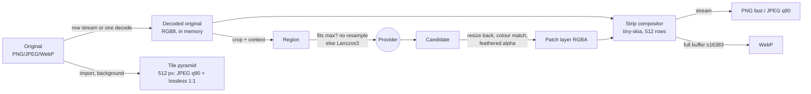

# ADR 0004: Large-image strategy (tile pyramid, regions, patch blend, flatten, export)

> Status: **accepted** 2026-11-07 (#32, #33): all OQ-IMG picks as written. OQ-IMG-12 (upstream bug report) is still with the owner. Evidence: [research/rust-imaging.md](../../research/rust-imaging.md).
> Input: #11 and #30 (typically ~2100×2800 to 4200×5600 px, supported up to ~16k), #13, #19, #24 (export to the owner's own VTT), #25 and #27 (animated WebP, and possibly GIF; after milestone 1, tokens first), #26 (plain files at a user-chosen px per square), KQ-23, KQ-25, KQ-28, [ADR 0001](0001-provider-integration.md) (canonical mask: 8-bit, white = editable), and the [canvas proposal](0003-canvas-library.md) (512 px tile pyramid, layer model, soft-brush mask).

## Context

- A 16k RGB8 battlemap is 768 MiB in memory, and RGBA is 1 GiB. A typical map (#30, ≤ 23.5 MP) is about 1/11 of that. Optimise for the typical size and keep 16k working on an ordinary Windows desktop, then macOS (#2).
- **Rust is the authority for flatten and export, and the canvas approximates** (KQ-25). Golden-image tests need deterministic output.
- A region goes to the provider (maximum input often 1024–3840 px). The returned candidate becomes a **patch layer** that must blend without seams (MVP step 7).
- Inputs are PNG, JPEG and WebP (KQ-28). Exports are plain PNG, JPEG and WebP at a chosen px per square (#26), plus animated WebP and possibly GIF later (#25, #27).

## Options

| Area | Options | Measured tradeoff |
|---|---|---|
| Codec stack | **A. Pure-Rust crates + libwebp (vendored C) for WebP encode** / B. pure Rust only / C. libvips (C) | B has no lossy or animated WebP: a 48-frame token is 32 MiB lossless vs 1.2 MiB lossy. C is a large C dependency with awkward Windows/macOS builds, for speed we don't need: PNG/JPEG export of 16k already streams in 13–17 s. |
| Working memory | **A. Decode the original once while its asset project is open (RGB8)** / B. memory-mapped raw cache in the local cache (#19) / C. re-decode per operation | A: ≤ 768 MiB at 16k (≤ 70 MiB typical), and region extraction takes 9–17 ms. B: low RAM, but a new `memmap2` dependency and disk equal to the raw size. C: 2–4 s per operation at 16k. |
| Tile pyramid encoding | **A. JPEG q90 for downsampled levels + lossless WebP for the 1:1 level** (= OQ-CNV-01) / B. all JPEG / C. all lossless | 16k all-JPEG q85: 3.2 s, 67 MiB, 4 ms per tile. All-lossless WebP: 3.4 s, 338 MiB, 16 ms per tile. A costs ≈ 270 MiB at 16k and ≈ 25 MiB at typical size, and keeps the 1:1 level exact. |
| Export pipeline | **A. Strip compose (512 rows) and stream into PNG/JPEG; WebP from one full buffer** / B. full buffer for every format | A: 16k peak 388 MiB vs 1155 MiB, and faster. Neither WebP encoder can stream. |
| Blend | **A. Inward feather + least-squares colour match, in sRGB, baked by Rust** / B. hard edge (the model blends) / C. linear-light blend | A: edge step 3.6 → 0.28 levels/px, offset 3.4 → 0.03. B leaves a visible line. C differs from the canvas by up to 10 levels. |
| Animated | **A. libwebp `WebPAnimEncoder` (lossy) + `gif` with NeuQuant** / B. pure-Rust lossless WebP mux + GIF | A: token 1.2 MiB in 2.3 s. B: 32 MiB. |

## Decision

- **Crates:** `image` (decode, with explicit `Limits`), `png` (row decode, streaming encode), `jpeg-encoder` (row-pull encode), `fast_image_resize`, `tiny-skia`, `rayon`, **`libwebp-sys` 0.14** (vendored libwebp 1.6.0), and `gif` + `color_quant` for when animation lands (#27).
  - **Not** `webp` 0.3, which vendors libwebp 1.3.1 (CVE-2023-4863).
  - **Never** libimagequant (GPL-3.0).
- **Pixel format:** RGB8 for originals and exports (battlemaps are opaque). RGBA8 straight alpha for patch layers and tokens. Every image is treated as sRGB, and embedded ICC profiles are ignored.
- **Memory:** hold at most one decoded original per open asset project. Build the pyramid from a PNG by streaming its rows. Decode JPEG/WebP whole, once. Export in **512-row strips**, which adds less than 400 MiB at 16k.
- **Tile pyramid:**
  - 512 px tiles with 2× box-filter levels, written to the local cache outside the library (#19).
  - Built in the background on import or open, in parallel, once per original: 16k ≈ 4 s, typical ≈ 0.3 s.
  - JPEG q90 for downsampled levels, lossless WebP (image-webp) for the 1:1 level.
- **Regions:** extract at full resolution with context. If the region fits the provider's maximum input, **send it unresampled**. Otherwise downscale with Lanczos3, upscale the candidate back with Lanczos3, and show the effective resolution loss.
- **Patch blend:**
  - The canonical mask may already be soft (the canvas brush has a hardness setting).
  - Rust applies an **inward feather** on top: default 48 px, tunable per patch, 0 = use the painted edge only (KQ-23). Pixels outside the mask never change.
  - Then an optional **colour match**: per-channel gain and offset, fitted on the unmasked context. Default on.
  - Rust **bakes the alpha and the colour-matched pixels into the patch layer's RGBA image**. The untouched candidate stays recoverable.
- **Flatten:** tiny-skia, premultiplied, sRGB "source-over", bicubic sampling for scaled or rotated layers. Layers use the canvas proposal's model (`cx, cy, scale, rotation, opacity, visible`, rotating about the centre), which is the same 2D affine.
- **Export:**
  - **PNG** with `Compression::Fast`, streamed.
  - **JPEG** q90, streamed (≤ 65535 px).
  - **WebP** ≤ 16383 px, from one full buffer, lossy via libwebp. On a partition overflow, retry as lossless.
  - When the px per square differs from the source, the export path also resamples (OQ-IMG-13).
- **Animated (after milestone 1):** animated WebP via libwebp, lossy q75 by default. GIF with one global NeuQuant palette and frame delays ≥ 20 ms.
- **Determinism:** pin the strip height and the renderer version. Golden tests compare **decoded pixels** exactly on one platform and allow ±1 across platforms.

## Consequences

- WebP export of a 16384 px map isn't possible. The UI offers PNG or JPEG, or WebP at ≤ 16383 px. Typical maps (#30) aren't affected.
- A C compiler becomes part of the build: MSVC on Windows (works), Xcode CLT on macOS (to verify). libwebp security updates arrive through `libwebp-sys` releases, so they need watching.
- The canvas draws baked patch layers and never re-implements the feather or the colour match. Parity tests use a tolerance on scaled or rotated layers.
- tiny-skia is single-threaded, so parallelism comes from strips.

## Open questions

All picks below were accepted as written (#32, #33), except OQ-IMG-12, which is still with the owner.

All picks below were accepted as written (#32, #33), except OQ-IMG-12, which is still with the owner.

| ID | Question | Options (pick in **bold**) | Tradeoff |
|---|---|---|---|
| OQ-IMG-01 | Approve the new dependencies (AGENTS §3.5)? | **A. Approve the crate list above, including `libwebp-sys` (C)** / B. pure Rust only, with no lossy or animated WebP | A meets #25. B drops it, or ships 25× larger files. |
| OQ-IMG-02 | Tile encoding (joint with OQ-CNV-01) | **A. JPEG q90 downsampled + lossless WebP 1:1** / B. all JPEG q85–q90 / C. all lossless | A is exact at 100 % zoom for ≈ 4× the cache of B. C costs 5× the cache and 4× the decode on every level. |
| OQ-IMG-03 | PNG export compression | **A. `Fast` by default** (16k: 13 s, 336 MiB) / B. `Balanced` (341 s, 270 MiB) / C. parallel deflate (new dependency, unmeasured) | A is 26× faster at +25 % size. |
| OQ-IMG-04 | WebP export limits and failure | **A. Cap at 16383 px; on a lossy failure retry lossless, with a notice** / B. also allow 16384 lossless (image-webp) | The VTT is the owner's own (#24), and libwebp decodes 16384, but image-webp 0.2.4 can't read it back. |
| OQ-IMG-05 | Working memory for large originals | **A. Decode once per open project** / B. memory-mapped raw cache (`memmap2`) | A keeps up to 768 MiB resident at 16k. B saves RAM for a dependency and disk. |
| OQ-IMG-06 | A region larger than the provider's maximum input | **A. Allow it with Lanczos3, and warn with the effective scale ("patch 3.4× softer")** / B. block it / C. split into sub-regions | A is simple but leaves a sharpness seam. C needs multi-job stitching (not tier S). |
| OQ-IMG-07 | Golden-image rule (KQ-25) | **A. Compare decoded pixels exactly per platform, ±1 across platforms; strip height and renderer version pinned** / B. byte-compare files | B breaks on every encoder update. |
| OQ-IMG-08 | Colour profiles | **A. Treat everything as sRGB; ignore ICC at import** / B. colour-manage in Rust (new dependency) | A risks a preview mismatch on tagged images, since Chromium colour-manages them. Provider outputs are sRGB. |
| OQ-IMG-09 | GIF palette | **A. `color_quant` NeuQuant, global palette, no dither** / B. `quantette` (MIT/Apache, Rust ≥ 1.90) | B is better for one more crate. libimagequant is excluded (GPL). |
| OQ-IMG-10 | Glossary | **A. Add "Feather" (the soft inward edge Rust applies to a patch layer's mask). "Tile pyramid" as in OQ-CNV-08.** / B. implementation words only | A keeps specs consistent (§2). |
| OQ-IMG-11 | Toolchain | **A. Pin stable Rust ≥ 1.90 in the stack ADR** / B. stay on 1.86 with older crates | A gets current `image`, `fast_image_resize` 6 and `quantette`. |
| OQ-IMG-12 | Report the image-webp 16384 decode bug upstream? (outward-facing) | **A. Yes: the owner files it, or OKs an agent filing it** / B. no | A costs nothing. |
| OQ-IMG-13 | Export at a different px per square (#26) | **A. Flatten at source resolution into one RGB8 buffer only when rescaling, then `fast_image_resize` Lanczos3, then encode** / B. compose directly at the output scale in strips (tiny-skia scales the base) | A is exact and simple, and costs ≤ 768 MiB extra at 16k (unmeasured, ~3 s). B stays streamed, but bicubic aliases beyond 2× downscale. |

## Note (2026-11-09, #60)

New-asset generation ([GEN](../../specs/new-asset-generation.md)) adds a **base image** layer: a picked generated image becomes layer 0 of the working image, in place of (or before) an imported original. Everything above still holds with "original" read as "the base image": it is decoded once, regions are cut from it, patches blend over it, and export flattens it. Generated images with alpha (transparent tokens) keep their alpha in their files. Where this ADR's RGB8 pipeline needs opaque pixels (canvas, thumbnails, region crops, export), they are flattened over neutral mid-grey (#60). The decision itself is unchanged.
