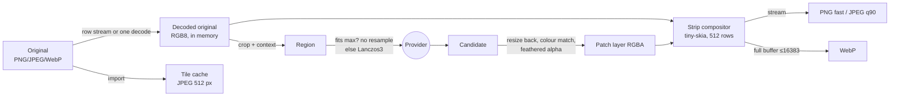

# Proposed ADR: Large-image strategy (tiles, regions, patch blend, flatten, export)

> Status: **proposed** (spike `spike/rust-imaging`, #22). The owner accepts or rejects it. Evidence: [research/rust-imaging.md](../../research/rust-imaging.md).
> Input: #11 (5–10k px typical, up to ~16k), #13, #19, KQ-21, KQ-23, KQ-25, KQ-28, [ADR 0001](0001-provider-integration.md) (canonical mask: 8-bit, white = editable). Owner scope addition during the spike: animated WebP export, and possibly GIF.

## Context

- A 16k RGB8 battlemap is 768 MiB in memory, and RGBA is 1 GiB. The app must work on an ordinary Windows desktop and later on macOS (#2).
- **Rust is the authority for flatten and export, and the canvas approximates** (KQ-25 pick). Golden-image tests need deterministic output.
- A region goes to the provider, whose maximum input is often 1024–3840 px. The candidate comes back, becomes a **patch layer**, and must blend without seams (MVP step 7).
- Inputs are PNG, JPEG and WebP (KQ-28). Exports are generic PNG, WebP and JPEG (KQ-21), plus animated WebP and GIF.

## Options

| Area | Options | Measured tradeoff |
|---|---|---|
| Codec stack | **A. Pure-Rust crates + libwebp (vendored C) for WebP encode only** / B. pure Rust only / C. libvips (C) | B has no lossy or animated WebP: a 48-frame token is 32 MiB lossless vs 1.2 MiB lossy. C is a large C dependency with awkward Windows/macOS builds, for speed we don't need: PNG/JPEG export already streams at 13–17 s for 16k. |
| Working memory | **A. Decode the original once while its asset project is open (RGB8)** / B. memory-mapped raw cache in the local cache dir (#19) / C. re-decode from the file per operation | A: up to 768 MiB at 16k, and region extraction takes 9–17 ms. B: low RAM, but a new `memmap2` dependency and ~768 MiB of disk per 16k map. C: low RAM, but 2–4 s per operation at 16k, and JPEG/WebP still decode whole. |
| Preview tiles | **A. JPEG, 512 px** / B. lossy WebP / C. PNG or lossless WebP | A: 16k pyramid in 3.2 s, 67 MiB, 4 ms per tile. B: 34 MiB, but 10 s and 2× the decode cost. C: 340–490 MiB. |
| Export pipeline | **A. Strip compose (512 rows) and stream into PNG/JPEG; WebP via one full buffer** / B. full buffer for every format | A: 16k peak 388 MiB vs 1155 MiB, and it's faster. WebP can't stream with either encoder. |
| Blend | **A. Inward feather + least-squares colour match, in sRGB, baked by Rust** / B. hard edge (the model blends) / C. linear-light blend | A: edge step 3.6 → 0.28 levels/px, offset 3.4 → 0.03. B leaves a visible line. C differs from the canvas by up to 10 levels. |
| Animated | **A. libwebp `WebPAnimEncoder` (lossy) + `gif` with NeuQuant** / B. pure-Rust lossless WebP mux + GIF | A: token 1.2 MiB in 2.3 s. B: 32 MiB. |

## Decision (proposed)

- **Crates:** `image` (decode, explicit `Limits`), `png` (row decode, streaming encode), `jpeg-encoder` (row-pull encode), `fast_image_resize`, `tiny-skia`, `rayon`, **`libwebp-sys` 0.14** (vendored libwebp 1.6.0), `gif` + `color_quant`. **Not** `webp` 0.3 (vendors libwebp 1.3.1, CVE-2023-4863). **Never** libimagequant (GPL-3.0).
- **Pixel format:** RGB8 for originals and exports (battlemaps are opaque). RGBA8 straight alpha for patch layers and tokens. Treat every image as sRGB and ignore embedded ICC profiles.
- **Memory:** hold at most one decoded original per open asset project. Import a PNG by streaming its rows. Import JPEG/WebP with a single full decode. Export in **512-row strips**, so export adds less than 400 MiB at 16k.
- **Tile cache:** JPEG, 512 px tiles, 2× box-filter levels, in the local cache outside the library (#19). It's rebuildable, built in parallel and written once per original.
- **Regions:** extract at full resolution with context. If the region fits the provider's maximum input, **send it unresampled**. Otherwise downscale with Lanczos3 and upscale the candidate back with Lanczos3, and show the user the effective resolution loss.
- **Patch blend:**
  - Canonical mask → **inward feather** (default 48 px, tunable per patch, KQ-23; pixels outside the mask never change) → **colour match** (per-channel gain and offset fitted on the unmasked context; optional, default on).
  - Rust **bakes the feathered alpha and the colour-matched pixels into the patch layer's RGBA image**. The untouched candidate stays recoverable.
- **Flatten:** tiny-skia, premultiplied, sRGB "source-over", bicubic sampling for scaled or rotated layers. Layers are drawn in order with position, scale, rotation and opacity.
- **Export:**
  - **PNG** with `Compression::Fast`, streamed.
  - **JPEG** q90, streamed (≤ 65535 px).
  - **WebP** ≤ 16383 px only, from a full buffer, lossy via libwebp. If libwebp reports a partition overflow, retry as lossless.
  - **Animated WebP:** libwebp, lossy q75 by default.
  - **GIF:** one global NeuQuant palette, frame delays ≥ 20 ms.
- **Determinism:** pin the strip height and the renderer version. Golden tests compare **decoded pixels** exactly on one platform and allow ±1 across platforms.

## Consequences

- WebP export of a 16384 px map isn't possible. The UI must offer PNG or JPEG, or offer to export at ≤ 16383 px.
- A C compiler becomes part of the build: MSVC on Windows (works), Xcode CLT on macOS (to verify). libwebp updates arrive through `libwebp-sys` releases, so they need watching.
- The canvas draws baked patch layers. It never re-implements the feather or the colour match. Parity tests use a tolerance on scaled or rotated layers.
- Each layer transform is single-threaded inside tiny-skia, so parallelism comes from strips.

## Open questions

| ID | Question | Options (pick in **bold**) | Tradeoff |
|---|---|---|---|
| OQ-IMG-01 | Approve the new dependencies (AGENTS §3.5)? | **A. Approve the crate list above, including `libwebp-sys` (C)** / B. pure Rust only, with no lossy or animated WebP | A meets the animated-WebP requirement. B drops it, or ships 25× larger files. |
| OQ-IMG-02 | Fidelity of level-0 preview tiles at 100 % zoom | **A. JPEG q90 for all levels, judged together with the canvas spike** / B. q85 (measured) / C. lossless WebP for level 0 | A costs ~25 % more cache than q85 and is unmeasured. C costs 5× the cache and 4× the decode. |
| OQ-IMG-03 | PNG export compression | **A. `Fast` by default** (16k: 13 s, 336 MiB) / B. `Balanced` (341 s, 270 MiB) / C. parallel deflate (new dependency, unmeasured) | A is 26× faster and +25 % size. C could get both, but it's another dependency. |
| OQ-IMG-04 | WebP export limits and failure | **A. Cap at 16383 px; on a lossy failure retry lossless, with a notice** / B. allow 16384 lossless via image-webp | B decodes in libwebp, but image-webp itself can't read it back and VTT support is unknown. |
| OQ-IMG-05 | Working memory for 16k originals | **A. Decode once per open project** / B. memory-mapped raw cache (`memmap2`) | A keeps up to 768 MiB resident. B saves RAM but costs disk and a dependency. |
| OQ-IMG-06 | A region larger than the provider's maximum input | **A. Allow it with Lanczos3, and warn with the effective scale ("patch 3.4× softer")** / B. block it and require a smaller region / C. split into sub-regions | A is simple but the seam stays visible. C needs multi-job stitching (not tier S). |
| OQ-IMG-07 | Golden-image rule (KQ-25) | **A. Compare decoded pixels exactly per platform, ±1 across platforms, with strip height and renderer version pinned** / B. byte-compare files | B breaks on every encoder update. |
| OQ-IMG-08 | Colour profiles | **A. Treat everything as sRGB and ignore or strip ICC at import** / B. colour-manage in Rust (new dependency) | A risks a preview mismatch on tagged images. Expect none in practice: provider outputs are sRGB. |
| OQ-IMG-09 | GIF quality | **A. `color_quant` NeuQuant with a global palette, no dither** / B. `quantette` (MIT/Apache, needs Rust 1.90) | B gives better palettes and dithering for one more crate. libimagequant is excluded (GPL). |
| OQ-IMG-10 | Glossary terms used here | **A. Add "Tile cache" (rebuildable preview tiles) and "Feather" (the mask's soft inward edge)** / B. keep them as implementation words | A keeps specs consistent (§2). |
| OQ-IMG-11 | Toolchain | **A. Pin a stable Rust ≥ 1.90 in the stack ADR** / B. stay on 1.86 with older crate versions | A gets current `image`, `fast_image_resize` 6 and `quantette`. |
| OQ-IMG-12 | Report the image-webp 16384 decode bug upstream? (outward-facing) | **A. Yes, the owner files it or OKs an agent filing it** / B. no | A costs nothing. The fix helps OQ-IMG-04 B. |
