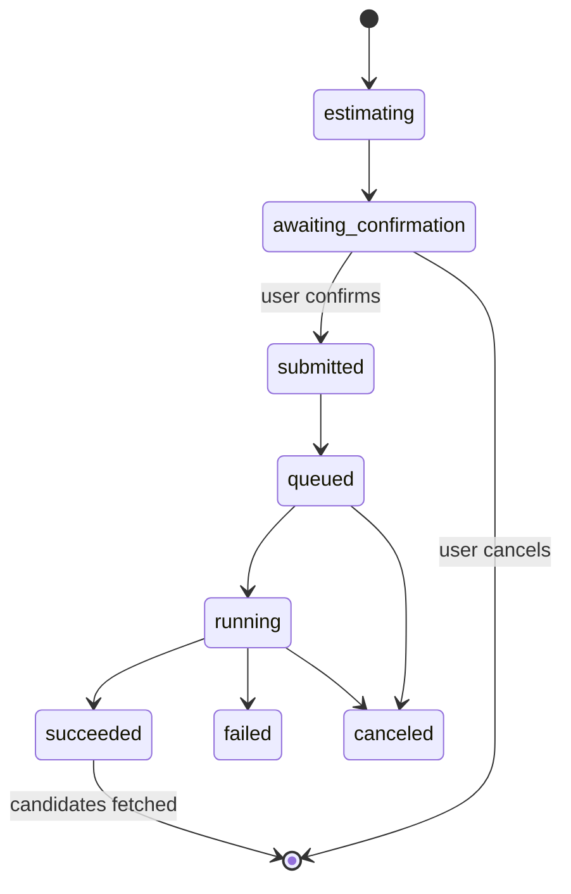

# Proposed ADR: Provider integration (Scenario)

> Status: **proposed**. The owner decides (AGENTS §3.2). Input: KQ-04, the [Scenario API research](../../research/scenario-api.md), #6, #9, #3.

## Context

- The app calls the **provider** itself, deterministically, from the Rust core. There's no LLM in the app (#9).
- Scenario has three surfaces over one REST API: **REST** (OpenAPI spec), the **TS SDK** `@scenario-labs/sdk` (generated from that spec, plus helpers) and the **MCP server** (an agent layer). See the [research](../../research/scenario-api.md#capability-matrix).
- Milestone 1 needs: upload a **region** and **mask** → localised edit → poll the **job** → fetch **candidates** → show cost and status.
- Other providers may follow, so the core must not depend on Scenario concepts.

## Options

| Option | Summary | For | Against |
|---|---|---|---|
| **A. REST adapter in Rust** | A hand-written client for ~12 endpoints behind a provider-agnostic adapter | Full coverage (dry-run, balance, cancel). The secret stays in the core. Plain JSON fixtures for the fake provider (KQ-24). ToS gives 90 days' notice for breaking changes. | We maintain the client ourselves. It needs an HTTP client crate (new dependency, OQ-PRV-07). |
| B. MCP client in Rust (`rmcp`) | The app acts as an MCP client of `mcp.scenario.com` | Official Rust SDK. A schema tool exists. | 0.x with no stability promise. OAuth means a browser. LLM-shaped results. Uploads still need raw HTTP. Fixtures must replay MCP sessions. Its agent features are unusable under #9. |
| C. TS SDK (webview or Node sidecar) | Use `@scenario-labs/sdk` from the UI or a bundled Node process | Typed, with retries, `wait()` and `uploadFile()` built in | Webview: the secret is in UI JavaScript (ToS §7.2) and CORS is unverified. Sidecar: a second runtime to ship, against the spirit of #3. 3 majors in 7 months. Its repo isn't public. Job and cost state end up split across TS and Rust. |
| D. Hybrid (REST for jobs + MCP for model discovery) | Use MCP `model_schema_get` and `search`, and REST for everything else | Gets MCP's reshaped schema | Two auth paths and two failure modes for no gain, because REST `GET /models/{id}` returns the same data |

**Pick: A.** MCP and the SDK stay outside the app. MCP remains fine for agent-driven exploration from a coding agent. The SDK source is a good reference for upload and polling behaviour.

## Decision sketch (if A is accepted)

- One `Provider` adapter interface in the core. Scenario is the first implementation, and a **fake provider** with recorded fixtures is the second (KQ-24, AGENTS §3.7).
- **Model capabilities** are read from the provider (`GET /models/{id}`). They're normalised into a generic shape and **overlaid with a hand-maintained per-model table** for what isn't machine-readable: mask convention, and reference role → input name.
- Inpainting is offered only for **allowlisted, fixture-tested models** (OQ-PRV-01).
- Every job runs **estimate → confirm (per KQ-06) → submit → poll → fetch**. The final prompt, all inputs, the seed and the capability snapshot are recorded on the job (KQ-17).

## Provider-agnostic adapter interface (operations, not code)

| Operation | Input | Output | Failure behaviour |
|---|---|---|---|
| `list_models` | filter (operation, asset type hint) | model summaries (id, name, operations) | offline/auth → error. The UI keeps the last cached list. |
| `get_capabilities` | model id | **model capabilities**: supported operations, controls (type, range, allowed values, default, cost-affecting), reference slots with **reference role**, mask support + convention, max input px/bytes, seed support | an unknown input type → that control is hidden, with a warning. No crash. |
| `upload` | image bytes, purpose (source, mask, reference) | provider asset ref | size over the limit → a validation error before upload. Network → retry under the bounded retry policy. |
| `estimate` | job request | cost (provider units + generic number) or `unknown` | `unknown` is allowed. The UI then requires explicit confirmation. |
| `submit` | job request | job handle | invalid request → field-level error. Insufficient balance → a distinct error. |
| `status` | job handle | state (`queued`, `running`, `succeeded`, `failed`, `canceled`), progress 0–1, cost if known, error + hint | rate limited → back off. Offline → state `unknown`, resumable. |
| `cancel` | job handle | ack | not cancellable → reported, the job continues |
| `fetch_candidates` | job handle | candidate images (bytes) + provider metadata (asset ids, seed, inputs) | expired URL → re-resolve the asset, then retry |
| `balance` | — | remaining provider units, period end, or `unknown` | `unknown` if the key can't read it |

**Job request (generic):** operation (`generate`, `edit_masked`, `extend`, `upscale`, `remove_background`, `tile`), model id, **final prompt**, control values, reference images by **reference role**, region image + **mask** (app-canonical: 8-bit, white = editable), candidate count, seed.

**Normalised errors:** `auth`, `insufficient_balance`, `rate_limited(retry_after)`, `invalid_request(field)`, `provider_failure(hint)`, `offline`, `timeout`.

### Generic vs Scenario-specific

| Generic (core and glossary) | Scenario-specific (adapter only) |
|---|---|
| job, candidate, cost, model capabilities, reference role, mask, seed | Basic `key:secret` auth, `projectId`/`teamId` |
| estimate before run | `?dryRun=true` → HTTP 269, `creativeUnitsCost` |
| job states, progress | `queued`/`warming-up`/`pending`/`in-progress`/`finalizing` → `queued`/`running` |
| upload → provider asset ref | `/assets` (< 4 MB) vs `/uploads` multipart, asset ids |
| canonical mask (white = edit) | per-model polarity: alpha-transparent, white, or black |
| reference role slots | `referenceImages`, `controlImage`, `characterReference`, … |
| balance | `/teams/{id}/limits`, CU, one-shot CU expiry |

## Consequences

- **KQ-04:** answered by A. **KQ-05:** a key + secret pair fits the OS credential store, used only in the Rust core. **KQ-06:** a pre-flight estimate exists, so "estimate + cap + confirm" is feasible. **KQ-17:** feasible. Seeds are absent on some models. **KQ-24:** the fake provider replays recorded JSON. Binary fixtures must be generated or CC0.
- A per-model overlay table becomes a maintained artifact with a fixture test per model.
- No webhooks. The app polls.

## Open questions

| ID | Question | Options (pick in **bold**) | Tradeoff |
|---|---|---|---|
| OQ-PRV-01 | Which models offer masked edits in milestone 1? | **A. An allowlist (start: GPT Image 2, Ideogram 4.5 Precise Edit) with a mask-convention overlay and a fixture each** / B. any model whose schema has a `mask` input | A is safe but needs manual upkeep. B risks silently inverted masks. |
| OQ-PRV-02 | Client: hand-written or generated from the OpenAPI spec? | **A. Hand-written for the ~12 routes used, with contract tests against recorded responses** / B. codegen | A is small and readable. B gains little because run bodies are `unknown`, and the spec is ~8 MB. |
| OQ-PRV-03 | How does the app send images? | **A. Upload first (`/assets` < 4 MB, `/uploads` above), then reference asset ids** / B. inline data URLs in the run body | A allows retry without re-upload and records ids. B is one call but resends bytes on each retry. |
| OQ-PRV-04 | Estimate before every job? | **A. Always (dry run is free; never set `ipDetection`)** / B. only above a threshold | A adds one round-trip. B can hide cost surprises. |
| OQ-PRV-05 | Polling cadence and limit? | **A. 2 s, backing off to 10 s. A user-visible "still running" after 3 min. Never auto-resubmit.** / B. fixed 3 s, 120 s timeout (SDK default) | A suits slow models. B gives up on long jobs. |
| OQ-PRV-06 | Uploaded regions on the provider side? | **A. Upload with `hide: true`, and don't auto-delete (tier S)** / B. delete after accept | A is simple. B is more private but needs delete handling and failure cases. |
| OQ-PRV-07 | New dependency: an HTTP client crate (e.g. `reqwest`) | **A. Approve one async HTTP client in the Rust core** / B. Tauri's HTTP plugin | AGENTS §3.5 needs the owner's OK. A is testable without Tauri. |
| OQ-PRV-08 | Glossary: the term for a provider's billing unit | **A. Add "Cost" = the provider-reported charge of a job, in provider units (Scenario: CU)** / B. use "credits" | A is generic. B mirrors the vision text but is vague. |
| OQ-PRV-09 | Balance if the key can't read team limits (unverified) | **A. Show "unknown" plus a per-session spend tally from job costs** / B. block generation | A keeps working. B is strict but annoying. |
| OQ-PRV-10 | Use the TS SDK for anything? | **A. No, reference reading only** / B. dev tooling scripts only (outside the app) | A means no npm dependency. B is handy for spikes but adds a second client to keep in sync. |
