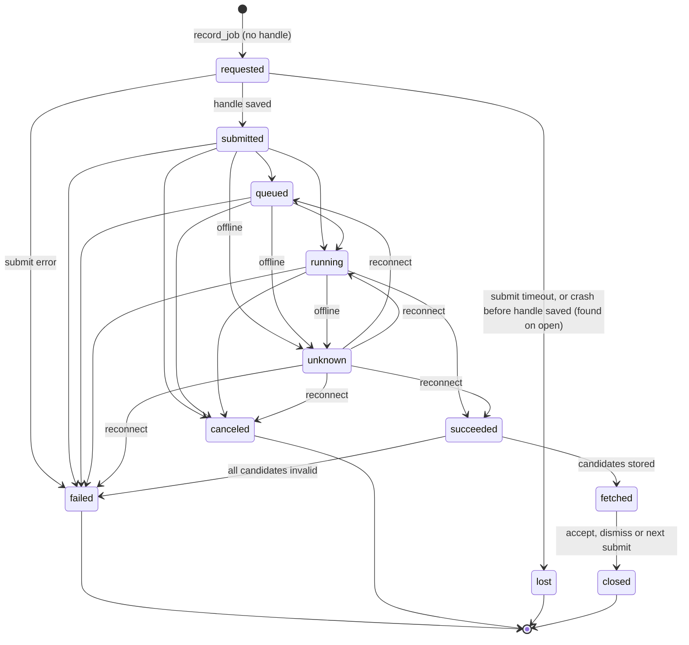

# Manifest schema

> Owner: [asset-project](../specs/asset-project.md) (PRJ). Status: **in review** with that spec.
> Single source of truth for every field PRJ stores. Other specs say what they **need**; the shapes live here (R2, R26).
> Shared-file rule (AGENTS §9): **add fields only.** Never rename or drop a field once real projects exist; add a new one and migrate on load.
> #44 redefined v1 in place (project-as-folder). No real projects existed, so there is no migration code.

## 1. Conventions

- **IDs:** ULIDs from the ID seam. **Times:** UTC RFC 3339 with ms, from the clock seam. **Hashes:** `sha256:<hex>` (#38).
- **Rects:** `{x, y, w, h}`, integer image px. **Region** = the inner rect; outer rect = region + **context margin** (R1).
- **Paths:** relative to the project folder, `/` separators (e.g. `working/crypt.png`, `.pforge/layers/<id>.png`). Never absolute, never credentials (FR-PRJ-12). `<data-dir>` files are the only exception (per machine, never synced).
- **JSON:** UTF-8, LF, pretty-printed (2 spaces), fields in the declared order below; unknown fields are kept and written after the known ones (FR-PRJ-27).
- Every mutable file (`project.json`, `job.json`, `settings.json`, `thumb.jpg`) is written temp → flush → rename. Write-once files are never rewritten.

## 2. Files

```
<library-root>/                          synced (#5, #13)
  Maps/  Tokens/  Items/                 sections (#44); kind map | token | item
  Maps/Crypt/                            project folder; folder name = project name (FR-PRJ-44)
    project.json                         the manifest: mutable, current state + indexes (commit point)
    working/crypt.png                    the original, copied in: never written (FR-PRJ-15)
    references/  structure/  parts/      user-owned: listed, never moved or deleted (FR-PRJ-47)
    results/001 kitchen/01.png           candidates: write-once, untouched, ext sniffed; one folder per iteration (§4.7)
    exports/Crypt_70px.png               EXP output (export spec)
    .pforge/                             hidden (dot name, plus the hidden attribute on Windows)
      revisions/<rev-id>.json            write-once
      layers/<layer-id>.png              write-once, baked patch RGBA8, cropped to alpha > 0
      masks/<mask-id>.png                write-once, 8-bit grey, 255 = editable, inner-rect size
      jobs/<job-id>/job.json             mutable: job state + provider data (authoritative)
      jobs/<job-id>/region.png           write-once, outer rect as sent (after fit)
      jobs/<job-id>/mask.png             write-once, padded + resampled, before polarity conversion
      trash/<item-id>/<project path>     trashed files, 30-day purge
      thumb.jpg                          home-grid thumbnail, ≤ 512 px, rebuildable (FR-PRJ-50)
      project.v<N>.json                  pre-migration copy (§6)
  Maps/.Crypt.pf-tmp-<ulid>/             a project being created (FR-PRJ-09)
  References/                            reference packs (#51); not a section (FR-PRJ-51)
    Swords/                              a pack; folder name = pack name (FR-REF-02)
      pack.json                          mutable: pack id, notes, roles (§4.12)
      longsword.png                      pack images, user files, top level only
      .pforge/thumb.jpg                  pack thumbnail, rebuildable (FR-REF-13)
    .pforge/trash/<item-id>/             References trash: item.json + files, 30-day purge (§4.13)
    .Swords.pf-tmp-<ulid>/               a pack being created (FR-REF-07)
<data-dir>/                              local, per machine, never synced (#19)
  settings.json                          §5
  cache/tiles/…                          tile pyramids; key, cap, eviction owned by EDT (R5)
  cache/provider/…                       model list + capabilities, owned by PRV
  pending/<project-id>/…                 write spool (§4.9, R12)
```

**Lose it?** Caches rebuild. `settings.json` is per-machine config (re-pick roots, re-enter spend cap). `pending/` holds not-yet-committed candidate bytes and job updates: losing it before replay loses those only.

## 3. Write rules

| Change | Order (each file temp → rename) | Commit point | Rolled forward on open |
|---|---|---|---|
| Project created | in `.<name>.pf-tmp-<ulid>/`: original copy, folders, `r0`, `project.json`; then rename the folder | folder rename | temp folder removed (FR-PRJ-09) |
| Any manifest change | new write-once files → `project.json` | manifest rename | trash moves (§4.8) |
| Mask submitted (`put_mask`) | mask PNG → manifest (mask record + `draft.mask_id`, one commit) | manifest rename | — |
| Job created (`record_job`) | `region.png`, `mask.png` → `job.json` (`requested`) → manifest | `job.json` rename (the job exists); manifest adds the index row | — |
| Job state change (`update_job`) | `job.json` only | `job.json` rename | — |
| Candidates stored (`add_candidates`) | `job.json` (`iteration` set) → candidate files in `results/NNN <slug>/` → manifest → `job.json` (`fetched`) | manifest rename | `succeeded` job whose candidates are in the manifest → `fetched`; otherwise the re-fetch replaces only that folder's unreferenced files |
| Accept / dismiss / re-tune | layer PNG + revision → manifest → `job.json` (`closed`) | manifest rename | `fetched` job with an accepted candidate or none left `new` → `closed` |

- Before every manifest write: compare on-disk `commit{seq, install_id}` with the last loaded/written values (FR-PRJ-35).
- On open: delete `*.pf-tmp-*`; move files in `.pforge/` referenced by **no** manifest field, revision or job file to the trash (`kind: orphan`). `thumb.jpg` and `project.v<N>.json` are known files. User-owned folders, and files the app didn't name, are never swept (FR-PRJ-47).
- Superseded draft masks (referenced by no draft, job or revision) go to the trash at the next commit (R7).

## 4. Records

### 4.1 Manifest (`project.json`)
| Field | Type | Notes |
|---|---|---|
| `schema_version` | int | 1 |
| `project_id` | ULID | |
| `kind` | `map\|token\|item` | from the section; follows the folder (FR-PRJ-46) |
| `created_at` | time | project creation |
| `commit` | `{seq, install_id, at}` | `seq` +1 per manifest write |
| `original` | §4.2 | |
| `layers[]` | §4.3 | **current** stack, draw order; `[0]` is the original. EXP and EDT read this (R6) |
| `masks[]` | §4.4 | |
| `draft` | §4.5 \| null | |
| `jobs[]` | `{id, state, iteration}` | index, rebuilt from `.pforge/jobs/*/job.json` on open (R2); `iteration` = the job's `iteration.n` \| null, so a home card counts iterations from this file alone |
| `candidates[]` | §4.7 | |
| `revisions[]` | `{id, seq, created_at, reason, label?}` | index, rebuilt from `.pforge/revisions/*.json` on open |
| `head_revision` | ULID | the revision the current state descends from |
| `trash[]` | §4.8 | |
| `export` | §4.10 \| null | OQ-EXP-04 |

### 4.2 Original
`file` (`working/<source file name>`), `content_hash`, `size`, `mtime`, `width`, `height`, `format` (`png|jpeg|webp`).

### 4.3 Layer
| Field | Type | Notes |
|---|---|---|
| `id`, `kind` | ULID, `original\|patch` | |
| `file` | path \| null | `.pforge/layers/<id>.png`; null for `original` (uses §4.2) |
| `cx`, `cy`, `scale`, `rotation`, `opacity`, `visible` | number, bool | ADR 0003; patches: scale 1, rotation 0 (FR-RGN-27) |
| **patch only:** `job_id`, `candidate_id`, `mask_id` | ULID | |
| `region` | `{inner, outer, margin}` | rects + margin px (R1) |
| `rect` | rect | placement of the cropped PNG |
| `blend` | `{feather_px, colour_match{on, gain[3], offset[3]}}` | fitted gain/offset stored |
| `retune_of` | ULID \| null | the layer this re-tune replaced (R3: new id + new file) |

### 4.4 Mask
`id`, `file` (`.pforge/masks/<id>.png`), `rect` (the region, inner), `created_at`.

### 4.5 Draft
`final_prompt`, `model_id`, `controls{}` (keyed by capability control `name`, #37), `seed` (int \| null), `region` (`{inner, margin}` \| null), `mask_id` (latest mask, R7) \| null, `references` (#51, REF: `{packs: [{pack_id, name}], items: [{key, on, role \| null}]}` \| null; null = REF's defaults, FR-REF-17), `updated_at`.

### 4.6 Job (`.pforge/jobs/<id>/job.json`)
| Field | Type | Notes |
|---|---|---|
| `schema_version`, `id`, `created_at`, `updated_at` | | |
| `state`, `state_times{}` | enum, `{<state>: time}` | written on **every** transition (R2) |
| `resolved_at` | time \| null | set when the job is resolved: accept, dismiss or the next submit ([region-edit](../specs/region-edit.md) FR-RGN-28) |
| `operation`, `model_id` | string | `edit_masked` |
| `capability_snapshot` | object | KQ-17 |
| `final_prompt`, `controls{}`, `candidate_count` | | as submitted |
| `seed` | `{requested, returned}` | int \| null each |
| `region` | `{inner, outer, margin}` | |
| `fit` | `{sent_w, sent_h, scale}` | |
| `mask_id` | ULID | the draft mask the job was built from |
| `inputs` | `{region: "region.png", mask: "mask.png"}` | as sent (R2) |
| `references[]` | `{source: project\|pack, pack_id \| null, pack_name \| null, path, content_hash, slot, role \| null, sent: {w, h, bytes, hash, resized}}` | #51, FR-REF-25: the files sent, in request order; `path` = `references/<file>` or `References/<pack>/<file>`; hashes only, no copies (OQ-REF-02). `[]` when none. Written with `requested`, never changed |
| `estimate`, `cost` | `{amount \| unknown, unit}` | PRV's generic `Cost` |
| `provider` | object | **opaque**; shape in [provider](../specs/provider.md) Appendix B (incl. the job handle, OQ-PRV-22 pick A). Persisted verbatim on every transition |
| `iteration` | `{n, dir}` \| null | set by `add_candidates` before any candidate file is written: `n` = 1 + the highest `n` in the project, `dir` = `results/NNN <slug>` ([region-edit](../specs/region-edit.md) FR-RGN-39) |
| `candidate_ids[]` | ULID | in provider order |
| `error` | `{code, hint}` \| null | normalised (ADR 0001) |


Terminal = `failed | canceled | lost | closed`. A re-pick (RGN FR-RGN-36) accepts another candidate of a `closed` job without a transition. Handle rule: `requested` has no handle; `submitted` and every state reached from it have one inside `provider{}`. PRJ never reads it. RGN's job runner drives the transitions (R14); PRJ persists them.

### 4.7 Candidate (manifest `candidates[]`)
| Field | Type | Notes |
|---|---|---|
| `id`, `job_id`, `index` | ULID, ULID, int | `index` = provider order |
| `file` | path | `results/NNN <slug>/NN.<ext>`, `NN` = `index` + 1, two digits |
| `format`, `width`, `height` | | sniffed / returned px |
| `seed` | int \| null | |
| `provider_meta` | object | opaque (PRV) |
| `status` | `new\|accepted\|dismissed\|discarded\|trashed\|invalid` | R10 |
| `starred` | bool | separate from status; starred is never trashed |
| `trash_id` | ULID \| null | set while the file is in the trash; after a purge it still names the purged item |
| `purged_at` | timestamp, optional | set when the 30-day purge deleted the file (FR-PRJ-32, BL-23); the record stays |

- `new` = ready to compare · `accepted` · `dismissed` = left over when its job was resolved · `discarded` = the user discarded it · `trashed` = moved by a sweep (orphan, conflict) · `invalid` = won't decode. UI statuses (`pending|ready|invalid`) are EDT/RGN's only.
- A rebuild (FR-PRJ-24, conflict) adds candidates listed in a job's `candidate_ids[]` but missing here, as `new` (or `invalid` if the file won't decode).

### 4.8 Trash item (manifest `trash[]`)
`id`, `kind` (`candidates|job_inputs|mask|layer|manifest|orphan|conflict_copy`), `files[]` (from → `.pforge/trash/<id>/<from>`; a restore moves it back to `<from>`, recreating its folder), `trashed_at`, `reason`. The manifest records the item first; the file moves follow the commit and are rolled forward on open. Purged when `trashed_at` + 30 days < now (at open).

### 4.9 Spool entry (`<data-dir>/pending/<project-id>/`)
`<seq>.json` = `{seq, op: add_candidates|update_job, job_id, payload, created_at}`, plus `<seq>-<cand-id>.<ext>` bytes. Replayed in `seq` order once the project is writable; each entry is deleted after its commit.

### 4.10 Export (manifest `export`, EXP owns the meaning)
| Field | Type | Notes |
|---|---|---|
| `grid` | `{mode: px\|cells, source_px_per_square?, cols?, rows?}` | |
| `target_px_per_square` | number \| null | |
| `format` | `png\|jpeg\|webp` | |
| `last` | object \| null | `{at, revision_id, layers_hash, path, format, width, height, bytes, fallback, strip_h, compose_version}` |

- `grid`, `target_px_per_square` and `format` are written by PRJ's debounced draft save (R30) and at `export_start` (R6); `last` only after a successful export. `last.path` is relative to the project folder (e.g. `exports/Crypt_70px.png`).
- `layers_hash` = SHA-256 of the canonical JSON (declared field order, no whitespace) of `layers[]` at export time.

### 4.11 Revision file (`revisions/<id>.json`, write-once)
`schema_version`, `id`, `seq` (`r<seq>`; `r0` = 0), `created_at`, `reason` (`create|accept|save|restore|retune|conflict`), `label` \| null, `parent` (ULID \| null: the revision it descends from; undo restores it, FR-PRJ-43), `layers[]` (§4.3, the stack at that point), `draft` (§4.5 \| null). The manifest's `revisions[]` row is `{id, seq, created_at, reason, label?}` of this file.

### 4.12 Reference pack (`pack.json`)
Owner of the meaning: [reference-packs](../specs/reference-packs.md) (REF). In `<library-root>/References/<pack>/`, mutable, temp → rename, unknown fields kept.

| Field | Type | Notes |
|---|---|---|
| `schema_version` | int | 1 |
| `pack_id` | ULID | stable across renames; a duplicate gets a new one (FR-REF-05) |
| `created_at`, `updated_at` | time | `updated_at` decides a conflict copy (FR-REF-28) |
| `notes` | string | ≤ 2000 chars; never sent (#9) |
| `images` | `{<file name>: {role: style\|structure\|identity}}` | optional per-image default role; entries for absent files are kept |

No `name`: the folder name is the pack name (OQ-REF-01).

### 4.13 References trash item
`<library-root>/References/.pforge/trash/<item-id>/item.json` = `{schema_version, id, kind: pack|images, pack_id, from, files[], trashed_at, restored_at?}` (`from` = `References/<pack>` for a pack, the file names for images), plus the moved files under the same folder. `item.json` is written first; the move is rolled forward at startup. `restored_at` is set before a restore moves files back, so a restore interrupted by a crash is finished at startup (R50). Purged when `trashed_at` + 30 days < now (FR-REF-12).

## 5. `settings.json` (R8)
| Section | Fields | Owner of the meaning |
|---|---|---|
| (top) | `schema_version`, `install_id` (ULID, made on first run) | PRJ |
| `library` | `roots[]` (absolute, per machine; the first receives new projects). `import_dest` is retired (#44): an old value is kept as an unknown field and ignored | PRJ |
| `spend` | `cap`, `threshold` (provider units; null = not set, asked on first submit) | RGN |
| `provider` | `team_id?`, `project_id?` (never credentials; those are in the OS store) | PRV |

Corrupt or unreadable → defaults + a warning; the bad file is kept as `settings.corrupt-<UTC>.json`. Unknown sections are kept.

## 6. Versioning and migration
- `schema_version` is an integer on `project.json`, `job.json`, revision files, `settings.json`, `pack.json` and References trash `item.json`. v1 is the first (redefined in place by #44 before any real project existed).
- Load runs pure migrations vN → vN+1 in order. A mutable file is written migrated at its next write; the pre-migration manifest is kept once as `.pforge/project.v<N>.json`. Write-once files are migrated in memory only.
- Newer than supported → the project opens **read-only** ("Made by a newer Pocket Forge"); nothing is written (FR-PRJ-26).
- Each migration has a fixture from the previous version and a `fr_prj_25_*` test.
