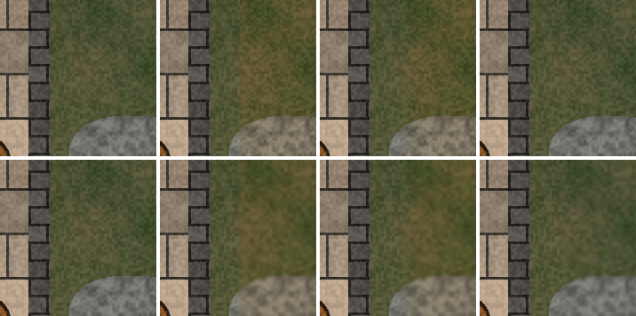

# Research: Rust large-image processing

> Spike `spike/rust-imaging` (#22). Input for [0004-large-image-strategy.md](../architecture/adr/0004-large-image-strategy.md). Measured 2026-11-07 with the throwaway crate in `spikes/imaging/` (deleted when the skeleton landed; see commit 3fb4228 in git history).
> All images are procedurally generated. No real art was used.

## Recommendation

**Pure-Rust crates for everything except WebP encoding, which uses vendored libwebp through `libwebp-sys`.** Stream PNG/JPEG export in 512-row strips. Build a 512 px tile pyramid (JPEG, plus a lossless 1:1 level). Blend in sRGB with an inward feather and a least-squares colour match, both baked by Rust.

- **Typical maps are easy.** At ~4200×5600 (#30, ≈ 1/11 of 16k), every step below scales about linearly: decode ≈ 0.2 s, pyramid ≈ 0.3 s, flatten + PNG export ≈ 1.2 s, ≈ 70 MiB per decoded copy. The 16k numbers are the stress case.
- **Crates:** `image` (decode), `png` (row-streaming decode and encode), `jpeg-encoder` (row-pull encode), `fast_image_resize`, `tiny-skia` (layer compose), `rayon`. Add `libwebp-sys` 0.14 (lossy and animated WebP) and `gif` + `color_quant` (GIF).
- **Memory:** a 16k original costs 768 MiB as RGB8. Hold at most one decoded copy. Import a PNG by streaming its rows (peak **279 MiB** for a 16k pyramid). Export in strips: **388 MiB** peak at 16k, against 1155 MiB for one full-size buffer.
- **Tiles:** 512 px, matching the [canvas proposal](../architecture/adr/0003-canvas-library.md).
  - JPEG: a 16k pyramid (1365 tiles) is written in **1.1 s** after decode and takes 67 MiB.
  - Lossless WebP for the 1:1 level (OQ-CNV-01) raises the cache to ≈ 270 MiB at 16k (≈ 25 MiB typical) and costs ≈ 0.2 s more.
  - Lossy WebP tiles are half the size of JPEG but take 3× the encode time and 2× the decode time.
- **Regions:** prefer a region that fits the provider's maximum input, so there's no resampling. A room-sized region (3000 × 2200 + 256 px context) fits GPT Image's 3840 px limit. Downscaling 3.4× leaves a **sharpness seam** that feathering can't hide.
- **Export:** PNG with `Compression::Fast` (16k in 13 s). `Balanced` takes 341 s, which is unusable. JPEG q90 takes 17 s, streamed. **WebP stops at 16383 px**, and lossy WebP can fail below that.
- **Animated (#25, after milestone 1 per #27):** libwebp `WebPAnimEncoder`, lossy. A 48-frame 1024 px token encodes in 2.3 s and takes 1.2 MiB. GIF uses `gif` + NeuQuant. **libimagequant is GPL-3.0 and can't be used** (#17).

## Test machine and fixture

- **Machine:** Windows 11, Intel 13th-gen HX laptop CPU, 24 cores / 32 threads, 64 GB RAM, NVMe SSD. Release builds with Rust 1.86 (`codegen-units = 16`, no LTO).
- **Fixture:** a procedural dungeon map (rooms, 50 px flagstones, brick walls, barrels, rough ground, 100 px grid; `spikes/imaging/src/synth.rs` in git history). It carries deliberate per-pixel noise, so **lossy encode times and sizes are pessimistic** compared with painted art.
- **Fixture files:**
  - 8k: PNG 67 MiB, JPEG q90 16 MiB, WebP q90 9.2 MiB.
  - 16k: PNG 267 MiB, JPEG 64 MiB, WebP lossless 237 MiB (lossy failed, see [limits](#format-limits)).
- **Peak** is the process's peak working set. Each case ran in its own process.

## Benchmarks

### 1. Decode

| Input | Decoder | 8k ms / peak MiB | 16k ms / peak MiB |
|---|---|---|---|
| PNG | `image`, **default limits** | 532 / 197 | **fails: "Memory limit exceeded"** (512 MiB default `max_alloc`) |
| PNG | `image`, `no_limits()` → RGB8 | 534 / 197 | 2126 / 773 |
| PNG | the same, then `into_rgba8()` | +60 / 452 | +241 / **1796** |
| PNG | `png` **row streaming** | 503 / **6** | 1976 / **6** |
| JPEG q90 | `image` (zune-jpeg) | 260 / 213 | 1059 / 837 |
| WebP | `image` (image-webp) | 1037 / 292 | **fails** at 16384 (bug, see [risks](#risks)) |
| WebP | libwebp | 629 / 398 | 4071 / 2034 (includes a copy made by the spike) |

- Keep battlemaps as **RGB8** (opaque). RGBA costs 33 % more and the conversion doubles the peak.
- JPEG and WebP have no row-streaming decoder in pure Rust. A JPEG or WebP original is decoded whole, once.

### 2. Tile pyramid (16k PNG source, 6 levels, 1365 tiles of 512 px, rayon)

| Tile format | Total ms (decode 2.1 s included) | Cache MiB | Decode per tile, one thread |
|---|---|---|---|
| **JPEG q85** | **3247** | 67 | 4.2 ms |
| WebP lossy q80 (libwebp) | 10179 | 34 | 8.5 ms (libwebp), 21.9 ms (image-webp) |
| WebP lossless (image-webp) | 3438 | 338 | 16.3 ms |
| PNG fast | 3657 | 492 | 10.2 ms |
| JPEG q85, **256 px tiles** | 5907 | 70 | 1.3 ms (4× the tiles: 5461) |
| JPEG q85, **PNG row streaming** | 3809 | 67 | peak **279 MiB** instead of 970 |

- The webview decodes tiles natively. The [canvas research](canvas-library.md) covers delivery and decode (custom URI scheme, `createImageBitmap`).

### 3. Region extraction and provider resize (source: a 16k image held in memory)

- Extraction is a row copy: 9 ms for 3512 × 2712, 17 ms for 6512 × 4912.
- A room-sized region (3512 × 2712 with context) **fits 3840 px as it is**.

| Region → provider max | Filter (`fast_image_resize`) | Down + up ms | Round-trip PSNR dB | Sharpness kept |
|---|---|---|---|---|
| 6512 × 4912 → 3840 | Lanczos3 | 73 + 95 | **33.6** | 0.72 |
| 6512 × 4912 → 3840 | CatmullRom | 21 + 26 | 32.6 | 0.60 |
| 6512 × 4912 → 3840 | Bilinear | 20 + 27 | 30.5 | 0.44 |
| 6512 × 4912 → 3840 | Nearest | 9 + 19 | 27.4 | aliased |
| 6512 × 4912 → 3840 | `image::imageops` Lanczos3 | **3731 + 8027** | 33.7 | — |
| 3512 × 2712 → 1024 | Lanczos3 | 6 + 8 | 27.0 | **0.29** |

- `fast_image_resize` is **20–150× faster** than `image::imageops` and gives the same quality.
- Any downscale to about 1024 px loses roughly 70 % of the detail. That's a property of the provider round trip, not of the filter.

### 4. Patch blend and seams (KQ-23)

The fake provider returns the region with a repainted room, global colour drift (R +6 %, B −6 %) and ±3 noise. The painted mask is 160 px wider than the repaint, so the seam measures drift, not content.

| Provider max | Variant | Max edge step (levels/px) | Offset across edge | Sharpness inside |
|---|---|---|---|---|
| 3840 (no resample) | hard edge | 3.56 | 3.39 | 1.55 |
| 3840 | feather 16 px | 0.55 | 3.39 | 1.55 |
| 3840 | feather 48 px | 0.40 | 3.39 | 1.55 |
| 3840 | **feather 48 + colour match** | **0.28** | **0.03** | 1.53 |
| 1024 (3.4× down/up) | hard / feather / + colour match | 16.1 (grid lines blurred) | 3.36 → **0.19** | **0.36** |

*Crops are 176 px at 100 %, with the mask edge on the vertical centre line. Top row: provider max 3840. Bottom row: 1024. Columns: source, hard edge, feather 48, feather 48 + colour match.*

- **Seams appear in two places.**
  - **Colour drift on a hard edge.** This is visible as a vertical line (top row, column 2). Feathering hides the line, and colour match removes the offset.
  - **Resolution loss.** The bottom row stays soft inside the patch whatever the edge treatment, and the soft grid lines are the most visible artefact.
- Colour match is a least-squares gain and offset per channel, fitted over the unmasked context the provider returned. It cuts context drift from 6.8 to 1.7 levels and costs 70 ms.
- The feather is an integer box blur ×3 that only reaches inward: pixels outside the mask never change. It costs 50–70 ms for a 9.5 MP region.

### 5. Flatten and export (base + 8 patch layers; half placed at integer positions, half scaled 0.75–1.5× and rotated ±20°; opacity 0.7–1)

| Size | Pipeline | Total s | Peak MiB | Output MiB |
|---|---|---|---|---|
| 16384² | **512-row strips → PNG fast**, base streamed from PNG | **13.2** | **388** | 336 |
| 16384² | one full-height strip → PNG fast | 16.6 | 1155 | 336 |
| 16384² | strips → PNG Balanced | 341 | 386 | 270 |
| 16384² | **strips → JPEG q90** (row-pull `ImageBuffer`) | 16.6 | 384 | 64 |
| 16384² | → WebP lossy | error: `VP8_ENC_ERROR_BAD_DIMENSION` | 1532 | — |
| 10240² | → WebP lossy q90 (whole image) | 130 | 1042 | 15 |
| 10240² | → WebP lossless (image-webp, whole image) | 1.9 | 1111 | 94 |
| 10240² | → PNG fast / JPEG q90 (strips) | 1.8 / 1.9 | 406 | 131 / 25 |

- Composing the 8 layers takes 0.26–0.44 s on 32 threads (2.7 s on one), so it's never the bottleneck. Decoding the base PNG takes about 3 s and deflate takes the rest.
- PNG and JPEG compose in strips with flat memory. **WebP can't**: libwebp and image-webp both need the whole image.

### 6. Determinism

| Check | Result |
|---|---|
| Flatten pixel hash: 1 thread vs 32 threads | identical |
| Flatten pixel hash: PNG fast vs PNG Balanced vs compose only | identical |
| `fast_image_resize`: scalar vs SSE4.1 vs AVX2, all 5 filters | identical |
| Feather + colour match + composite, run twice | identical |
| **Strip height 512 vs 256 vs full height** | **different**: 0.016 % of pixels, max 1 level (tiny-skia sampling and AA depend on device offset) |

- Golden tests (KQ-25) must **compare decoded pixels, not file bytes**. Encoder versions change the bytes.
- Golden tests must also **pin the strip height**.
- Not checked: macOS/ARM. NEON paths and float `powf` may differ, so allow ±1 across platforms.

### 7. Preview parity risk (the canvas must match the Rust export)

| What | Rust export | Canvas 2D default | Risk / mitigation |
|---|---|---|---|
| Blend space | gamma-encoded sRGB "source-over" | the same | Low. Linear-light blending would differ by ≤ 1 level on smooth drift and **up to 10 levels** on blurred grid lines. **Don't blend in linear.** |
| Alpha | tiny-skia is premultiplied 8-bit | premultiplied 8-bit | Low. ±1 at low alpha. |
| Feather and colour match | computed in Rust | — | **Bake them into the patch layer's RGBA**, so the canvas only draws pixels. |
| Scaled or rotated layers | bicubic (tiny-skia) | bilinear or mipmapped, GPU-dependent | **Medium.** Edges and texture can differ by a few levels. Use tolerance-based parity tests. Integer-position layers at scale 1 match exactly. |
| Colour profiles | the spike ignores ICC | Chromium colour-manages tagged images | **Medium.** Pick one rule: treat everything as sRGB and strip ICC at import. |

### 8. Animated WebP and GIF (frames are given; encoding only)

| Clip | Encoder | Time | Size | Notes |
|---|---|---|---|---|
| Token 1024², 48 frames, alpha | **libwebp anim lossy q75** | **2.3 s** | **1.2 MiB** | 48 ms per frame |
| Token | libwebp anim lossy q90 | 16.9 s | 4.0 MiB | |
| Token | libwebp anim lossless | 89 s | 23.8 MiB | slow: libwebp tries several encodings per frame |
| Token | pure-Rust lossless (image-webp + hand-written ANMF mux) | 0.4 s | 32.0 MiB | libwebp decodes all 48 frames |
| Token | GIF, NeuQuant (per-frame or global palette) | 4.4 s | 22 MiB | 1-bit alpha: jagged token rim |
| Map region 2048 × 1536, 24 frames, torch flicker | **libwebp anim lossy q75** | 1.7 s | **0.4 MiB** | libwebp merged one unchanged frame (23 of 24) |
| Map region | pure-Rust lossless, changed-rect frames | 0.6 s | 47.5 MiB | |
| Map region | GIF, NeuQuant | 7.7–9.6 s | 58–60 MiB | noisy art compresses badly in GIF |

- **Only libwebp gives lossy animated WebP.** No pure-Rust lossy WebP encoder exists. image-webp's encoder is lossless only.
- GIF is 18–150× larger than lossy WebP here and has 1-bit transparency. Offer it as a compatibility export, not the default.

## Format limits

| Format | Max px per side | Other limits | Source |
|---|---|---|---|
| PNG | 2³¹ − 1 | — | [PNG spec, IHDR](https://www.w3.org/TR/png-3/#11IHDR) |
| JPEG | 65535 | `jpeg-encoder` takes `u16`. Measured: 65535 OK. | [ITU-T T.81](https://www.w3.org/Graphics/JPEG/itu-t81.pdf) (16-bit frame header) |
| WebP lossy (VP8) | **16383** | 14-bit size. libwebp `WEBP_MAX_DIMENSION 16383`. Measured: 16384 → `BAD_DIMENSION`, and **16383² → `PARTITION0_OVERFLOW`** even with `partition_limit=100`. | [RFC 6386 §9.1](https://datatracker.ietf.org/doc/html/rfc6386#section-9.1), libwebp `src/webp/encode.h` |
| WebP lossless (VP8L) | **16384** | `ReadBits(14) + 1`. libwebp's *encoder* still stops at 16383. image-webp writes 16384, and libwebp decodes it. | [Lossless bitstream spec](https://developers.google.com/speed/webp/docs/webp_lossless_bitstream_specification) |
| WebP container / animation | canvas 2²⁴, area ≤ 2³² − 1 | Frames are still VP8/VP8L (≤ 16383 via libwebp; measured). Frame offsets are stored ÷ 2, so they must be even. Duration is 24-bit ms. Loop count is 16-bit. No frame-count limit in the spec. | [RIFF container spec](https://developers.google.com/speed/webp/docs/riff_container), libwebp `format_constants.h` |
| GIF | 65535 | 256 colours per table, delay in 1/100 s, 1-bit transparency. Browsers show delays ≤ 10 ms as 100 ms, so use ≥ 20 ms. | [GIF89a](https://www.w3.org/Graphics/GIF/spec-gif89a.txt); [Gigazine](https://gigazine.net/gsc_news/en/20220222-fastest-gif-animation/), [splopp](https://ww.splopp.com/blog/The-Fastest-GIF-Does-Not-Exist) |

**Consequence:** a 16384 px battlemap (#11's upper end) exports to PNG or JPEG only. WebP export must be capped at 16383 px, and lossy WebP can still fail on large, detailed maps. The VTT is the owner's own (#24), so its import limits can follow these.

## Crates and licences (all compatible with MIT, #17, except where marked)

| Crate | Licence | Role | Notes |
|---|---|---|---|
| `image` 0.25 | MIT/Apache-2.0 | decode PNG/JPEG/WebP/GIF | Default `max_alloc` 512 MiB; set limits explicitly. 0.25.10 needs Rust 1.88. |
| `png` 0.18 | MIT/Apache-2.0 | row decode, streaming encode | `Compression::Fast` uses fdeflate |
| `jpeg-encoder` 0.6 (0.7 needs a newer Rust) | (MIT/Apache-2.0) AND IJG | streaming JPEG encode | IJG asks for an acknowledgement in the docs |
| `fast_image_resize` 5.1 (6.x needs a newer Rust) | MIT/Apache-2.0 | resize | SIMD output is identical across back-ends |
| `tiny-skia` 0.12 | BSD-3-Clause | layer transform and composite | single-threaded, so parallelise by strip |
| `rayon` | MIT/Apache-2.0 | parallelism | |
| `libwebp-sys` 0.14.4 | MIT, bundled libwebp 1.6.0 BSD-3-Clause | lossy and animated WebP, WebP decode | C build through `cc`: MSVC (works here), Xcode CLT on macOS (not tested) |
| `image-webp` 0.2 (via `image`) | MIT/Apache-2.0 | lossless WebP encode | lossless only; 16384 decode bug |
| `gif` 0.13 + `color_quant` 1.1 | MIT/Apache-2.0, MIT | GIF + NeuQuant | |
| ~~`webp` 0.3.1~~ | MIT/Apache-2.0 | — | **Avoid: it vendors libwebp 1.3.1** (CVE-2023-4863, fixed in 1.3.2) |
| `webp-animation` 0.10 | MIT/Apache-2.0 | — | Goes through `libwebp-sys2`; on MSVC it needs vcpkg or a `static` feature. It's a second binding to maintain, and not needed. |
| `quantette` | MIT/Apache-2.0 | better GIF palettes (Wu + k-means) | Newest needs Rust 1.90. An option for later. |
| ~~`imagequant` / libimagequant~~ | **GPL-3.0-or-later** (or commercial) | — | **Unusable** under #17 |

## Risks

- **image-webp 0.2.4 can't decode 16384 px lossless WebP.** `decoder.rs` computes `(1 + header) & 0x3FFF`, which wraps 16384 to 0. libwebp decodes the same file. Decode WebP with libwebp, or stay ≤ 16383.
- **libwebp lossy is slow and fragile at large sizes.** It took 75 s at 8k and 130 s at 10k, and failed at 16383 on noisy content. Painted art is probably faster but untested. Run WebP export off the UI thread and fall back to lossless.
- **The `libwebp-sys` wrapper is thin and partly sloppy.** For example, its `WebPConfig::new` passes the decoder ABI version. Call the `*Internal` functions with the correct ABI constants, as the spike does.
- **The toolchain is older than the crates.** Local Rust is 1.86, and current `image`, `fast_image_resize` 6 and `quantette` need 1.88–1.90. Pin a newer toolchain in the stack ADR.
- **Synthetic content** makes PNG/WebP sizes and lossy timings worse than real maps. Re-measure once with CC0 or the owner's maps (manual check only, KQ-22).
- **Not measured:** the macOS build and run, and the resample step for export at a different px per square (#26, OQ-IMG-13). Expect ~3 s at 16k from the region resize rates.
