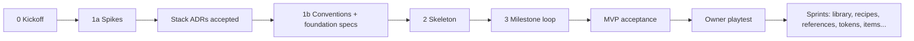
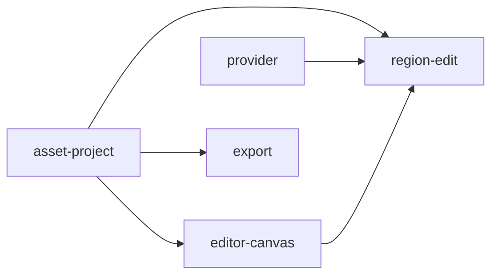

# Roadmap

> Status: **current.** Updated at each gate.

| Phase | Content | Gate | State |
|---|---|---|---|
| 0 Kickoff | Answer the [kickoff questions](kickoff-questions.md), rank tiers, finish the vision | Owner signs off on the vision and tiers | ✅ done |
| 1a Spikes | Scenario API, video, canvas and imaging spikes → ADRs 0001–0004 | Owner accepts the stack ADRs | ✅ done |
| 1b Conventions + foundation specs | AGENTS §9 draft. Specs: asset-project, editor-canvas, region-edit, provider, export ([seams](agents/seams-phase1b.md)) | Owner approves the specs and §9 | ⏳ now |
| 2 Skeleton | One builder: workspace layout, Tauri shell, UI shell, core command plumbing, project load/save, fake provider, test harness, CI jobs. Deletes `spikes/` | Owner runs it | |
| 3 Milestone loop | The MVP scenario in [vision.md](vision.md), built in parallel slices from the specs | Demo script | |
| MVP acceptance | Full scenario end to end, plus a crash test (kill mid-save, reopen intact) and one manual real Scenario call | Owner playtest | |
| Post-MVP sprints | Tier A in order: animated tokens, library, recipes, reference roles, MCP endpoint (#36), … | Per sprint | |

## Spec dependencies (phase 1b)

