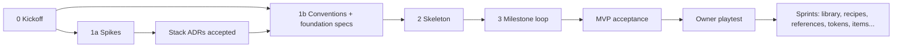

# Roadmap

> Status: **draft outline.** Phases are firmed up after kickoff answers and the stack spikes.

| Phase | Content | Gate |
|---|---|---|
| 0 Kickoff | Answer the [kickoff questions](kickoff-questions.md), rank tiers, finish the vision | Owner signs off on the vision and tiers |
| 1a Spikes | Throwaway proofs that de-risk the provisional stack (see below) | Owner accepts the stack ADRs |
| 1b Conventions + foundation specs | AGENTS §9, specs for the project format, canvas/editor core, provider integration, region editing | Owner approves the specs |
| 2 Skeleton | One builder: Tauri shell, UI shell, project load/save, fake provider, test harness, CI | Owner runs it |
| 3 Milestone loop | The MVP scenario in [vision.md](vision.md) | Demo script |

## Spikes (proposed)

| Spike | Question it answers |
|---|---|
| `spike/scenario-api` | What does Scenario expose via MCP vs REST (models, capabilities, inpainting, uploads, cost, job polling)? Can a desktop app use the MCP server directly? |
| `spike/canvas-large-image` | Can Konva or Fabric (or PixiJS) pan, zoom and mask a large battlemap smoothly in WebView2 using tiles? |
| `spike/rust-imaging` | How fast does Rust tile, extract regions, feather-blend patches and flatten-export at target sizes? |
