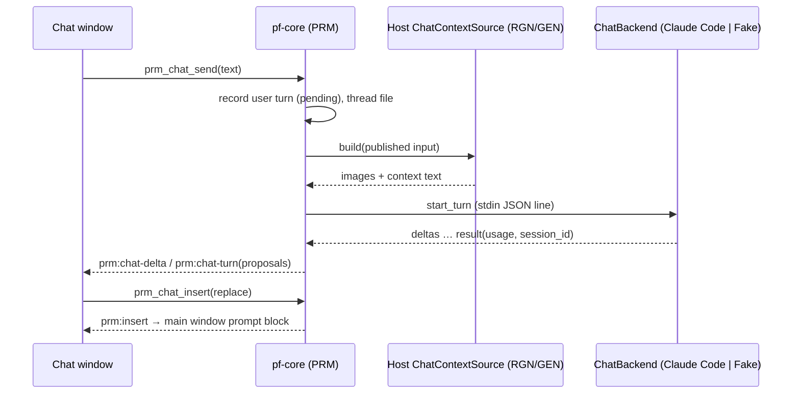

# Prompt helper (helpers + prompt chat)

## 1. Summary
Two prompt aids from the first real session (#58, BL-37). **Prompt helpers** (part A) are predefined, editable snippets per asset type. They are ticked like references, and each ticked helper adds visible text to the **final prompt**. **Prompt chat** (part B) is an optional, opt-in pop-out chat. It sees what the next job would send (RGN: the sent crop with the mask overlaid; GEN: per [seams](../agents/seams-phase4.md)), plus the prompt, the model and its controls. It proposes prompts that the user inserts with one click. The chat backend is **Claude Code headless** behind an adapter, with a fake backend for CI. The chat never sends anything to the provider (#58).

## 2. Scope
Tier "next phase" (#58) in [feature-tiers](../feature-tiers.md): "Prompt helpers (presets) and prompt chat (Claude Code headless)". Supersedes #9 for the opt-in chat only. The **prompt block** (typed prompt, helpers, final prompt preview, chat button) is hosted by RGN and GEN ([seams](../agents/seams-phase4.md)).

## 3. Goals
- What is sent is always visible: the final prompt preview shows every helper's text, and the job records it.
- Helpers are plain, editable text with a sensible starter set per asset type. No AI is involved.
- The chat sees exactly what the next job would send, at a size Claude reads well, and nothing else from the disk.
- A chat suggestion reaches the prompt **only** through Insert. The chat cannot submit, estimate or touch the provider.
- No real LLM call in CI (AGENTS §3.7 by analogy). The backend can be swapped (OpenRouter later) without UI changes.

## 4. Non-goals
- Art recipes (tier A). Helpers that change controls, references or the model. Per-project helper sets.
- The chat editing anything except through Insert. Tool use, file access or web access by the chat. Automatic prompt rewriting.
- Other backends now (OpenRouter, the Anthropic API): the trait allows them; they need their own decision.
- A chat spend cap (the usage is shown, see §10). Sharing chats. Markdown rendering beyond fenced blocks.
- Owned elsewhere: the blend instruction and its toggle (RGN, #55), estimate and submit (RGN, GEN), the draft store (PRJ), what GEN's context contains (GEN).

## 5. User stories
- As a DM preparing a session, I tick "No people or tokens" on a Maps project, and every edit's final prompt ends with that sentence until I untick it.
- I tune a helper's wording once in Settings, and Reset brings back the starter text when I've made it worse.
- I paint a mask, open the chat and ask "how do I get a kitchen here that keeps the stone floor?". It sees my crop with the mask, proposes a prompt, and I click Insert. Then I check the final prompt and press Generate myself.
- On Retry I get the same helpers back, and a helper whose text I've changed since is flagged.
- When Claude Code isn't installed or I'm logged out, the chat tells me exactly that and what to run.

## 6. Functional requirements
### Part A: prompt helpers
| ID | Requirement (testable) |
|---|---|
| FR-PRM-01 | A **prompt helper** is `{id, label (1–40 chars), text (1–500 chars), kinds[] ⊆ {map, token, item} (≥ 1), default_on, builtin}`. At most 60 helpers. Ids are `builtin:<slug>` or a ULID for user-made ones. Validation failures → `invalid_input(field)`. |
| FR-PRM-02 | Helper definitions live in `<data-dir>/settings.json`, section `prompt_helpers` (OQ-PRM-01). An absent section means the built-in starter set ([Appendix A](#appendix-a-starter-helpers)). Saving writes the whole list. Built-ins are stored as overrides only: `{id, label?, text?, default_on?, hidden?}`. |
| FR-PRM-03 | **Edit and reset:** label, text, kinds and `default_on` are editable for every helper. A built-in can be hidden but not deleted. **Reset** on a built-in restores its starter label, text, kinds and `default_on` and unhides it. **Reset all** restores the starter set and keeps user-made helpers. A user-made helper can be deleted (no trash; Settings asks for confirmation inline). |
| FR-PRM-04 | The **helpers row** in the prompt block lists the visible helpers whose `kinds` contain the host's asset type, in settings order, as toggle chips (label, with the text as the tooltip). The order can be changed in Settings by drag or up/down buttons. |
| FR-PRM-05 | **Ticks** are stored per asset project in the host's draft as `prompt_helpers: [id] \| null`. `null` means the defaults: every visible helper of that kind with `default_on`. The first tick change writes the explicit list. Ticks are saved through PRJ's debounced draft save (FR-PRJ-19) and aren't on the undo stack (as FR-REF-20). |
| FR-PRM-06 | **Compose** (Rust API `prompt::compose`, used by RGN and GEN): final prompt = the non-empty parts joined with `\n\n`, in this order: (1) the typed prompt, trimmed at the end; (2) the ticked helpers' texts in helpers-row order, joined with a single space; (3) the blend instruction (RGN only, FR-RGN-09). An unticked, hidden, deleted or wrong-kind helper is never added. |
| FR-PRM-07 | **Dedupe:** texts are compared after normalising (trim, collapse whitespace, lower case, drop a trailing `.`). A helper whose text equals an earlier helper's text is sent once. A helper whose text is contained in the blend instruction as appended (e.g. "Top-down battlemap view." for Maps, FR-RGN-09) is skipped. Every skipped helper is returned as `skipped{id, reason: duplicate \| in_blend_instruction}`, and its chip shows the reason. The typed prompt is never deduplicated against. |
| FR-PRM-08 | The **final prompt preview** ("Final prompt (as sent)", FR-RGN-09) shows the composed text, marking each part's source (typed, the helper label, blend instruction) and the total character count. It updates on every tick and keystroke without a provider call. Helpers don't affect the estimate id (the prompt is not cost-affecting, FR-RGN-12). |
| FR-PRM-09 | The **job record** gets `prompt_helpers[]`: `{id, label, text}` for each helper actually sent, in order (skipped ones excluded). It is written with the `requested` commit and never changes. `final_prompt` already contains the text (FR-RGN-09). A job from before this spec has no field, which reads as `[]`. |
| FR-PRM-10 | **Retry** (FR-RGN-21, GEN's equivalent) sets the draft ticks to the job's `prompt_helpers[]` ids. A helper whose current text differs from the recorded one is ticked and badged `changed since NNN`, and the current text is sent. A helper that no longer exists is listed as `missing`, unticked and not sent. |
| FR-PRM-11 | **Writing tip** (OQ-PRM-02): the empty prompt field shows a placeholder per host. RGN: "Describe the result, e.g. 'a kitchen with a stone floor and a hearth'". GEN: "Describe the image". A "Tips" popover next to the field lists three fixed tips, the first being "Describe the result, not an instruction". Tips never change the final prompt. |
| FR-PRM-12 | Read-only project (FR-RGN-38): the helpers row is shown but disabled. Settings editing still works (it isn't part of the project). |

### Part B: prompt chat
| ID | Requirement (testable) |
|---|---|
| FR-PRM-20 | **Opt-in:** the chat is off until the user accepts the privacy notice ([Appendix C](#appendix-c-privacy-notice)) once. Acceptance stores `prompt_chat.consent{accepted_at, notice_version}` in settings. A higher `notice_version` asks again. Before acceptance, no backend process is started, not even detection (tested with a spawner that panics on use). Settings has "Prompt chat: on/off". Turning it off ends any running process and keeps the threads. |
| FR-PRM-21 | **Window** (OQ-PRM-04): the **Chat** button in the prompt block (`prm-block-chat`) opens or focuses one pop-out window, label `prompt-chat` (min 360×480, size and position remembered per machine). The window is bound to the asset project open in the main window: if that changes, the window switches to that project's thread; with no project open it shows "Open a project to chat about it". Closing it never cancels a job. |
| FR-PRM-22 | **Threads** (OQ-PRM-05): each asset project has chat **threads**, with one active. "New chat" starts a new thread; older threads are listed read-only and can be reopened or deleted. A thread is a file `.pforge/chat/<thread-id>.json` (§8), written temp → rename after the user's message is recorded and again after each reply. |
| FR-PRM-23 | **Live context:** the host's prompt block publishes its draft inputs to the core with `prm_context_publish` (debounced 300 ms, and once more right before a chat send), and clears them on unmount. These are the same inputs its estimate takes. The context is built only when a turn is sent, by the host's Rust `ChatContextSource` (RGN here, GEN in its spec). Nothing else on disk is read. |
| FR-PRM-24 | **RGN context** (OQ-PRM-07): one image, the sent crop (FR-RGN-04/05, after fit) with the mask tinted magenta at 35 % and a 2 px outline. Text: the asset type; region size; context margin; "sent unresampled" or the softness factor; the typed prompt; the ticked helpers; the blend instruction (on or off, with its text); the final prompt; the model name and id; every visible control with its value, range or allowed values. With no region or no mask, the chat sends text only and says "no region yet". |
| FR-PRM-25 | **Image limits:** each image is downscaled with Lanczos3 to a long side ≤ 1568 px and encoded as JPEG q85, with at most 6 images and ≤ 4 MiB encoded per turn. Over the limit, GEN's context order decides what is dropped, and the context strip names it. An image is attached only when its content hash differs from the last one this thread sent for that role, so unchanged images aren't re-sent each turn. |
| FR-PRM-26 | **Context strip:** above the composer, the chat shows what the next turn will send: thumbnails, plus a one-line summary such as "crop 1024×768 + mask · prompt · Ideogram 4.5 · 4 controls". Each sent turn keeps that summary as a chip. "Include images" (default on, per thread) can be turned off for a text-only turn. |
| FR-PRM-27 | **Turn:** Send (Ctrl+Enter) records the user message, builds the context and calls the backend. The reply streams into the transcript (`prm:chat-delta`). One turn at a time per thread; a second send → `turn_active`. **Stop** cancels the running turn (§10): the partial reply is kept, marked `canceled`, and no proposals are extracted from it. |
| FR-PRM-28 | **Proposals:** every fenced block tagged `prompt` (` ```prompt `) in a finished reply becomes a **proposal** card, at most 5 per turn. The system prompt ([Appendix B](#appendix-b-system-prompt)) asks the assistant to put each suggested typed prompt in such a block, without the helper texts or the blend instruction. A reply without one has no card. |
| FR-PRM-29 | **Insert** is the only way chat text reaches the prompt. A card offers **Replace** (the default, sets the typed prompt) and **Append** (typed prompt, trimmed at the end, + a space + the proposal), plus Copy. `prm_chat_insert` emits `prm:insert` to the main window, whose prompt block applies it as a normal edit (a draft save, then the preview updates). With no prompt block attached for that project → `no_prompt_block` ("Open the Generate panel"). Insert never changes helpers, the blend instruction, controls or the model. |
| FR-PRM-30 | **Undo insert:** after an insert, the card shows "Undo insert" while the typed prompt still equals the inserted result. Clicking it restores the previous typed prompt. Each card records which mode it was last inserted with. |
| FR-PRM-31 | **Never to the provider:** no PRM command calls PRV, estimates or submits. A test runs a whole chat (send, proposals, insert, undo) against the fake provider and checks that its call log is empty. |
| FR-PRM-32 | **Backend seam:** the `ChatBackend` trait has `detect`, `start_turn` (streaming events to a sink) and `cancel`. It is dispatched through an `AnyChatBackend` enum: `ClaudeCode` and `Fake`. The mode comes from `PF_CHAT_BACKEND=fake\|claude-code`. Debug and test builds default to `fake`, release builds to `claude-code` (mirrors FR-PRV-02). The process spawner, clock and ids are injected seams. |
| FR-PRM-33 | **Detection** (`prm_chat_status`), cached for 60 s and refreshed on window focus: resolve the executable (§10), run `claude --version` (parse the first `\d+\.\d+\.\d+`), then `claude auth status --json`. Only `loggedIn`, `authMethod` and `subscriptionType` are kept; every other field (email, org, paths) is dropped unread and never logged. Results: `not_installed`, `version_unsupported{found, min}`, `not_logged_in` (exit 1 or `loggedIn: false`), `ok{version, auth_method, plan?}`. Each comes with a readable message and the command to fix it (Appendix D). |
| FR-PRM-34 | **Invocation** of the Claude Code backend is exactly §10's argument list (a snapshot test). No user text is ever put in an argument: messages go over stdin as stream-json. The working directory is `<data-dir>/chat/<thread-id>/`, which holds only this turn's images (the previous turn's are deleted first). The child's environment is the user's environment minus every `PF_*` variable, plus §10's env vars. |
| FR-PRM-35 | **Process lifetime:** one child per active thread stays alive across turns (stdin stays open). It ends after 10 min idle, on New chat, on project switch, on window close and on app quit. The next turn starts a new child with `--resume <session_id>` (taken from the stream's `session_id`, stored per machine on the thread, §8). A failed resume (exit 1 with no output) starts a fresh session. Its first message replays the last ≤ 10 turns of the thread as text, without images, and the strip says "context restarted". |
| FR-PRM-36 | **Timeouts:** no stream event within 60 s of a send → `timeout`. More than 90 s between events → `timeout`. The turn total is capped at 300 s (Settings, 60–900 s). On timeout the child is killed, partial text is kept, and the turn is `failed(timeout)`. |
| FR-PRM-37 | **Errors** map to readable codes (Appendix D): `not_installed`, `version_unsupported`, `not_logged_in`, `usage_limit`, `offline`, `timeout`, `backend_crashed{exit_code}`, `stream_malformed`, `backend_error{message}`. A `result` with `is_error: true` uses its `subtype` / `errors[]`. The last 2 KB of stderr is kept in memory for the error detail, with the user's home path replaced by `<home>`. It is never written to the project. |
| FR-PRM-38 | **Usage:** each turn records `usage{input_tokens, output_tokens, cost_usd?, notional}` from the `result` message. `notional: true` when `authMethod` is `claude.ai` (plan usage, not billed per call). The window footer shows the thread total ("≈ $0.04 plan usage" or "$0.04 billed"). With an `api_key` auth method the strip warns once per thread: "Billed to your Anthropic API key". |
| FR-PRM-39 | **Fake backend:** deterministic. The reply quotes the user text, lists the context it received (image roles with sizes and hashes, model id, final prompt) and ends with one ` ```prompt ` block derived from the user text. Cases (`PF_FAKE_CHAT_CASE` or `prm_chat_fake_set_case`): `success`, `slow(n)`, `no_proposal`, `two_proposals`, `not_installed`, `not_logged_in`, `version_old`, `usage_limit`, `offline`, `timeout`, `crash`, `malformed`, `resume_fails`. It starts no process and opens no network connection. |
| FR-PRM-40 | Every capability is a `pf-core` command (AGENTS §9), with inputs validated at the boundary, except opening the window (a Tauri-layer command, `prm_window_open`). A failed command leaves the project and settings unchanged. |

## 7. UI/UX notes
- **Prompt block** (`app/src/features/prompt-helper/`, exported from `index.ts`, rendered by RGN and GEN in their Generate panels; replaces RGN's own prompt rows). Top to bottom: prompt textarea with the placeholder and a Tips popover (FR-PRM-11), helpers row (chips), the host's extra rows (RGN's "Blend with surroundings" toggle), "Final prompt (as sent)" with part markers and a character count, and the **Chat** button.
- **Settings section "Prompt helpers"** (registered via `shared/settings.ts`): a list per asset type tab (Maps, Tokens, Items) with label, text, the kinds checkboxes, "On by default", up/down, Hide or Delete, and Reset. Then **+ Helper** and **Reset all**. **Settings section "Prompt chat"**: on/off, backend status (version, auth method, plan), executable path override, model override (blank = the CLI default), turn timeout, and "Show privacy notice".
- **Chat window:** header (project name · host "Region edit" / "New asset" · backend chip `Claude Code 2.1.x · Max` or the error); transcript (user messages, assistant text as plain text with fenced blocks shown as code, proposal cards); context strip; composer (Send / Stop); footer usage.
- **States:** *not opted in*: the notice with Accept / Not now · *not installed / not logged in / version too old*: the Appendix D message and the command to fix it, plus Recheck · *no project* · *no region yet*: text-only note · *running*: a streaming caret and Stop · *error*: inline under the turn, with Retry (resends the same text) · *offline*: Send is disabled after an `offline` error until Recheck succeeds · *read-only project*: chat works, nothing is saved ("Not saved: read-only project"), Insert disabled · *fake*: a `Fake chat` chip is always shown.
- Test ids: `prm-block-{prompt,tips,helper,final-prompt,chars,chat}` (+ `data-record-id` = helper id on `prm-block-helper`), `prm-settings-helper-{label,text,kind,default,up,down,hide,delete,reset}`, `prm-settings-{add,reset-all,chat-toggle,chat-status,chat-path,chat-model,chat-timeout}`, `prm-chat-{consent-accept,consent-decline,input,send,stop,new,thread,strip,include-images,usage,status,recheck}`, `prm-chat-proposal` (+ `data-record-id`), `prm-chat-proposal-{replace,append,copy,undo}`.

## 8. Data and file effects
Field shapes go to [manifest-schema](../architecture/manifest-schema.md) as add-only amendments (OQ-PRM-10).

| What | Where | Written | Recoverable |
|---|---|---|---|
| Helper definitions | `<data-dir>/settings.json` `prompt_helpers{helpers[]}` (per machine) | on Save in Settings | absent → the starter set |
| Chat settings + consent | `settings.json` `prompt_chat{enabled, consent{accepted_at, notice_version}, claude_path?, model?, turn_timeout_s, window{x,y,w,h}}` | on change | absent → off, not consented |
| Draft ticks | `project.json` draft `prompt_helpers: [id] \| null` (GEN: its draft) | debounced draft save | with the project |
| Job helpers | `.pforge/jobs/<id>/job.json` `prompt_helpers[]{id, label, text}` | the `requested` commit, write-once | with the project |
| Chat thread | `.pforge/chat/<thread-id>.json`: `schema_version, id, created_at, updated_at, host, backend, sessions{<install_id>: session_id}, turns[{id, at, role, text, state: pending\|done\|canceled\|failed\|interrupted, error?, context{summary, images[{role, w, h, hash}], final_prompt, model_id, controls{}}, proposals[{id, text, inserted?: replace\|append, inserted_at?}], usage?}]` | temp → rename, per turn | with the project; deleted threads go to the project trash (30 days, #18) |
| Turn images | `<data-dir>/chat/<thread-id>/` (cwd of the child) | per turn, the previous turn's deleted | not kept; the hashes are on the turn |
| Claude Code's own transcript | Claude Code's config dir, outside our control | by the CLI | named in the privacy notice; Delete thread runs `claude purge` on the thread folder when the CLI supports it (best effort) |

- The thread never stores image bytes, credentials, the email or other `auth status` fields.
- The `sessions` map is keyed by PRJ's `install_id`, so another machine starts a fresh session (FR-PRM-35).
- `.pforge/chat/` needs PRJ's orphan sweep to skip it (OQ-PRM-10).

## 9. Commands and events
| Command | Input → result | Errors |
|---|---|---|
| `prm_helpers_list` | `{kind?}` → `[{id, label, text, kinds, default_on, builtin, hidden, modified}]` | — |
| `prm_helpers_save` | `{helpers[]}` (full ordered list) → list | `invalid_input(field)`, `too_many`, PRJ settings errors |
| `prm_helpers_reset` | `{id}` or `{all: true}` → list | `invalid_input` (not a built-in), `not_found` |
| `prm_compose_preview` | `{kind, typed_prompt, helper_ids \| null, blend_instruction: string \| null}` → `{text, parts[{source: typed\|helper\|blend, id?, text}], skipped[{id, reason}], chars}` | `invalid_input` |
| `prm_chat_status` | — → `{enabled, consent, mode: fake\|claude-code, backend: ok{…}\|<error>}` | — |
| `prm_chat_consent` | `{accept: bool}` → status | settings errors |
| `prm_context_publish` / `_clear` | `{project_id, host: rgn\|gen, input}` / `{project_id, host}` → ok | `no_project`, `invalid_input` |
| `prm_chat_threads` | `{project_id}` → `{active, threads[{id, created_at, updated_at, turns, first_line}]}` | `no_project` |
| `prm_chat_thread_new` / `_delete` | `{project_id}` / `{project_id, thread_id}` → thread / trash id | `read_only`, `locked`, `conflict`, `not_found` |
| `prm_chat_send` | `{project_id, thread_id, text (1–8000 chars), include_images}` → `{turn_id, context_summary}` | `consent_required`, `chat_disabled`, `turn_active`, `no_context`, every FR-PRM-37 code |
| `prm_chat_cancel` | `{turn_id}` → ok | `not_found` |
| `prm_chat_insert` / `_undo_insert` | `{project_id, proposal_id, mode: replace\|append}` / `{project_id, proposal_id}` → ok | `no_prompt_block`, `read_only`, `prompt_changed` (undo only) |
| `prm_chat_fake_set_case` | `{case}` → ok | `not_fake_mode`, `invalid_input` |
| `prm_window_open` (Tauri layer) | — → ok | — |

- **Rust API:** `prompt::compose(kind, typed, ticks, &helpers, blend) → FinalPrompt{text, sent[], skipped[]}` for RGN and GEN; the trait `ChatContextSource { fn build(&self, core, input) -> ChatContext }`, implemented by RGN and GEN.
- **Events:** `prm:chat-delta{turn_id, text}` · `prm:chat-turn{turn_id, state, usage?, error?, proposals?}` · `prm:chat-status` · `prm:insert{project_id, host, proposal_id, mode, text}` · `prm:helpers-changed`.

## 10. Provider interaction
**Scenario:** none. No PRM command calls PRV (FR-PRM-31). Helpers only change the text RGN or GEN submits.

**Chat backend: Claude Code headless** (checked against the CLI 2.1.x help and the current docs: headless, CLI reference, Agent SDK streaming input, sessions, env vars):

```
<claude> -p --input-format stream-json --output-format stream-json --verbose
  --tools "" --strict-mcp-config --permission-prompts none --disable-slash-commands
  --safe-mode                      # no CLAUDE.md, hooks, plugins, skills or MCP; auth still works
  --system-prompt <Appendix B>     # replaces the coding prompt; re-passed on every resume
  [--model <prompt_chat.model>]  [--resume <session_id>]
cwd = <data-dir>/chat/<thread-id>/
env + CLAUDE_CODE_DISABLE_NONESSENTIAL_TRAFFIC=1, DISABLE_AUTOUPDATER=1; minus PF_*
```

- **Stdin message** per turn, one JSON line: `{"type":"user","message":{"role":"user","content":[{"type":"image","source":{"type":"base64","media_type":"image/jpeg","data":…}}…,{"type":"text","text":<context block + user text>}]},"parent_tool_use_id":null}` (OQ-PRM-06).
- **Stdout** lines are parsed as JSON. `system/init` gives the `session_id`. `assistant` and stream text become `prm:chat-delta`. `result{subtype, is_error, result, session_id, total_cost_usd, usage, errors[]}` ends the turn. Unknown types are ignored. A non-JSON line → `stream_malformed` after 3 in a row.
- **Not used:** `--bare`, which never reads the subscription login. `--no-session-persistence`, which makes resume impossible. Any `--allowedTools`. Image file paths, which would need the Read tool.
- **Executable:** `prompt_chat.claude_path`, else `claude.exe` on `PATH`, else `<home>/.local/bin/claude.exe` (native installer), else `claude.cmd` on `PATH` (npm). A `.cmd` runs through `cmd /c` with fixed arguments only (no user text, FR-PRM-34). The window is created hidden (`CREATE_NO_WINDOW`).
- **Cancel:** the child is killed (on Windows, ending the whole job object, OQ-PRM-09). The docs say a killed run leaves the turn unrecorded, so the next turn resumes from the last finished one. A partial reply is kept only in our thread.
- **Minimum version:** set by build slice 0 on the owner's CLI. The probe checks that every flag above is accepted (`--safe-mode`, `--permission-prompts` ≥ 2.1.259). A flag missing in an older CLI → `version_unsupported`.
- **Privacy:** images, prompt, model and controls go to Anthropic through the user's own Claude Code login and plan. This is shown once and opted into (FR-PRM-20). `ANTHROPIC_API_KEY` in the environment overrides the plan login in `-p` mode; detection reports `api_key`, and FR-PRM-38 warns.



## 11. Edge cases
| Case | Behaviour |
|---|---|
| Crash mid-save | Thread file temp → rename. A `pending` user turn without a reply on open → `interrupted`, with "Resend". Settings are temp → rename (PRJ). Job helpers are in the `requested` commit, so all or nothing. |
| App crash with a child running | The job object (OQ-PRM-09) ends the child with the app. At startup, `<data-dir>/chat/*/` folders are deleted. |
| Sync conflict / locked | A thread conflict copy (FR-PRJ-34 name rule) is listed as a separate thread named "(conflict copy)"; nothing is merged. A locked thread file is retried for ≤ 3 s, then the turn still runs and the error banner says "not saved". Settings conflicts follow PRJ. |
| Offline | Detection still works (local commands). A turn fails as `offline`, and Send stays disabled until Recheck. Helpers and Insert work offline. |
| Backend error or timeout | FR-PRM-36/37. Nothing is retried automatically; Retry resends the same text. `usage_limit` shows the CLI's message verbatim (e.g. the reset time). |
| Very large image | The crop is ≤ 4096² (FR-RGN-02) and is downscaled to ≤ 1568 px (FR-PRM-25). Stdin's 10 MB cap is never approached (≤ 4 MiB of images per turn). |
| Corrupt or unsupported input | A thread file that won't parse is renamed `<id>.corrupt-<UTC>.json` and not listed, with a notice. A settings section that's invalid → the starter helpers plus a warning (PRJ's corrupt-settings rule). |
| Helper edited or deleted between preview and submit | The job records what compose produced at submit; the preview refreshes on `prm:helpers-changed`. |
| Undo across the boundary | Insert is a normal prompt edit plus FR-PRM-30. Tick changes aren't undoable (as REF). The chat transcript is never undone. |
| Project closed or switched during a turn | The turn finishes into its own thread file (the project path is captured at send). The child then ends (FR-PRM-35). |

## 12. Performance budget
- Compose plus preview: < 1 ms. Ticking a chip updates the preview within one frame.
- Context build (RGN crop + overlay + JPEG), typical / worst (4096² outer): ≤ 150 ms / ≤ 600 ms. Detection: ≤ 3 s (two short CLI runs), cached for 60 s.
- App overhead per turn, excluding the backend: ≤ 100 ms before the stdin write. Each stream delta reaches the window within 50 ms.
- Window open ≤ 1 s. A thread with 200 turns loads in ≤ 200 ms. Extra memory ≤ 32 MiB plus the child process.

## 13. Test plan
- **Rust unit** (`fr_prm_NN_*`): helper validation and limits (01); settings default, overrides, reset and reset-all (02, 03); compose order, separators, empty parts and wrong-kind helpers (06); dedupe against helpers and against the blend instruction, Maps included (07); the job `prompt_helpers[]` record and absent-field read (09); retry `changed` and `missing` (10); the invocation argument snapshot and env filtering (34); version and `auth status` parsing with extra fields dropped and never logged (33); stream-json parser over the recordings (deltas, result, error subtypes, malformed) (37); proposal extraction (fences, tags, max 5, none) (28); append separator and undo-insert guard (29, 30); timeouts under a fake clock (36); turn image hashing and re-send rules (25).
- **Integration** (pf-core + fake chat backend + fake provider): consent gating with a spawner that panics before consent (20); a whole chat with context from the RGN fixture region, the overlay image's hash checked against a golden (24); the fake provider's call log is empty after send, insert and undo (31); every fake case (39); thread files across restart, the `interrupted` turn, a corrupt thread and a conflict copy (22, §11); resume: the replayed `ReplayProcess` sees `--resume <id>` on the second child, and `resume_fails` falls back to a fresh session with the text replay (35); cancel kills the child and keeps the partial text (27). The ClaudeCode adapter runs against a **process seam** that replays recorded stdout, so the real parser and lifecycle are tested without the CLI.
- **Vitest** (`FR-PRM-NN …`): helper chips per kind and default ticks (04, 05); the preview's part markers, count and skipped badges (07, 08); the Settings editor (03); chat window states (§7); proposal card Replace / Append / Undo (29, 30).
- **Thin e2e** (Playwright, mocked commands, KQ-33): tick two helpers → the final prompt preview; open the chat → consent → send → proposal → Replace → the main prompt field updates.
- **Fixtures:** RGN's generated rooms battlemap and fixture mask (public-safe). Chat recordings `fixtures/chat/claude-code/<case>.jsonl`: `success-image`, `two-proposals`, `usage-limit`, `not-logged-in`, `resume`. The owner records them once with the probe on the rooms fixture. Session ids, uuids and paths are replaced with placeholders, and the recordings must pass `check-hygiene.sh`. No real chat calls in CI: the real backend needs `PF_CHAT_BACKEND=claude-code` plus `PF_CHAT_REAL=1`, and CI fails if either is set (as FR-PRV-28).
- **Walkthrough** (test agent, dev build, fake provider + fake chat, `PF_DATA_DIR=.pf-dev/data`, `PF_LIBRARY_DIR=.pf-dev/library`):

| # | Step | Expected |
|---|---|---|
| 1 | Open a Maps project from the rooms fixture, `R`, drag a region, paint a mask | Prompt block with the placeholder; Maps helpers only; "Fake chat" chip |
| 2 | Tick "No people or tokens" and "Top-down battlemap" | Preview = typed + helper text + blend instruction; "Top-down battlemap" badged `in_blend_instruction` (FR-PRM-07) |
| 3 | Settings → edit the helper's text, then Reset | Preview follows; Reset restores the starter text |
| 4 | Click Chat | Privacy notice; Not now → nothing spawned; Chat again, Accept |
| 5 | Send "make this a kitchen" | Context strip shows crop + mask; streamed fake reply lists the image hash and model; one proposal card |
| 6 | Replace, then Undo insert, then Append | Main prompt field = proposal; then restored; then typed + space + proposal. No estimate or job was started by the chat |
| 7 | Generate (fake provider) and open the job file | `final_prompt` contains the helper text; `prompt_helpers[]` lists it |
| 8 | Edit that helper's text, then Retry | Helper ticked and badged `changed since 001` |
| 9 | Close the chat window, reopen, send again | Same thread; the fake reports `resume`; image not re-sent (hash unchanged) |
| 10 | `PF_FAKE_CHAT_CASE=not_logged_in`, Recheck | The not-logged-in message with `claude auth login` |

- **Manual acceptance (owner, real Claude Code):** run the probe (slice 0), then one real turn on the rooms fixture. Check the privacy notice, the overlay image as Claude describes it, a proposal and Insert, closing and reopening the window (resume), Stop mid-reply, and the usage footer.

## 14. Build split
| # | Slice | Shared files (AGENTS §9) | Depends on |
|---|---|---|---|
| 0 | **Probe** (`pf-chat-probe`, dev only): verifies §10's flags on the installed CLI, records the fixtures, fixes the minimum version. The owner runs the one real turn | none | orchestrator: crate |
| 1 | Helpers core: settings section, `compose`, dedupe, helper commands, job and draft fields | command registry (append), schema (add) | PRJ settings |
| 2 | Prompt block + Settings sections (mocked commands) | UI feature registry (append) | 1 |
| 3 | RGN integration: the prompt block replaces RGN's prompt rows, compose in `prepare_job`, job record, retry (RGN amendment) | RGN files | 1, 2 |
| 4 | `pf-chat` crate: trait, fake, ClaudeCode adapter (executable resolution, detection, invocation, stream parser, job object, timeouts), process seam + replay | root `Cargo.toml` (orchestrator) | 0 |
| 5 | Chat core: consent, threads, context publish, RGN `ChatContextSource` (overlay), send/cancel/insert/undo, events | command registry (append), schema (add), PRJ sweep rule | 3, 4 |
| 6 | Chat window: second window, transcript, cards, strip, states | `tauri.conf.json` / capabilities (orchestrator), UI registry (append) | 5 |
| 7 | GEN `ChatContextSource` and prompt block in GEN | GEN files | 5, GEN |

**For the orchestrator (not made here):**
- **Capability:** a new `prompt-chat` window label in a capability with `core:default` (events, window focus); the window is created from Rust at runtime (`WebviewWindowBuilder`). CSP unchanged (thumbnails use the existing `pf-tiles` scheme).
- **Process spawn:** from Rust only (`tokio::process`, the `process` feature of the approved `tokio`). No `tauri-plugin-shell`, and no spawn permission for any webview.
- **New dependencies:** `windows-sys` (Job Object, OQ-PRM-09; probably already in the tree through tokio/tauri, so a direct dependency only). A new crate `crates/pf-chat/` (OQ-PRM-08), with `check-crate-deps.mjs` updated: `pf-core → pf-chat`.
- **Glossary** (§2): *prompt helper*, *prompt block*, *prompt chat*, *chat thread*, *proposal*; *Final prompt* redefined to include ticked helper texts (OQ-PRM-11).

## 15. Open questions
| ID | Question | Options (pick in **bold**) | Blocking? | Affects |
|---|---|---|---|---|
| OQ-PRM-01 | Where do helper definitions live? | **A. `settings.json`, per machine, like the blend instruction (#55)**: simple, no sync conflicts; not shared across machines / B. `<library-root>/.pforge/prompt-helpers.json`, synced: follows you; conflict handling needed | slice 1 | PRJ settings |
| OQ-PRM-02 | Is "Describe the result" a helper? | **A. No: a placeholder and tip (FR-PRM-11)**. It is advice for the writer; as model text it does nothing / B. A helper adding text | no | — |
| OQ-PRM-03 | RGN's built-in "Top-down battlemap view." for Maps (FR-RGN-09) | **A. Keep it; FR-PRM-07 skips an identical helper**: no change to #55 / B. Move it into a default-on Maps helper: one mechanism, but an RGN amendment | no | RGN |
| OQ-PRM-04 | Where the chat lives | **A. Pop-out window**: keeps the canvas and panel full size; needs a second window / B. A drawer in the Generate panel: no new window; squeezes a 300–380 px panel | slice 6 | orchestrator config |
| OQ-PRM-05 | Chat history scope | **A. Threads per asset project in `.pforge/chat/`**: survives, syncs, and jobs don't exist before submit / B. Per job: tidy, but the chat happens before the job / C. Per machine only, not synced | slice 5 | PRJ |
| OQ-PRM-06 | How images reach Claude Code | **A. Base64 image blocks on stream-json stdin, with all tools off**: documented for streaming input; no file access at all / B. File paths + the Read tool confined to the turn folder: depends on undocumented confinement | slice 0 confirms | — |
| OQ-PRM-07 | What the RGN chat sees | **A. One overlay image (crop + tinted mask + outline)**: one image, the mask in place / B. Crop + mask as two images: exact, twice the tokens / C. A plus the whole map downscaled: more context, more cost | no | RGN |
| OQ-PRM-08 | Where the backend code lives | **A. A new crate `pf-chat` (like `pf-provider`)**: the process and parser are isolated and testable alone / B. A module in `pf-core`: no layout change | slice 4 | AGENTS §9 layout |
| OQ-PRM-09 | Orphaned children after an app crash | **A. A Windows Job Object (`windows-sys`)**: the child dies with the app / B. A pid file, killed at next start: no dependency, but leaks until restart and risks pid reuse | slice 4 | dependency |
| OQ-PRM-10 | Amendments to other specs | **A. Accept as listed**: PRJ (skip `.pforge/chat/` in the sweep; trash for deleted threads), schema (draft and job `prompt_helpers`, settings `prompt_helpers` and `prompt_chat`), RGN (prompt block, compose in FR-RGN-09/21, `ChatContextSource`), GEN (hosts the prompt block, implements `ChatContextSource`, no blend instruction) / B. Change some | slices 1, 3, 5 | PRJ, RGN, GEN, schema |
| OQ-PRM-11 | Glossary | **A. Add the §14 terms and redefine Final prompt** / B. Other names | no | glossary |
| OQ-PRM-12 | System prompt (Appendix B) | **A. Fixed in code, versioned**: predictable / B. Editable in Settings: tunable, easy to break | no | — |
| OQ-PRM-13 | Starter helpers on by default? | **A. All off**: the final prompt changes only when you tick / B. Some on (e.g. "No people or tokens" for Maps) | no | — |

## Appendix A: starter helpers
Starter wording for the owner to tune. All are `default_on: false` (OQ-PRM-13).

| id | Kinds | Label | Text |
|---|---|---|---|
| `builtin:top-down-map` | map | Top-down battlemap | Top-down battlemap view. |
| `builtin:match-style` | map | Match surrounding style | Match the existing art style, palette, line weight and lighting. |
| `builtin:no-people` | map | No people or tokens | No people, creatures or tokens. |
| `builtin:no-grid-text` | map | No grid or text | No grid lines, labels or text. |
| `builtin:token-single` | token | Single creature | A single creature, centred and fully in frame, seen from above. |
| `builtin:token-plain-bg` | token | Plain background | Plain, uncluttered background. |
| `builtin:item-single` | item | Single item | A single item, centred and fully in frame. |
| `builtin:item-plain-bg` | item | Plain background | Plain neutral background, soft even lighting. |
| `builtin:no-text` | token, item | No text | No text, frame, border or watermark. |

## Appendix B: system prompt
Versioned constant (`PROMPT_CHAT_SYSTEM_V1`), re-passed on every resume:

> You help a tabletop game master write a prompt for an image model. Each message may contain an image of the area being edited, with the editable part tinted magenta, plus the model, its settings and the current prompt. Describe the desired *result*, not an instruction ("a kitchen with a stone floor", not "add a kitchen"). Keep within what the model and its settings can do. The listed helper texts and the blend instruction are appended automatically: do not repeat them. Put each suggested prompt in its own fenced block tagged `prompt`, at most three per reply. Keep the rest of the reply short. You cannot run jobs, see other files or change settings; the user decides what to send.

## Appendix C: privacy notice
Version 1. It is shown before the first chat and from Settings.

> **Prompt chat sends data to Anthropic.** When you send a message, Pocket Forge passes it to Claude Code on this computer. Claude Code sends it, with the image of the region you're editing (or your references and structure image), your prompt, the model and its settings, to Anthropic under your own Claude login, and it counts toward your plan's usage. Claude Code keeps its own copy of the conversation on this computer. Nothing is sent until you press Send, and nothing the chat says reaches Scenario unless you insert it and press Generate yourself. [Accept] [Not now]

## Appendix D: backend errors
| Code | Message | Fix shown |
|---|---|---|
| `not_installed` | Claude Code isn't installed, or isn't on PATH. | Install Claude Code, or set its path in Settings → Prompt chat. |
| `version_unsupported` | Claude Code {found} is too old (needs {min}). | Run `claude update`. |
| `not_logged_in` | Claude Code isn't logged in. | Run `claude auth login` in a terminal, then Recheck. |
| `usage_limit` | Your Claude plan's usage limit is reached. | The CLI's message, verbatim (e.g. the reset time). |
| `offline` | Can't reach Anthropic. | Check the connection, then Recheck. |
| `timeout` | Claude Code didn't answer in time. | Retry; raise the timeout in Settings. |
| `backend_crashed` | Claude Code stopped unexpectedly (exit {code}). | Retry; details show the stderr tail. |
| `stream_malformed` / `backend_error` | Unexpected output from Claude Code. | Retry; details show the message. |
