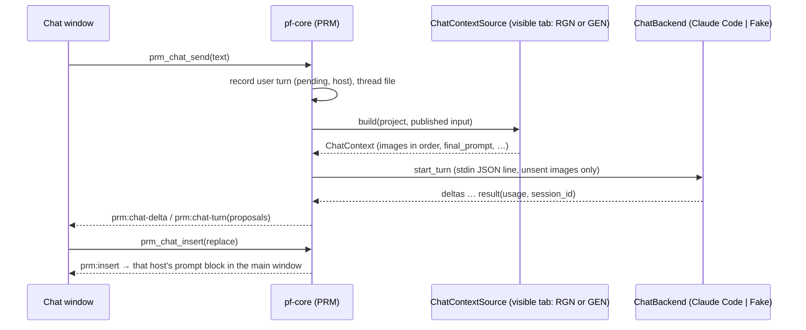

# Prompt helper (helpers + prompt chat)

## 1. Summary
Two prompt aids from the first real session (#58, BL-37). **Prompt helpers** (part A) are predefined, editable snippets per asset type. They are ticked like references, and each ticked helper adds visible text to the **final prompt**. **Prompt chat** (part B) is an optional, opt-in pop-out chat. It sees what the next job would send (Region edit: the sent crop with the mask overlaid; New image: the structural sketch and the references), plus the prompt, the model and its controls. It proposes prompts that the user inserts with one click. The chat backend is **Claude Code headless** behind an adapter, with a fake backend for CI. The chat never sends anything to the provider (#58).

## 2. Scope
Tier "next phase" (#58) in [feature-tiers](../feature-tiers.md): "Prompt helpers (presets) and prompt chat (Claude Code headless)". #58 **supersedes #9**: the app may now contain AI, but only through the opt-in prompt chat, and nothing reaches the provider without the user's click. Helpers are plain text, not AI. The **prompt block** (typed prompt, helpers, final prompt preview, chat button) is defined here and hosted by RGN (Region edit tab) and GEN (New image tab) ([seams](../agents/seams-phase4.md)). The v1 cut of part B is OQ-PRM-14.

## 3. Goals
- What is sent is always visible: the final prompt preview shows every helper's text, and the job records it.
- Helpers are plain, editable text with a sensible starter set per asset type.
- The chat sees exactly what the next job of the visible tab would send, at a size Claude reads well, and nothing else from the disk.
- A chat suggestion reaches the prompt **only** through Insert. The chat cannot submit, estimate or touch the provider.
- No real LLM call in CI (AGENTS §3.7 by analogy). The backend can be swapped (OpenRouter later) without UI changes.

## 4. Non-goals
- Art recipes (tier A). Helpers that change controls, references or the model. Per-project helper sets.
- The chat editing anything except through Insert. Tool use, file access or web access by the chat. Automatic prompt rewriting.
- Other backends now (OpenRouter, the Anthropic API): the trait allows them; they need their own decision.
- A chat spend cap (the usage is shown, see §10). Sharing chats. Markdown rendering beyond fenced blocks.
- Owned elsewhere: the blend instruction and its toggle (RGN, #55), estimate and submit (RGN, GEN), the draft store (PRJ). GEN hosts the prompt block in its tab and implements `ChatContextSource` (FR-PRM-42) in its own build slice.

## 5. User stories
- As a DM preparing a session, I tick "No people or tokens" on a Maps project, and every edit's final prompt ends with that sentence until I untick it.
- I tune a helper's wording once in Settings, and Reset brings back the starter text when I've made it worse.
- I paint a mask, open the chat and ask "how do I get a kitchen here that keeps the stone floor?". It sees my crop with the mask, proposes a prompt, and I click Insert. Then I check the final prompt and press Generate myself.
- On the New image tab I ask how to describe a crypt that follows my sketch. The chat sees the sketch and my references.
- On Retry I get the same helpers back, and a helper whose text I've changed since is flagged.
- When Claude Code isn't installed or I'm logged out, the chat tells me exactly that and what to run.

## 6. Functional requirements
Items marked **[OQ-PRM-14]** are outside the reviewer's proposed v1. They stay specified in case the owner picks B.

### Part A: prompt helpers
| ID | Requirement (testable) |
|---|---|
| FR-PRM-01 | A **prompt helper** is `{id, label (1–40 chars), text (1–500 chars), kinds[] ⊆ {map, token, item} (≥ 1), default_on, builtin}`. At most 60 helpers. Ids are `builtin:<slug>` or a ULID for user-made ones. Validation failures → `invalid_input(field)`. |
| FR-PRM-02 | Helper definitions live in `<data-dir>/settings.json`, section `prompt_helpers` (OQ-PRM-01). An absent section means the built-in starter set ([Appendix A](#appendix-a-starter-helpers)). Saving writes the whole list. Built-ins are stored as overrides only: `{id, label?, text?, default_on?, hidden?}`. |
| FR-PRM-03 | **Edit and reset:** label, text, kinds and `default_on` are editable for every helper. A built-in can be hidden but not deleted. **Reset** on a built-in restores its starter label, text, kinds and `default_on` and unhides it. **Reset all** restores the starter set and keeps user-made helpers. A user-made helper can be deleted (no trash; Settings asks for confirmation inline). |
| FR-PRM-04 | The **helpers row** in the prompt block lists the visible helpers whose `kinds` contain the project's asset type, in settings order, as toggle chips (label, with the text as the tooltip). The order is changed in Settings with up/down buttons. |
| FR-PRM-05 | **Ticks** are stored per asset project in the host's draft as `prompt_helpers: [id] \| null` (`draft` for RGN, `draft.generate` for GEN). `null` means the defaults: every visible helper of that kind with `default_on`. The first tick change writes the explicit list. Ticks are saved through PRJ's debounced draft save (FR-PRJ-19) and aren't on the undo stack (as FR-REF-20). |
| FR-PRM-06 | **Compose** (Rust API `prompt::compose`, used by RGN and GEN): final prompt = the non-empty parts joined with `\n\n`, in this order: (1) the typed prompt, trimmed at the end; (2) the ticked helpers' texts in helpers-row order, joined with a single space; (3) the blend instruction (RGN only, FR-RGN-09). An unticked, hidden, deleted or wrong-kind helper is never added. |
| FR-PRM-07 | **Dedupe:** texts are compared after normalising (trim, collapse whitespace, lower case, drop a trailing `.`). A helper whose text equals an earlier helper's text is sent once. A helper whose text is contained in the blend instruction as appended (e.g. "Top-down battlemap view." for Maps, FR-RGN-09) is skipped. Every skipped helper is returned as `skipped{id, reason: duplicate \| in_blend_instruction}`, and its chip shows the reason. The typed prompt is never deduplicated against. |
| FR-PRM-08 | The **final prompt preview** ("Final prompt (as sent)", FR-RGN-09) shows the composed text, marking each part's source (typed, the helper label, blend instruction) and the total character count. It updates on every tick and keystroke without a provider call. Helpers don't affect the estimate id (the prompt is not cost-affecting, FR-RGN-12). |
| FR-PRM-09 | The **job record** gets `prompt_helpers[]`: `{id, label, text}` for each helper actually sent, in order (skipped ones excluded). It is written with the `requested` commit and never changes. `final_prompt` already contains the text (FR-RGN-09). A job from before this spec has no field, which reads as `[]`. |
| FR-PRM-10 | **Retry** (FR-RGN-21, FR-GEN-32) sets the draft ticks to the job's `prompt_helpers[]` ids. A helper whose current text differs from the recorded one is ticked and badged `changed since NNN`, and the current text is sent. A helper that no longer exists is listed as `missing`, unticked and not sent. |
| FR-PRM-11 | **Writing tip** (OQ-PRM-02): the empty prompt field shows a placeholder per host. Region edit: "Describe the result, e.g. 'a kitchen with a stone floor and a hearth'". New image: "Describe the image". A "Tips" popover next to the field lists three fixed tips, the first being "Describe the result, not an instruction". Tips never change the final prompt. |
| FR-PRM-12 | Read-only project (FR-RGN-38): the helpers row is shown but disabled. Settings editing still works (it isn't part of the project). |

### Part B: prompt chat
| ID | Requirement (testable) |
|---|---|
| FR-PRM-20 | **Opt-in:** the chat is off until the user accepts the privacy notice ([Appendix C](#appendix-c-privacy-notice)) once. Acceptance stores `prompt_chat.consent{accepted_at, notice_version}` in settings. A higher `notice_version` asks again. Before acceptance, or while the chat is off, no backend process is started, not even detection (tested with a spawner that panics on use), and `prm_chat_status` reports `backend: not_checked`. Settings has "Prompt chat: on/off". Turning it off ends any running process and keeps the thread. |
| FR-PRM-21 | **Window** (OQ-PRM-04): the **Chat** button in the prompt block (`prm-block-chat`) opens or focuses one pop-out window, label `prompt-chat` (min 360×480; size and position remembered per machine). The window is bound to the asset project open in the main window. If that changes, the window switches to that project's thread; with no project open it shows "Open a project to chat about it". Closing it never cancels a job. |
| FR-PRM-22 | **Thread** (OQ-PRM-05): each asset project has one active chat **thread**, shared by both tabs. **[OQ-PRM-14]** "New chat" starts a new thread; older threads are listed read-only and can be reopened or deleted (deleted → project trash). A thread is a file `.pforge/chat/<thread-id>.json` (§8), written temp → rename after the user's message is recorded and again after each reply. |
| FR-PRM-23 | **Live context:** the visible tab's prompt block publishes its draft inputs to the core with `prm_context_publish` (debounced 300 ms, and once more right before a chat send). These are the same inputs its estimate takes. It calls `prm_context_clear` when it is hidden or unmounted. The context is built only when a turn is sent, by the host's `ChatContextSource` (FR-PRM-41). Nothing else on disk is read. |
| FR-PRM-24 | **Region edit context** (RGN implements; OQ-PRM-07): one image, `rgn:overlay`. This is the sent crop (FR-RGN-04/05, after fit) with the mask tinted magenta at 35 % and a 2 px outline. Facts: the region size, the context margin, and "sent unresampled" or the softness factor. With no region or no mask, the turn has no image and the facts say "no region yet". |
| FR-PRM-25 | **Image limits and re-sending:** each image is downscaled with Lanczos3 to a long side ≤ 1568 px and encoded as JPEG q85. A turn carries at most 6 images and ≤ 4 MiB encoded. Images are kept in `ChatContext.images` order and the tail is dropped; the context strip names every dropped image. An image is attached only when this backend session hasn't already received the same `(image id, content hash)` pair. A fresh session (FR-PRM-35) starts with none received. |
| FR-PRM-26 | **Context strip:** above the composer, the chat shows the host ("Region edit" / "New image") and what the next turn will send: thumbnails, plus a one-line summary such as "crop 1024×768 + mask · prompt · Ideogram 4.5 · 4 controls". Each sent turn keeps that summary as a chip. "Include images" (default on, per thread) can be turned off for a text-only turn. |
| FR-PRM-27 | **Turn:** Send (Ctrl+Enter) needs an attached prompt block for the project; without one → `no_prompt_block` ("Open the Generate panel"). It records the user message and the host (FR-PRM-43), builds the context and calls the backend. The reply streams into the transcript (`prm:chat-delta`). One turn at a time per thread; a second send → `turn_active`. **Stop** cancels the running turn (§10): the partial reply is kept, marked `canceled`, and no proposals are extracted from it. |
| FR-PRM-28 | **Proposals:** every fenced block tagged `prompt` (` ```prompt `) in a finished reply becomes a **proposal** card, at most 3 per turn (extra blocks stay as plain text). The system prompt ([Appendix B](#appendix-b-system-prompt)) asks for at most three, each holding only a typed prompt, without the helper texts or the blend instruction. A reply without one has no card. |
| FR-PRM-29 | **Insert** is the only way chat text reaches the prompt. A card offers **Replace** (sets the typed prompt) and Copy. **[OQ-PRM-14]** **Append** adds the proposal to the typed prompt (trimmed at the end) after a space. `prm_chat_insert` emits `prm:insert` to the main window. The prompt block of the proposal's turn host applies it as a normal edit (a draft save, then the preview updates). If that host's block isn't attached (e.g. the other tab is visible) → `no_prompt_block` ("Switch to the Region edit tab to insert"). Insert never changes helpers, the blend instruction, controls or the model. |
| FR-PRM-30 | **[OQ-PRM-14] Undo insert:** after an insert, the card shows "Undo insert" while the typed prompt still equals the inserted result. Clicking it restores the previous typed prompt. Each card records which mode it was last inserted with. |
| FR-PRM-31 | **Never to the provider:** no PRM command calls PRV, estimates or submits. A test runs a whole chat (send, proposals, insert) on both hosts against the fake provider and checks that its call log is empty. |
| FR-PRM-32 | **Backend seam:** the `ChatBackend` trait has `detect`, `start_turn` (streaming events to a sink) and `cancel`. It is dispatched through an `AnyChatBackend` enum: `ClaudeCode` and `Fake`. The mode comes from `PF_CHAT_BACKEND=fake\|claude-code`. Debug and test builds default to `fake`, release builds to `claude-code` (mirrors FR-PRV-02). The process spawner, clock and ids are injected seams. |
| FR-PRM-33 | **Detection** (`prm_chat_status`, only after consent), cached for 60 s and refreshed on window focus: resolve the executable (§10), run `claude --version` (parse the first `\d+\.\d+\.\d+`), then `claude auth status --json`. Only `loggedIn`, `authMethod` and `subscriptionType` are kept; every other field (email, org, paths) is dropped unread and never logged. Results: `not_checked` (FR-PRM-20), `not_installed`, `version_unsupported{found, min}`, `not_logged_in` (exit 1 or `loggedIn: false`), `ok{version, auth_method, plan?}`. Each comes with a readable message and the command to fix it (Appendix D). |
| FR-PRM-34 | **Invocation** of the Claude Code backend is exactly §10's argument list (a snapshot test). No user text is ever put in an argument: messages go over stdin as stream-json. The working directory is `<data-dir>/chat/<thread-id>/`, which holds only this turn's images (the previous turn's are deleted first). The child's environment is the user's environment minus every `PF_*` variable, plus §10's env vars. |
| FR-PRM-35 | **Process lifetime:** one child per active thread stays alive across turns (stdin stays open) while the window is open. It ends on window close, project switch, chat off, app quit and, **[OQ-PRM-14]**, after 10 min idle. The next turn then starts a **fresh session**, and the strip says "new session: earlier messages not sent". **[OQ-PRM-14]** Instead, it resumes with `--resume <session_id>` (the stream's `session_id`, stored per machine on the thread, §8). A failed resume (exit 1 with no output) starts a fresh session whose first message replays the last ≤ 10 turns as text. |
| FR-PRM-36 | **Timeouts:** no stream event within 60 s of a send → `timeout`. More than 90 s between events → `timeout`. The turn total is capped at 300 s (**[OQ-PRM-14]** a Settings value, 60–900 s). On timeout the child is killed, partial text is kept, and the turn is `failed(timeout)`. |
| FR-PRM-37 | **Errors** map to readable codes (Appendix D): `not_installed`, `version_unsupported`, `not_logged_in`, `usage_limit`, `offline`, `timeout`, `backend_crashed{exit_code}`, `stream_malformed`, `backend_error{message}`. A `result` with `is_error: true` uses its `subtype` / `errors[]`. The last 2 KB of stderr is kept in memory for the error detail, with the user's home path replaced by `<home>`. It is never written to the project. |
| FR-PRM-38 | **Usage:** each turn records `usage{input_tokens, output_tokens, cost_usd?, notional}` from the `result` message. `notional: true` when `authMethod` is `claude.ai` (plan usage, not billed per call). The docs call `total_cost_usd` a client-side estimate. The window footer shows the thread total ("≈ $0.04 plan usage" or "≈ $0.04 billed"). With an `api_key` auth method the strip warns once per thread: "Billed to your Anthropic API key". |
| FR-PRM-39 | **Fake backend:** deterministic. The reply quotes the user text and lists the `ChatContext` it received: host, image ids with sizes and hashes, model id and final prompt. It ends with one ` ```prompt ` block derived from the user text. Cases (`PF_FAKE_CHAT_CASE` or `prm_chat_fake_set_case`): `success`, `slow(n)`, `no_proposal`, `two_proposals`, `not_installed`, `not_logged_in`, `version_old`, `usage_limit`, `offline`, `timeout`, `crash`, `malformed`, `resume_fails`. It starts no process and opens no network connection. |
| FR-PRM-40 | Every capability is a `pf-core` command (AGENTS §9), with inputs validated at the boundary, except opening the window (a Tauri-layer command, `prm_window_open`). A failed command leaves the project and settings unchanged. |
| FR-PRM-41 | **`ChatContext`** (defined here, built by the host's `ChatContextSource::build(core, project, published_input)`, read-only, no provider call): `{host: rgn \| gen, kind, images[{id, role: region_overlay \| structure \| reference, label, w, h, content_hash, jpeg}], typed_prompt, helpers[{id, label, text}], blend_instruction: {on, text} \| null, final_prompt (from compose, FR-PRM-06), model{id, name}, controls[{name, type, value, min?, max?, allowed?}], facts[string]}`. Image ids are stable identities: `rgn:overlay`, `structure:<path>`, `ref:<item key>` (FR-REF-16). The `final_prompt` is exactly what submit would send at that moment. A failure of the source (e.g. `original_unavailable`, `reference_unavailable`) drops only the affected image and adds it to the facts; the turn still runs. |
| FR-PRM-42 | **New image context** (GEN implements, in GEN's build slice; it replaces `gen_chat_context`): images in this order: the chosen structural sketch (`structure`), then the `on` reference items in send order (`reference`), each the bytes `prepare_for_send` would send, then downscaled per FR-PRM-25. FR-PRM-25 drops from the tail, so the sketch is kept first and the last references go first. Facts: the output size (W × H or ratio), the candidate count and "no sketch" / "this model takes no structural sketch" where they apply. `blend_instruction` is `null`. |
| FR-PRM-43 | **Host:** the host of a turn is the visible tab when Send is pressed: Region edit (`rgn`) or New image (`gen`). It is recorded on each turn, not on the thread. A tab switch clears the old tab's published context (FR-PRM-23) and publishes the new one; the next turn uses the new host. Earlier turns and their proposals keep their own host. The header and the context strip always show the current host. |
| FR-PRM-44 | **Per-host system prompt:** the system prompt is Appendix B's common text plus the host paragraph of the **first** turn of the backend session. A turn whose host differs from that one gets a one-line host note at the top of its user message (Appendix B), so the session needs no restart. |

## 7. UI/UX notes
- **Prompt block** (`app/src/features/prompt-helper/`, exported from `index.ts`, rendered by RGN in the Region edit tab and by GEN in the New image tab; it replaces RGN's own prompt rows). Top to bottom: the prompt textarea with the placeholder and a Tips popover (FR-PRM-11), the helpers row (chips), the host's extra rows (RGN's "Blend with surroundings" toggle), "Final prompt (as sent)" with part markers and a character count, and the **Chat** button.
- **Settings section "Prompt helpers"** (registered via `shared/settings.ts`): a list per asset type tab (Maps, Tokens, Items) with label, text, the kinds checkboxes, "On by default", up/down, Hide or Delete, and Reset. Then **+ Helper** and **Reset all**. **Settings section "Prompt chat"**: on/off, backend status (version, auth method, plan, or "not checked"), executable path override, "Show privacy notice", and **[OQ-PRM-14]** a model override (blank = the CLI default) and the turn timeout.
- **Chat window:** header (project name · current host "Region edit" / "New image" · backend chip `Claude Code 2.1.x · Max` or the error); transcript (user messages with a host tag, assistant text as plain text with fenced blocks shown as code, proposal cards); context strip; composer (Send / Stop); footer usage.
- **States:** *not opted in*: the notice with Accept / Not now · *not installed / not logged in / version too old*: the Appendix D message and the command to fix it, plus Recheck · *no project* · *no prompt block* (Generate panel closed): Send disabled with the reason · *no region yet*: text-only note · *running*: a streaming caret and Stop · *error*: inline under the turn, with Retry (resends the same text) · *offline*: Send is disabled after an `offline` error until Recheck succeeds · *read-only project*: the chat works, nothing is saved ("Not saved: read-only project"), Insert disabled · *fake*: a `Fake chat` chip is always shown.
- Test ids: `prm-block-{prompt,tips,helper,final-prompt,chars,chat}` (+ `data-record-id` = helper id on `prm-block-helper`), `prm-settings-helper-{label,text,kind,default,up,down,hide,delete,reset}`, `prm-settings-{add,reset-all,chat-toggle,chat-status,chat-path,chat-model,chat-timeout}`, `prm-chat-{consent-accept,consent-decline,input,send,stop,new,thread,strip,host,include-images,usage,status,recheck}`, `prm-chat-proposal` (+ `data-record-id`), `prm-chat-proposal-{replace,append,copy,undo}`.

## 8. Data and file effects
Field shapes go to [manifest-schema](../architecture/manifest-schema.md) as add-only amendments (§14, *Amendments*).

| What | Where | Written | Recoverable |
|---|---|---|---|
| Helper definitions | `<data-dir>/settings.json` `prompt_helpers{helpers[]}` (per machine) | on Save in Settings | absent → the starter set |
| Chat settings + consent | `settings.json` `prompt_chat{enabled, consent{accepted_at, notice_version}, claude_path?, model?, turn_timeout_s?, window{x,y,w,h}}` | on change | absent → off, not consented |
| Draft ticks | `project.json` `draft.prompt_helpers` (RGN) and `draft.generate.prompt_helpers` (GEN): `[id] \| null` | debounced draft save | with the project |
| Job helpers | `.pforge/jobs/<id>/job.json` `prompt_helpers[]{id, label, text}` | the `requested` commit, write-once | with the project |
| Chat thread | `.pforge/chat/<thread-id>.json`: `schema_version, id, created_at, updated_at, backend, sessions{<install_id>: session_id}, turns[{id, at, role, host, text, state: pending\|done\|canceled\|failed\|interrupted, error?, context{summary, images[{id, role, w, h, hash}], final_prompt, model_id, controls{}}, proposals[{id, text, inserted?: replace\|append, inserted_at?}], usage?}]` | temp → rename, per turn | with the project; a deleted thread goes to the project trash, kind `chat_thread` (30 days, #18) |
| Turn images | `<data-dir>/chat/<thread-id>/` (cwd of the child) | per turn, the previous turn's deleted | not kept; the hashes are on the turn |
| Claude Code's own transcript | Claude Code's config dir, outside our control | by the CLI, **including the images** (base64) | kept by Claude Code indefinitely. Pocket Forge doesn't delete it; the privacy notice says so. **[OQ-PRM-14]** Delete thread runs `claude purge <thread folder>` (unverified, slice 0) |

- The thread never stores image bytes, credentials, the email or other `auth status` fields.
- `sessions{install_id: session_id}` sits in the synced library. That is harmless: the session id is a random UUID, not a credential. It can only be resumed on the machine whose Claude Code holds that transcript; another machine starts a fresh session (FR-PRM-35).
- PRJ must skip `.pforge/chat/` in the orphan sweep and detect thread conflict copies (§14, *Amendments*).

## 9. Commands and events
| Command | Input → result | Errors |
|---|---|---|
| `prm_helpers_list` | `{kind?}` → `[{id, label, text, kinds, default_on, builtin, hidden, modified}]` | — |
| `prm_helpers_save` | `{helpers[]}` (full ordered list) → list | `invalid_input(field)`, `too_many`, PRJ settings errors |
| `prm_helpers_reset` | `{id}` or `{all: true}` → list | `invalid_input` (not a built-in), `not_found` |
| `prm_compose_preview` | `{kind, typed_prompt, helper_ids \| null, blend_instruction: string \| null}` → `{text, parts[{source: typed\|helper\|blend, id?, text}], skipped[{id, reason}], chars}` | `invalid_input` |
| `prm_chat_status` | — → `{enabled, consent, mode: fake\|claude-code, backend: not_checked \| ok{…} \| <error>}` | — |
| `prm_chat_consent` | `{accept: bool}` → status | settings errors |
| `prm_context_publish` / `_clear` | `{project_id, host: rgn\|gen, input}` / `{project_id, host}` → ok | `no_project`, `invalid_input` |
| `prm_chat_threads` | `{project_id}` → `{active, threads[{id, created_at, updated_at, turns, first_line}]}` | `no_project` |
| `prm_chat_thread_new` / `_delete` **[OQ-PRM-14]** | `{project_id}` / `{project_id, thread_id}` → thread / trash id | `read_only`, `locked`, `conflict`, `not_found` |
| `prm_chat_send` | `{project_id, thread_id, text (1–8000 chars), include_images}` → `{turn_id, host, context_summary, dropped[]}` | `consent_required`, `chat_disabled`, `no_prompt_block`, `turn_active`, every FR-PRM-37 code |
| `prm_chat_cancel` | `{turn_id}` → ok | `not_found` |
| `prm_chat_insert` / `_undo_insert` **[OQ-PRM-14]** | `{project_id, proposal_id, mode: replace\|append}` / `{project_id, proposal_id}` → ok | `no_prompt_block`, `read_only`, `prompt_changed` (undo only) |
| `prm_chat_fake_set_case` | `{case}` → ok | `not_fake_mode`, `invalid_input` |
| `prm_window_open` (Tauri layer) | — → ok | — |

- **Rust API:** `prompt::compose(kind, typed, ticks, &helpers, blend) → FinalPrompt{text, sent[], skipped[]}` for RGN and GEN. The trait `ChatContextSource { fn build(&self, core, project, input) -> ChatContext }` (FR-PRM-41) is implemented by RGN (FR-PRM-24) and GEN (FR-PRM-42).
- **Events:** `prm:chat-delta{turn_id, text}` · `prm:chat-turn{turn_id, state, usage?, error?, proposals?}` · `prm:chat-status` · `prm:insert{project_id, host, proposal_id, mode, text}` (applied only by that host's attached block) · `prm:helpers-changed`.

## 10. Provider interaction
**Scenario:** none. No PRM command calls PRV (FR-PRM-31). Helpers only change the text RGN or GEN submits.

**Chat backend: Claude Code headless.** Checked against the local CLI 2.1.319 `--help` and the current docs (headless, CLI reference, Agent SDK streaming input, sessions, env vars, authentication):

```
<claude> -p --input-format stream-json --output-format stream-json --verbose
  --tools "" --strict-mcp-config --disable-slash-commands
  --permission-prompts none        # UNVERIFIED behaviour, see below
  --safe-mode                      # UNVERIFIED behaviour; OQ-PRM-15 if absent
  --system-prompt <Appendix B>     # replaces the coding prompt; re-passed on every start
  [--model <prompt_chat.model>]  [--resume <session_id>]   # both [OQ-PRM-14]
cwd = <data-dir>/chat/<thread-id>/
env + CLAUDE_CODE_DISABLE_NONESSENTIAL_TRAFFIC=1, DISABLE_AUTOUPDATER=1; minus PF_*
```

| Claim | Status |
|---|---|
| `-p`, stream-json in and out with `--verbose`, `--tools ""`, `--strict-mcp-config`, `--disable-slash-commands`, `--system-prompt`, `--resume`, `--model`; base64 image blocks in streaming input; `result.total_cost_usd`; the two env vars; `--bare` never reads the subscription login | documented |
| `--safe-mode` keeps the plan login while skipping the user's hooks, plugins, skills, MCP and `~/.claude` CLAUDE.md; `--permission-prompts none` denies every prompt | **unverified**. Both appear in the 2.1.319 `--help`; the behaviour isn't confirmed |
| The minimum version that has both flags | **unknown**. Slice 0 fixes it; at most 2.1.319 |
| `claude purge <path>` deletes that folder's transcripts | **unverified** (in `--help`) |
| A 10 MB cap on stdin applies to stream-json input | **unverified**. FR-PRM-25 keeps a turn ≤ 4 MiB of images regardless |
| Killing a run leaves the turn out of the CLI transcript | **unverified**. The CLI may record the user message at once. If it does, a resumed session holds a question with no answer; that is harmless and the next turn goes on |
| `auth status --json` fields `loggedIn`, `subscriptionType` | **observed** on 2.1.319, not documented; `authMethod` and exit codes 0 / 1 are documented |

- **Slice 0 gates slice 4.** The probe runs the exact list above on the owner's CLI and checks each unverified row. In particular, it puts a marker hook and a marker CLAUDE.md in a throwaway `CLAUDE_CONFIG_DIR` and checks that neither reaches the child. The adapter isn't built until the probe passes or OQ-PRM-15 is decided.
- **Stdin message** per turn, one JSON line: `{"type":"user","message":{"role":"user","content":[{"type":"image","source":{"type":"base64","media_type":"image/jpeg","data":…}}…,{"type":"text","text":<host note? + context block + user text>}]},"parent_tool_use_id":null}` (OQ-PRM-06).
- **Stdout** lines are parsed as JSON. `system/init` gives the `session_id`. `assistant` and stream text become `prm:chat-delta`. `result{subtype, is_error, result, session_id, total_cost_usd, usage, errors[]}` ends the turn. Unknown types are ignored. Three non-JSON lines in a row → `stream_malformed`.
- **Not used:** `--bare`, which never reads the subscription login. `--no-session-persistence`, which makes resume impossible. Any `--allowedTools`. Image file paths, which would need the Read tool.
- **Executable:** `prompt_chat.claude_path`, else `claude.exe` on `PATH`, else `<home>/.local/bin/claude.exe` (native installer), else `claude.cmd` on `PATH` (npm). A `.cmd` runs through `cmd /c` with fixed arguments only (no user text, FR-PRM-34). The window is created hidden (`CREATE_NO_WINDOW`).
- **Cancel:** the child is killed (on Windows, ending the whole job object, OQ-PRM-09). A partial reply is kept only in our thread.
- **Recordings scrub** (`fixtures/chat/claude-code/*.jsonl`): `session_id`, `uuid` and message ids → `<session-N>` / `<uuid-N>`; `system/init.cwd` and every absolute path → `<data-dir>/chat/<thread>` or `<home>`; the init lists `tools`, `mcp_servers`, `plugins`, `slash_commands`, `agents` and `skills` → `[]`; `apiKeySource` → `<redacted>`; image data → `{"fixture": "<name>.jpg"}`. Every recording must pass `check-hygiene.sh`.
- **Privacy:** images, prompt, model and controls go to Anthropic through the user's own Claude Code login and plan, and Claude Code keeps its own copy, images included. This is shown once and opted into (FR-PRM-20). `ANTHROPIC_API_KEY` in the environment overrides the plan login in `-p` mode; detection reports `api_key`, and FR-PRM-38 warns.



## 11. Edge cases
| Case | Behaviour |
|---|---|
| Crash mid-save | Thread file temp → rename. A `pending` user turn without a reply on open → `interrupted`, with "Resend". Settings are temp → rename (PRJ). Job helpers are in the `requested` commit, so all or nothing. |
| App crash with a child running | The job object (OQ-PRM-09) ends the child with the app. At startup, `<data-dir>/chat/*/` folders are deleted. |
| Sync conflict / locked | A thread conflict copy (detected by PRJ, §14 *Amendments*) is listed as a separate thread named "(conflict copy)" (read-only under OQ-PRM-14 A); nothing is merged. A locked thread file is retried for ≤ 3 s; then the turn still runs and the error banner says "not saved". Settings conflicts follow PRJ. |
| Offline | Detection still works (local commands). A turn fails as `offline`, and Send stays disabled until Recheck. Helpers and Insert work offline. |
| Backend error or timeout | FR-PRM-36/37. Nothing is retried automatically; Retry resends the same text. `usage_limit` shows the CLI's message verbatim (e.g. the reset time). |
| Tab switch during a turn | The running turn keeps its host. Its proposals insert only into that host's block (FR-PRM-29). |
| Very large image or many references | The crop is ≤ 4096² (FR-RGN-02) and is downscaled to ≤ 1568 px. GEN's ≤ 16 references + sketch are cut to 6 images by FR-PRM-25, and the dropped ones are named. |
| Corrupt or unsupported input | A thread file that won't parse is renamed `<id>.corrupt-<UTC>.json` and not listed, with a notice. A settings section that's invalid → the starter helpers plus a warning (FR-PRJ-39). A context image that can't be read → dropped, named in the facts (FR-PRM-41). |
| Helper edited or deleted between preview and submit | The job records what compose produced at submit; the preview refreshes on `prm:helpers-changed`. |
| Undo across the boundary | Insert is a normal prompt edit (plus FR-PRM-30 under OQ-PRM-14 B). Tick changes aren't undoable (as REF). The chat transcript is never undone. |
| Project closed or switched during a turn | The turn finishes into its own thread file (the project path is captured at send). The child then ends (FR-PRM-35). |

## 12. Performance budget
- Compose plus preview: < 1 ms. Ticking a chip updates the preview within one frame.
- Context build, typical / worst: Region edit (crop + overlay + JPEG, 4096² outer) ≤ 150 ms / ≤ 600 ms. New image (6 images from REF's prepared cache) ≤ 200 ms / ≤ 800 ms.
- Detection: ≤ 3 s (two short CLI runs), cached for 60 s.
- App overhead per turn, excluding the backend: ≤ 100 ms before the stdin write. Each stream delta reaches the window within 50 ms.
- Window open ≤ 1 s. A thread with 200 turns loads in ≤ 200 ms. Extra memory ≤ 32 MiB plus the child process.

## 13. Test plan
- **Rust unit** (`fr_prm_NN_*`):
  - helpers: validation and limits (01); settings default, overrides, reset and reset-all (02, 03); compose order, separators, empty parts and wrong-kind helpers (06); dedupe against helpers and against the blend instruction, Maps included (07); the job `prompt_helpers[]` record and the absent-field read (09); retry `changed` and `missing` (10).
  - backend: the invocation argument snapshot and env filtering (34); version and `auth status` parsing, extra fields dropped and never logged (33); `not_checked` before consent (20); the stream-json parser over the recordings: deltas, result, error subtypes, malformed (37); timeouts under a fake clock (36).
  - chat: proposal extraction (fences, tags, max 3, none) (28); the image order, drop-from-tail and `(id, hash)` re-send rules, including a fresh session re-sending all (25, 42); host per turn and the insert target (43, 29).
- **Integration** (pf-core + fake chat backend + fake provider): consent gating with a spawner that panics before consent (20); a chat on the RGN fixture region, with the overlay image's hash checked against a golden (24, 41); a chat on GEN's sketch + 8 references, where the sketch is first and the last references are dropped (42); switching tabs between turns, and inserting a Region edit proposal while New image is visible → `no_prompt_block` (43); the fake provider's call log is empty after send and insert on both hosts (31); every fake case (39); thread files across a restart, the `interrupted` turn, a corrupt thread and a conflict copy (22, §11); a fresh session after the child ends, plus (OQ-PRM-14 B) `--resume` through `ReplayProcess` and `resume_fails` (35); cancel kills the child and keeps the partial text (27). The ClaudeCode adapter runs against a **process seam** that replays recorded stdout, so the real parser and lifecycle are tested without the CLI.
- **Vitest** (`FR-PRM-NN …`): helper chips per kind and default ticks (04, 05); the preview's part markers, count and skipped badges (07, 08); the Settings editor (03); chat window states and the host tag (§7, 43); proposal card Replace and Copy (29).
- **Thin e2e** (Playwright, mocked commands, KQ-33): tick two helpers → the final prompt preview; open the chat → consent → send → proposal → Replace → the main prompt field updates.
- **Fixtures:** RGN's generated rooms battlemap and fixture mask; GEN's line-art sketch fixture and REF's swatches (public-safe). Chat recordings `fixtures/chat/claude-code/<case>.jsonl`: `success-image`, `two-proposals`, `usage-limit`, `not-logged-in`, plus `resume` (OQ-PRM-14 B). The owner records them once with the probe on the rooms fixture, scrubbed per §10. No real chat calls in CI: the real backend needs `PF_CHAT_BACKEND=claude-code` plus `PF_CHAT_REAL=1`, and CI fails if either is set (as FR-PRV-28).
- **Walkthrough** (test agent, dev build, fake provider + fake chat, `PF_DATA_DIR=.pf-dev/data`, `PF_LIBRARY_DIR=.pf-dev/library`):

| # | Step | Expected |
|---|---|---|
| 1 | Open a Maps project from the rooms fixture, `R`, drag a region, paint a mask | Prompt block with the placeholder; Maps helpers only; "Fake chat" chip |
| 2 | Tick "No people or tokens" and "Top-down battlemap" | Preview = typed + helper text + blend instruction; "Top-down battlemap" badged `in_blend_instruction` (FR-PRM-07) |
| 3 | Settings → edit the helper's text, then Reset | Preview follows; Reset restores the starter text |
| 4 | Click Chat | Privacy notice; status `not checked`; Not now → nothing spawned; Chat again, Accept |
| 5 | Send "make this a kitchen" | Host "Region edit"; strip shows crop + mask; the streamed fake reply lists `rgn:overlay` and the model; one proposal card |
| 6 | Replace | Main prompt field = proposal; no estimate or job was started by the chat |
| 7 | Switch to New image, add the sketch fixture and 8 refs, send "a crypt" | Host "New image"; sketch first, 5 refs sent, 3 named as dropped |
| 8 | Click Replace on step 5's card while New image is visible | `no_prompt_block`, "Switch to the Region edit tab to insert" |
| 9 | Back to Region edit, Generate (fake provider), open the job file | `final_prompt` contains the helper text; `prompt_helpers[]` lists it |
| 10 | Edit that helper's text, then Retry | Helper ticked and badged `changed since 001` |
| 11 | Close the chat window, reopen, send again | Same thread; "new session" note; the overlay image is sent again |
| 12 | `PF_FAKE_CHAT_CASE=not_logged_in`, Recheck | The not-logged-in message with `claude auth login` |

- **Manual acceptance (owner, real Claude Code):** run the probe (slice 0), then one real turn on each host with the fixtures. Check the privacy notice, the overlay image as Claude describes it, a proposal and Replace, Stop mid-reply, and the usage footer.

## 14. Build split
| # | Slice | Shared files (AGENTS §9) | Depends on |
|---|---|---|---|
| 0 | **Probe** (`pf-chat-probe`, dev only): runs §10's list on the installed CLI, checks every unverified row, records and scrubs the fixtures, fixes the minimum version. The owner runs the real turns | none | orchestrator: crate |
| 1 | Helpers core: settings section, `compose`, dedupe, helper commands, job and draft fields | command registry (append), schema (add) | PRJ settings |
| 2 | Prompt block + Settings sections (mocked commands) | UI feature registry (append) | 1 |
| 3 | RGN integration: the prompt block replaces RGN's prompt rows, compose in `prepare_job`, job record, retry, RGN `ChatContextSource` stub. Needs the RGN amendment below | RGN files | 1, 2, RGN amendment accepted |
| 4 | `pf-chat` crate: trait, fake, ClaudeCode adapter (executable resolution, detection, invocation, stream parser, job object, timeouts), process seam + replay | root `Cargo.toml` (orchestrator) | **0 passed** (or OQ-PRM-15 decided) |
| 5 | Chat core: consent, thread, context publish, host per turn, `ChatContext`, the RGN overlay source, send/cancel/insert, events | command registry (append), schema (add), PRJ amendment | 3, 4 |
| 6 | Chat window: second window, transcript, cards, strip, states | `tauri.conf.json` / capabilities (orchestrator), UI registry (append) | 5 |

GEN hosts the prompt block and implements `ChatContextSource` (FR-PRM-42) in **GEN's** build slice 6, after PRM slices 2 and 5. PRM has no GEN slice.

**Amendments to other specs** (OQ-PRM-10)
| Spec | Amendment |
|---|---|
| RGN | FR-RGN-09: the final prompt = PRM's compose (typed, helpers, blend instruction); drop "Nothing else is added (#9)". FR-RGN-21 / `rgn_job_retry_draft`: restore helper ticks (FR-PRM-10). §7: the prompt rows become PRM's prompt block. The job records `prompt_helpers[]`. RGN implements `ChatContextSource` (FR-PRM-24). |
| GEN | FR-GEN-16 depends on OQ-PRM-11 (the Final prompt definition). FR-GEN-17 and `gen_chat_context` are replaced by GEN implementing `ChatContextSource` per FR-PRM-42. GEN slice 6 owns hosting. The job records `prompt_helpers[]`. |
| PRJ | FR-PRJ-20: the orphan sweep skips `.pforge/chat/`. FR-PRJ-34: conflict-copy detection also covers `.pforge/chat/*.json`. FR-PRJ-39: settings sections `prompt_helpers` and `prompt_chat`. |
| Schema | §4.5 draft: `prompt_helpers` (and in `draft.generate`). §4.6 job: `prompt_helpers[]`. §4.8 trash `kind` adds `chat_thread`. §5 settings: `prompt_helpers`, `prompt_chat`. A new §4.x for the chat thread file. |
| Glossary | OQ-PRM-11. |

**For the orchestrator (not made here):**
- **Capability:** a new `prompt-chat` window label in a capability with `core:default` (events, window focus). The window is created from Rust at runtime (`WebviewWindowBuilder`). CSP unchanged (thumbnails use the existing `pf-tiles` scheme).
- **Process spawn:** from Rust only (`tokio::process`, the `process` feature of the approved `tokio`). No `tauri-plugin-shell`, and no spawn permission for any webview.
- **New dependencies:** `windows-sys` (Job Object, OQ-PRM-09; probably already in the tree through tokio/tauri, so a direct dependency only). A new crate `crates/pf-chat/` (OQ-PRM-08), with `check-crate-deps.mjs` updated: `pf-core → pf-chat`. Both need the owner's OK before slice 4.

## 15. Open questions
| ID | Question | Options (pick in **bold**) | Blocking? | Affects |
|---|---|---|---|---|
| OQ-PRM-01 | Where do helper definitions live? | **A. `settings.json`, per machine, like the blend instruction (#55)**: simple, no sync conflicts; not shared across machines / B. `<library-root>/.pforge/prompt-helpers.json`, synced: follows you; conflict handling needed | slice 1 | PRJ settings |
| OQ-PRM-02 | Is "Describe the result" a helper? | **A. No: a placeholder and tip (FR-PRM-11)**. It is advice for the writer; as model text it does nothing / B. A helper adding text | no | — |
| OQ-PRM-03 | RGN's built-in "Top-down battlemap view." for Maps (FR-RGN-09) | **A. Keep it; FR-PRM-07 skips an identical helper**: no change to #55 / B. Move it into a default-on Maps helper: one mechanism, but an RGN amendment | no | RGN |
| OQ-PRM-04 | Where the chat lives | **A. Pop-out window**: keeps the canvas and panel full size; needs a second window / B. A drawer in the Generate panel: no new window; squeezes a 300–380 px panel | slice 6 | orchestrator config |
| OQ-PRM-05 | Chat history scope | **A. Per asset project in `.pforge/chat/`, shared by both tabs, host per turn**: survives, syncs, and jobs don't exist before submit / B. Per job: tidy, but the chat happens before the job / C. Per machine only, not synced | slice 5 | PRJ |
| OQ-PRM-06 | How images reach Claude Code | **A. Base64 image blocks on stream-json stdin, with all tools off**: documented for streaming input; no file access at all / B. File paths + the Read tool confined to the turn folder: depends on undocumented confinement | slice 0 confirms | — |
| OQ-PRM-07 | What the Region edit chat sees | **A. One overlay image (crop + tinted mask + outline)**: one image, the mask in place / B. Crop + mask as two images: exact, twice the tokens / C. A plus the whole map downscaled: more context, more cost | no | RGN |
| OQ-PRM-08 | Where the backend code lives | **A. A new crate `pf-chat` (like `pf-provider`)**: the process and parser are isolated and testable alone / B. A module in `pf-core`: no layout change | slice 4 | AGENTS §9 layout |
| OQ-PRM-09 | Orphaned children after an app crash | **A. A Windows Job Object (`windows-sys`)**: the child dies with the app / B. A pid file, killed at next start: no dependency, but leaks until restart and risks pid reuse | slice 4 | dependency |
| OQ-PRM-10 | Amendments to other specs | **A. Accept the §14 *Amendments* table** (RGN, GEN, PRJ, schema) / B. Change some | slices 1, 3, 5 | RGN, GEN, PRJ, schema |
| OQ-PRM-11 | Glossary | **A. Add *prompt helper*, *prompt block*, *prompt chat*, *chat thread*, *proposal*, *chat host*; redefine *Final prompt* = typed prompt + ticked helper texts + blend instruction (RGN only), amending #57**. *New image tab* and *base image* are GEN's terms / B. Other names | slice 1 (Final prompt) | glossary, GEN FR-GEN-16 |
| OQ-PRM-12 | System prompt (Appendix B) | **A. Fixed in code, versioned**: predictable / B. Editable in Settings: tunable, easy to break | no | — |
| OQ-PRM-13 | Starter helpers on by default? | **A. All off**: the final prompt changes only when you tick / B. Some on (e.g. "No people or tokens" for Maps) | no | — |
| OQ-PRM-14 | v1 scope of the chat (review item 15, #58: "pop-out chat … insert with one click") | **A. The reviewer's v1: one thread per project, Replace + Copy, a fresh session whenever the child restarts (no resume, no replay, no idle timeout)**. Everything marked [OQ-PRM-14] waits: New chat / thread list / delete, Append, Undo insert, resume + replay, the model override, the turn-timeout setting, `purge`. Smaller and less to verify / B. Everything as specified: the conversation survives restarts, but more surface and two more unverified CLI paths | slice 5 | — |
| OQ-PRM-15 | If the probe shows `--safe-mode` doesn't exist or doesn't isolate (the user's hooks, plugins or CLAUDE.md reach the child) | **A. Refuse to run the chat (`version_unsupported`) until a CLI version does**: no leak, no extra login; the owner's 2.1.319 already lists the flag / B. An isolated `CLAUDE_CONFIG_DIR=<data-dir>/claude-config/` with a one-time `claude auth login` there: full isolation, and transcripts we can delete; but a second login and a CLI credentials file inside our data dir / C. `--setting-sources` + `--strict-mcp-config` only: no extra step, but plugins and CLAUDE.md may still load | gates slice 4 | backend |

## Appendix A: starter helpers
Starter wording for the owner to tune. All are `default_on: false` (OQ-PRM-13).

| id | Kinds | Label | Text |
|---|---|---|---|
| `builtin:top-down-map` | map | Top-down battlemap | Top-down battlemap view. |
| `builtin:match-style` | map | Match surrounding style | Match the existing art style, palette, line weight and lighting. |
| `builtin:no-people` | map | No people or tokens | No people, creatures or tokens. |
| `builtin:no-grid-text` | map | No grid or text | No grid lines, labels or text. |
| `builtin:token-single` | token | Single creature | A single creature, centred and fully in frame, seen from above. |
| `builtin:token-plain-bg` | token | Plain background | Plain, uncluttered background. |
| `builtin:item-single` | item | Single item | A single item, centred and fully in frame. |
| `builtin:item-plain-bg` | item | Plain background | Plain neutral background, soft even lighting. |
| `builtin:no-text` | token, item | No text | No text, frame, border or watermark. |

## Appendix B: system prompt
Versioned constant (`PROMPT_CHAT_SYSTEM_V1`), passed on every start: the common text plus the paragraph for the session's first host (FR-PRM-44).

> **Common:** You help a tabletop game master write a prompt for an image model. Each message may contain images, the model, its settings and the current prompt. Describe the desired *result*, not an instruction ("a kitchen with a stone floor", not "add a kitchen"). Keep within what the model and its settings can do. The listed helper texts, and the blend instruction when present, are appended automatically: do not repeat them. Put each suggested prompt in its own fenced block tagged `prompt`, at most three per reply. Keep the rest of the reply short. You cannot run jobs, see other files or change settings; the user decides what to send.
>
> **Region edit:** The image shows the area being edited and its surroundings. The editable part is tinted magenta and outlined. Only that part will change, and it must blend into the rest.
>
> **New image:** A new image will be generated from scratch. The first image, if marked as the structural sketch, fixes the layout. The other images are the reference images sent with the request.

Host note, prefixed to a user message whose host differs from the session's first: `[Now on: Region edit]` or `[Now on: New image]`, followed by that host's paragraph.

## Appendix C: privacy notice
Version 1. It is shown before the first chat and from Settings.

> **Prompt chat sends data to Anthropic.** When you send a message, Pocket Forge passes it to Claude Code on this computer. Claude Code sends it to Anthropic under your own Claude login, together with the image of the region you're editing (or your structural sketch and references), your prompt, the model and its settings. It counts toward your plan's usage, or is billed to your API key if one is set. **Claude Code keeps its own copy of each conversation on this computer, images included, and Pocket Forge can't delete it.** Nothing is sent until you press Send, and nothing the chat says reaches Scenario unless you insert it and press Generate yourself. [Accept] [Not now]

## Appendix D: backend errors
| Code | Message | Fix shown |
|---|---|---|
| `not_installed` | Claude Code isn't installed, or isn't on PATH. | Install Claude Code, or set its path in Settings → Prompt chat. |
| `version_unsupported` | Claude Code {found} is too old (needs {min}). | Run `claude update`. |
| `not_logged_in` | Claude Code isn't logged in. | Run `claude auth login` in a terminal, then Recheck. |
| `usage_limit` | Your Claude plan's usage limit is reached. | The CLI's message, verbatim (e.g. the reset time). |
| `offline` | Can't reach Anthropic. | Check the connection, then Recheck. |
| `timeout` | Claude Code didn't answer in time. | Retry. |
| `backend_crashed` | Claude Code stopped unexpectedly (exit {code}). | Retry; details show the stderr tail. |
| `stream_malformed` / `backend_error` | Unexpected output from Claude Code. | Retry; details show the message. |
