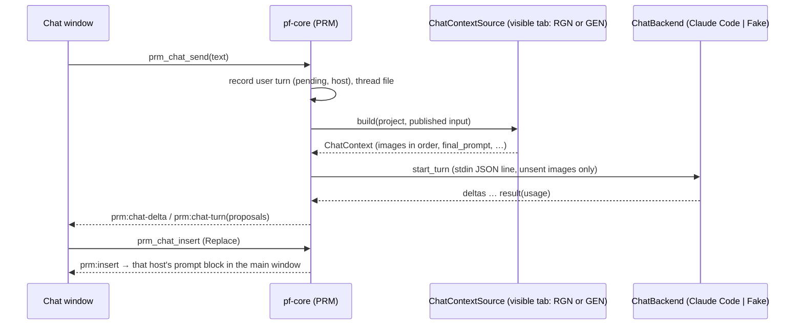

# Prompt helper (helpers + prompt chat)

## 1. Summary
Two prompt aids from the first real session (#58, BL-37). **Prompt helpers** (part A) are predefined, editable snippets per asset type. They are ticked like references, and each ticked helper adds visible text to the **final prompt**. **Prompt chat** (part B) is an optional, opt-in pop-out chat. It sees what the next job would send (Region edit: the sent crop with the mask overlaid; New image: the structural sketch and the references), plus the prompt, the model and its controls. It proposes prompts that the user inserts with one click. The chat backend is **Claude Code headless**, run with its own isolated config folder, behind an adapter with a fake backend for CI. The chat never sends anything to the provider (#58, #60).

## 2. Scope
Tier "next phase" (#58) in [feature-tiers](../feature-tiers.md): "Prompt helpers (presets) and prompt chat (Claude Code headless)". #58 **supersedes #9**: the app may now contain AI, but only through the opt-in prompt chat, and nothing reaches the provider without the user's click. Helpers are plain text, not AI. The **prompt block** (typed prompt, helpers, final prompt preview, chat button) is defined here and hosted by RGN (Region edit tab) and GEN (New image tab) ([seams](../agents/seams-phase4.md)). Part B is the **v1 chat** approved in #60: one thread per asset project, Replace + Copy, and a fresh session after a restart.

## 3. Goals
- What is sent is always visible: the final prompt preview shows every helper's text, and the job records it.
- Helpers are plain, editable text with a sensible starter set per asset type.
- The chat sees exactly what the next job of the visible tab would send, at a size Claude reads well, and nothing else from the disk.
- A chat suggestion reaches the prompt **only** through Insert. The chat cannot submit, estimate or touch the provider.
- The chat child never reads the user's own Claude Code setup (hooks, plugins, CLAUDE.md), and the chat stays off if that can't be guaranteed (#60).
- No real LLM call in CI (AGENTS §3.7 by analogy). The backend can be swapped (OpenRouter later) without UI changes.

## 4. Non-goals
- Art recipes (tier A). Helpers that change controls, references or the model. Per-project helper sets.
- The chat editing anything except through Insert. Tool use, file access or web access by the chat. Automatic prompt rewriting.
- **Deferred by #60:** New chat and thread lists, Append, Undo insert, session resume with a transcript replay, a model override, a turn-timeout setting, deleting Claude Code transcripts with `claude purge`.
- Other backends now (OpenRouter, the Anthropic API): the trait allows them; they need their own decision.
- A chat spend cap (the usage is shown, see §10). Sharing chats. Markdown rendering beyond fenced blocks.
- Owned elsewhere: the blend instruction and its toggle (RGN, #55), estimate and submit (RGN, GEN), the draft store (PRJ). GEN hosts the prompt block in its tab and implements `ChatContextSource` (FR-PRM-42) in its own build slice.

## 5. User stories
- As a DM preparing a session, I tick "No people or tokens" on a Maps project, and every edit's final prompt ends with that sentence until I untick it.
- I tune a helper's wording once in Settings, and Reset brings back the starter text when I've made it worse.
- I paint a mask, open the chat and ask "how do I get a kitchen here that keeps the stone floor?". It sees my crop with the mask, proposes a prompt, and I click Insert. Then I check the final prompt and press Generate myself.
- On the New image tab I ask how to describe a crypt that follows my sketch. The chat sees the sketch and my references.
- On Retry I get the same helpers back, and a helper whose text I've changed since is flagged.
- When Claude Code isn't installed or the chat isn't logged in, the chat tells me exactly that and offers the fix.

## 6. Functional requirements
### Part A: prompt helpers
| ID | Requirement (testable) |
|---|---|
| FR-PRM-01 | A **prompt helper** is `{id, label (1–40 chars), text (1–500 chars), kinds[] ⊆ {map, token, item} (≥ 1), default_on, builtin}`. At most 60 helpers. Ids are `builtin:<slug>` or a ULID for user-made ones. Validation failures → `invalid_input(field)`. |
| FR-PRM-02 | Helper definitions live in `<data-dir>/settings.json`, section `prompt_helpers`, per machine (#60). An absent section means the built-in starter set ([Appendix A](#appendix-a-starter-helpers)). Saving writes the whole list. Built-ins are stored as overrides only: `{id, label?, text?, default_on?, hidden?}`. |
| FR-PRM-03 | **Edit and reset:** label, text, kinds and `default_on` are editable for every helper. A built-in can be hidden but not deleted. **Reset** on a built-in restores its starter label, text, kinds and `default_on` and unhides it. **Reset all** restores the starter set and keeps user-made helpers. A user-made helper can be deleted (no trash; Settings asks for confirmation inline). While the `prompt_helpers` section is invalid (FR-PRJ-39), Reset and Reset all refuse with `corrupt` (field `prompt_helpers`) and a readable message, so user helpers are never overwritten (R97). |
| FR-PRM-04 | The **helpers row** in the prompt block lists the visible helpers whose `kinds` contain the project's asset type, in settings order, as toggle chips (label, with the text as the tooltip). The order is changed in Settings with up/down buttons. |
| FR-PRM-05 | **Ticks** are stored per asset project in the host's draft as `prompt_helpers: [id] \| null` (`draft` for RGN, `draft.generate` for GEN). `null` means the defaults: every visible helper of that kind with `default_on`. The first tick change writes the explicit list. Ticks are saved through PRJ's debounced draft save (FR-PRJ-19) and aren't on the undo stack (as FR-REF-20). |
| FR-PRM-06 | **Compose** (Rust API `prompt::compose`, used by RGN and GEN): final prompt = the non-empty parts joined with `\n\n`, in this order: (1) the typed prompt, trimmed at the end; (2) the ticked helpers' texts in helpers-row order, joined with a single space; (3) the blend instruction (RGN only, FR-RGN-09). An unticked, hidden, deleted or wrong-kind helper is never added. |
| FR-PRM-07 | **Dedupe:** texts are compared after normalising (trim, collapse whitespace, lower case, drop a trailing `.`). A helper whose text equals an earlier helper's text is sent once. A helper whose text is contained in the blend instruction as appended (e.g. "Top-down battlemap view." for Maps, FR-RGN-09, kept as is by #60) is skipped. Every skipped helper is returned as `skipped{id, reason: duplicate \| in_blend_instruction}`, and its chip shows the reason. The typed prompt is never deduplicated against. |
| FR-PRM-08 | The **final prompt preview** ("Final prompt (as sent)", FR-RGN-09) shows the composed text, marking each part's source (typed, the helper label, blend instruction) and the total character count. It updates on every tick and keystroke without a provider call. Helpers don't affect the estimate id (the prompt is not cost-affecting, FR-RGN-12). |
| FR-PRM-09 | The **job record** gets `prompt_helpers[]`: `{id, label, text, skipped?}` for each **ticked** helper, in helpers-row order; `skipped: duplicate \| in_blend_instruction` marks the ones the dedupe left out (R94). It is written with the `requested` commit and never changes. `final_prompt` already contains the sent texts (FR-RGN-09). A job from before this spec has no field, which reads as `[]`; one from before R94 lists only the helpers sent. |
| FR-PRM-10 | **Retry** (FR-RGN-21, FR-GEN-32) sets the draft ticks to the job's `prompt_helpers[]` ids, skipped ones included (R94). A helper whose current text differs from the recorded one is ticked and badged `changed since NNN`, and the current text is sent. A helper that no longer exists is listed as `missing`, unticked and not sent. |
| FR-PRM-11 | **Writing tip:** the empty prompt field shows a placeholder per host. Region edit: "Describe the result, e.g. 'a kitchen with a stone floor and a hearth'". New image: "Describe the image". A "Tips" popover next to the field lists three fixed tips, the first being "Describe the result, not an instruction". Tips never change the final prompt. |
| FR-PRM-12 | Read-only project (FR-RGN-38): the helpers row is shown but disabled. Settings editing still works (it isn't part of the project). |

### Part B: prompt chat (v1, #60)
| ID | Requirement (testable) |
|---|---|
| FR-PRM-20 | **Opt-in:** the chat is off until the user accepts the privacy notice ([Appendix C](#appendix-c-privacy-notice)) once. Acceptance stores `prompt_chat.consent{accepted_at, notice_version}` in settings. A higher `notice_version` asks again. Before acceptance, or while the chat is off, no backend process is started, not even detection (tested with a spawner that panics on use), and `prm_chat_status` reports `backend: not_checked`. Settings has "Prompt chat: on/off". Turning it off ends any running process and keeps the thread. |
| FR-PRM-21 | **Window:** the **Chat** button in the prompt block (`prm-block-chat`) opens or focuses one pop-out window, label `prompt-chat` (min 360×480; size and position remembered per machine). The window is bound to the asset project open in the main window. If that changes, the window switches to that project's thread; with no project open it shows "Open a project to chat about it". Closing it never cancels a job. |
| FR-PRM-22 | **Thread:** each asset project has exactly one chat **thread**, shared by both tabs, in `.pforge/chat/<thread-id>.json` (§8). It is created at the first send and written temp → rename after the user's message is recorded and again after each reply. The window shows the whole thread. On a read-only project nothing is written: the new turns are kept in memory (until the project closes) and shown marked "Not saved" (R94). A writable project whose thread file can't be written (e.g. locked, §11) keeps its new turns in memory the same way: they are listed in `unsaved_turn_ids`, `prm_chat_send` answers `saved: false`, and the next save that works writes them (R97). |
| FR-PRM-23 | **Live context:** the visible tab's prompt block publishes its draft inputs to the core with `prm_context_publish` (debounced 300 ms, and once more right before a chat send). These are the same inputs its estimate takes. It calls `prm_context_clear` when it is hidden or unmounted. A published input over 256 KiB of JSON → `invalid_input` (R96). The send-time flush waits for a publish still in flight, and a publish for a project that has closed is dropped (R97). The context is built only when a turn is sent, by the host's `ChatContextSource` (FR-PRM-41). Nothing else on disk is read. |
| FR-PRM-24 | **Region edit context** (RGN implements): one image, `rgn:overlay`. This is the sent crop (FR-RGN-04/05, after fit) with the mask tinted magenta at 35 % and a 2 px outline. Facts: the region size, the context margin, and "sent unresampled" or the softness factor. With no region or no mask, the turn has no image and the facts say "no region yet". |
| FR-PRM-25 | **Image limits and re-sending:** each image is downscaled with Lanczos3 to a long side ≤ 1568 px and encoded as JPEG q85. A source image over 16384 px on a side (`pf_imaging::MAX_SIDE`) is refused before decoding and dropped as FR-PRM-41 (R96). A turn carries at most 6 images and ≤ 4 MiB encoded. Images are kept in `ChatContext.images` order and the tail is dropped; the context strip names every dropped image. An image is attached only when the current backend session hasn't already received the same `(image id, content hash)` pair. A fresh session (FR-PRM-35) starts with none received. |
| FR-PRM-26 | **Context strip:** above the composer, the chat shows the host ("Region edit" / "New image") and what the next turn will send: thumbnails, plus a one-line summary such as "crop 1024×768 + mask · prompt · Ideogram 4.5 · 4 controls". Each sent turn keeps that summary as a chip. "Include images" (default on, per thread) can be turned off for a text-only turn. |
| FR-PRM-27 | **Turn:** Send (Ctrl+Enter) needs an attached prompt block for the project; without one → `no_prompt_block` ("Open the Generate panel"). It records the user message and the host (FR-PRM-43), builds the context and calls the backend. The reply streams into the transcript (`prm:chat-delta`). One turn at a time per thread; a second send → `turn_active`. A send counts as the running turn **before** it builds the context, so a second send while the first is still building is refused too; a send that fails releases it. The window ignores a second click and disables Retry and Resend while a turn is being sent or running (R97). **Stop** cancels the running turn (§10): the partial reply is kept, marked `canceled`, and no proposals are extracted from it. |
| FR-PRM-28 | **Proposals:** every fenced block tagged `prompt` (` ```prompt `) in a finished reply becomes a **proposal** card, at most 3 per turn (extra blocks stay as plain text). The system prompt ([Appendix B](#appendix-b-system-prompt)) asks for at most three, each holding only a typed prompt, without the helper texts or the blend instruction. A reply without one has no card. |
| FR-PRM-29 | **Insert** is the only way chat text reaches the prompt. A card offers **Replace** (sets the typed prompt) and **Copy** (#60). `prm_chat_insert` emits `prm:insert` to the main window. The prompt block of the proposal's turn host applies it as a normal edit (a draft save, then the preview updates). If that host's block isn't attached (e.g. the other tab is visible) → `no_prompt_block` ("Switch to the Region edit tab to insert"). Insert never changes helpers, the blend instruction, controls or the model. The card shows "Inserted" with the time. |
| FR-PRM-30 | *Removed (#60): Undo insert is deferred. The number is kept so the other FRs keep theirs.* |
| FR-PRM-31 | **Never to the provider:** no PRM command calls PRV, estimates or submits. A test runs a whole chat (send, proposals, insert) on both hosts against the fake provider and checks that its call log is empty. |
| FR-PRM-32 | **Backend seam:** the `ChatBackend` trait (crate `pf-chat`, #60) has `detect`, `start_turn` (streaming events to a sink) and `cancel`. It is dispatched through an `AnyChatBackend` enum: `ClaudeCode` and `Fake`. The mode comes from `PF_CHAT_BACKEND=fake\|claude-code`. Debug and test builds default to `fake`, release builds to `claude-code` (mirrors FR-PRV-02). The process spawner, clock and ids are injected seams. |
| FR-PRM-33 | **Detection** (`prm_chat_status`, only after consent), cached for 60 s and refreshed on window focus. Every step runs with FR-PRM-45's environment. Resolve the executable (§10). Run `claude --version` (parse the first `\d+\.\d+\.\d+`). Run `claude auth status --json`; only `loggedIn`, `authMethod`, `subscriptionType` and `configDirectory` are kept, and every other field (email, org, paths) is dropped unread and never logged. Results: `not_checked` (FR-PRM-20), `not_installed`, `version_unsupported{found, min}`, `isolation_unavailable` (FR-PRM-45), `not_logged_in` (exit 1 or `loggedIn: false`), `ok{version, auth_method, plan?}`. Each comes with a readable message and its fix (Appendix D). |
| FR-PRM-34 | **Invocation** of the Claude Code backend is exactly §10's argument list (a snapshot test). No user text is ever put in an argument: messages go over stdin as stream-json. The working directory is `<data-dir>/chat/<thread-id>/`, which holds only this turn's images (the previous turn's are deleted first). The child's environment is the user's environment minus every `PF_*` variable, plus FR-PRM-45's and §10's variables. |
| FR-PRM-35 | **Process lifetime:** one child per open chat window stays alive across turns (stdin stays open), with no idle timeout. It ends on window close, project switch, chat off and app quit. The next turn then starts a **fresh session** (#60), and the strip says "New session: earlier messages aren't sent". The thread file keeps the whole transcript for the user. |
| FR-PRM-36 | **Timeouts:** no stream event within 60 s of a send → `timeout`. More than 90 s between events → `timeout`. A turn is capped at 300 s in total. On timeout the child is killed, the partial text is kept, and the turn is `failed(timeout)`. |
| FR-PRM-37 | **Errors** map to readable codes (Appendix D): `not_installed`, `version_unsupported`, `isolation_unavailable`, `not_logged_in`, `usage_limit`, `offline`, `timeout`, `backend_crashed{exit_code}`, `stream_malformed`, `backend_error{message}`. A `result` with `is_error: true` uses its `subtype` / `errors[]`. The last 2 KB of stderr is kept in memory for the error detail, with the user's home path replaced by `<home>`. It is never written to the project. **Message mapping** (R99): an expired OAuth 401 → `not_logged_in`; the 5-hour, weekly and session limits and an HTTP 429 → `usage_limit` ("Context limit reached" is not one); connection resets (`ECONNRESET` and similar) → `offline`; an auth or limit message followed by an exit with no `result` → that code, not `backend_crashed`. **Size caps:** a stdout line over 1 MiB → `stream_malformed` (R96); the reply text is capped at 1 MiB and cut at a char boundary (R99). |
| FR-PRM-38 | **Usage:** each turn records `usage{input_tokens, output_tokens, cost_usd?, notional}` from the `result` message. `notional: true` when `authMethod` is `claude.ai` (plan usage, not billed per call) and on the fake backend (nothing billed; its footer says so). The docs call `total_cost_usd` a client-side estimate. The window footer shows the thread total ("≈ $0.04 plan usage" or "≈ $0.04 billed"). With an `api_key` auth method the strip warns once per thread: "Billed to your Anthropic API key". |
| FR-PRM-39 | **Fake backend:** deterministic. The reply quotes the user text and lists the `ChatContext` it received: host, image ids with sizes and hashes, model id and final prompt. It ends with one ` ```prompt ` block derived from the user text. Cases (`PF_FAKE_CHAT_CASE` or `prm_chat_fake_set_case`): `success`, `slow(n)`, `no_proposal`, `two_proposals`, `not_installed`, `not_logged_in`, `version_old`, `isolation_unavailable`, `usage_limit`, `offline`, `timeout`, `crash`, `malformed`. It starts no process and opens no network connection. |
| FR-PRM-40 | Every capability is a `pf-core` command (AGENTS §9), with inputs validated at the boundary. Two commands are the exception: opening the window and opening the login console are Tauri-layer commands (`prm_window_open`, `prm_chat_login`). A failed command leaves the project and settings unchanged. **Per-window grants** (R96): app commands are declared in `build.rs` and granted per window. The `prompt-chat` window gets only the commands it calls (§9, *Chat window's commands*); settings, logout, context, provider, library and export commands are main-window only. |
| FR-PRM-41 | **`ChatContext`** (defined here, built by the host's `ChatContextSource::build(core, project, published_input)`, read-only, no provider call): `{host: rgn \| gen, kind, images[{id, role: region_overlay \| structure \| reference, label, w, h, content_hash, jpeg}], typed_prompt, helpers[{id, label, text}], blend_instruction: {on, text} \| null, final_prompt (from compose, FR-PRM-06), model{id, name}, controls[{name, type, value, min?, max?, allowed?}], facts[string]}`. Image ids are stable identities: `rgn:overlay`, `structure:<path>`, `ref:<item key>` (FR-REF-16). The `final_prompt` is exactly what submit would send at that moment. A failure of the source (e.g. `original_unavailable`, `reference_unavailable`) drops only the affected image and adds it to the facts; the turn still runs. |
| FR-PRM-42 | **New image context** (GEN implements, in GEN's build slice; it replaces `gen_chat_context`): images in this order: the chosen structural sketch (`structure`), then the `on` reference items in send order (`reference`), each the bytes `prepare_for_send` would send, then downscaled per FR-PRM-25. FR-PRM-25 drops from the tail, so the sketch is kept first and the last references go first. Facts: the output size (W × H or ratio), the candidate count and "no sketch" / "this model takes no structural sketch" where they apply. `blend_instruction` is `null`. |
| FR-PRM-43 | **Host:** the host of a turn is the visible tab when Send is pressed: Region edit (`rgn`) or New image (`gen`). It is recorded on each turn, not on the thread. A tab switch clears the old tab's published context (FR-PRM-23) and publishes the new one; the next turn uses the new host. Earlier turns and their proposals keep their own host. The header and the context strip always show the current host. |
| FR-PRM-44 | **Per-host system prompt:** the system prompt is Appendix B's common text plus the host paragraph of the **first** turn of the backend session. A turn whose host differs from that one gets a one-line host note at the top of its user message (Appendix B), so the session needs no restart. |
| FR-PRM-45 | **Isolated config** (#60): every chat child and every detection command runs with `CLAUDE_CONFIG_DIR=<data-dir>/claude-config/`. This folder is created on first use, per machine, and is never synced or committed. Every chat child also runs with `--safe-mode` and with `HOME`/`USERPROFILE` pointed at an empty `<data-dir>/chat-home/` (detection and login keep the real home), because the config folder alone does not stop CLAUDE.md memory loading (probe C08, R87). Together these keep the user's own Claude Code setup (hooks, plugins, skills, MCP servers, CLAUDE.md, AGENTS.md, memory, settings) out of the chat; the probe's gate rows C08, C24 and C25 verify it. **Login** is done once into that folder: Settings → Prompt chat → **Log in…** opens a console window running `claude auth login` with that environment. The command is also shown for copying, with paths single-quoted (PowerShell `''`, sh `'\''`, R96). **Log out** runs `claude auth logout` the same way. Pocket Forge never reads the credentials Claude Code keeps there. **Fail closed:** if `auth status` reports a `configDirectory` other than that folder, or slice 0's probe found that isolation doesn't hold, the status is `isolation_unavailable` and the chat stays disabled. At startup and after each child ends, `<data-dir>/claude-config/projects/` is emptied as a backstop (§10). |

## 7. UI/UX notes
- **Prompt block** (`app/src/features/prompt-helper/`, exported from `index.ts`, rendered by RGN in the Region edit tab and by GEN in the New image tab; it replaces RGN's own prompt rows). Top to bottom: the prompt textarea with the placeholder and a Tips popover (FR-PRM-11), the helpers row (chips), the host's extra rows (RGN's "Blend with surroundings" toggle), "Final prompt (as sent)" with part markers and a character count, and the **Chat** button.
- **Settings section "Prompt helpers"** (registered via `shared/settings.ts`): a list per asset type tab (Maps, Tokens, Items) with label, text, the kinds checkboxes, "On by default", up/down, Hide or Delete, and Reset. Then **+ Helper** and **Reset all**.
- **Settings section "Prompt chat":** on/off, backend status (version, auth method, plan, or "not checked"), **Log in…** / **Log out** with the command shown, executable path override, "Show privacy notice".
- **Chat window:** header (project name · current host "Region edit" / "New image" · backend chip `Claude Code 2.1.x · Max` or the error); transcript (user messages with a host tag, assistant text as plain text with fenced blocks shown as code, proposal cards with Replace and Copy); context strip; composer (Send / Stop); footer usage.
- **States:** *not opted in*: the notice with Accept / Not now · *chat off*: **Turn it on** (`prm-chat-enable`) emits `prm:chat-enable`, and the main window turns the chat on (`enabled` only, never consent or the path), so the chat window needs no `prm_chat_settings_put` (R99) · *not installed / version too old / isolation unavailable / not logged in*: the Appendix D message and the fix (Log in…, or the command), plus Recheck · *no project* · *no prompt block* (Generate panel closed): Send disabled with the reason · *no region yet*: the strip and the turn summary say "no image" (a text-only turn) · *running*: a streaming caret and Stop · *error*: inline under the turn, with Retry (resends the same text) and, for a crash or malformed output, the detail (stderr tail / message, kept only while the window is open) · *offline*: Send, Retry and Resend are disabled after an `offline` error until Recheck (shown beside the reason) succeeds · *read-only project*: the chat works, nothing is saved ("Not saved: read-only project"; each new turn is tagged "Not saved", R94), Insert disabled · *not saved (locked)*: a writable project's thread file couldn't be written; the banner says "Not saved: the chat file is locked. These turns are kept until the project closes." and the turns are tagged "Not saved" (§11, R97) · *fake*: a `Fake chat` chip is always shown in the chat window's header.
- Test ids: `prm-block-{prompt,tips,helper,final-prompt,chars,chat}` (+ `data-record-id` = helper id on `prm-block-helper`), `prm-settings-helper-{label,text,kind,default,up,down,hide,delete,reset}`, `prm-settings-{add,reset-all,chat-toggle,chat-status,chat-path,chat-login,chat-logout}`, `prm-chat-{consent-accept,consent-decline,enable,input,send,stop,strip,host,include-images,usage,status,recheck}`, `prm-chat-proposal` (+ `data-record-id`), `prm-chat-proposal-{replace,copy}`.

## 8. Data and file effects
Field shapes go to [manifest-schema](../architecture/manifest-schema.md) as add-only amendments (§14, *Amendments*).

| What | Where | Written | Recoverable |
|---|---|---|---|
| Helper definitions | `<data-dir>/settings.json` `prompt_helpers{helpers[]}` (per machine) | on Save in Settings | absent → the starter set |
| Chat settings + consent | `settings.json` `prompt_chat{enabled, consent{accepted_at, notice_version}, claude_path?, window{x,y,w,h}}` | on change; `claude_path` only from the main window (R96) | absent → off, not consented |
| Draft ticks | `project.json` `draft.prompt_helpers` (RGN) and `draft.generate.prompt_helpers` (GEN): `[id] \| null` | debounced draft save | with the project |
| Job helpers | `.pforge/jobs/<id>/job.json` `prompt_helpers[]{id, label, text, skipped?}` (every ticked helper, R94) | the `requested` commit, write-once | with the project |
| Chat thread | `.pforge/chat/<thread-id>.json`: `schema_version, id, created_at, updated_at, backend, turns[{id, at, role, host, text, state: pending\|done\|canceled\|failed\|interrupted, error?, context{summary, images[{id, role, w, h, hash}], dropped[], final_prompt, model_id, controls{}}, proposals[{id, text, inserted_at?}], usage?}]` | temp → rename, per turn | with the project |
| Turn images | `<data-dir>/chat/<thread-id>/` (cwd of the child) | per turn, the previous turn's deleted | not kept; the hashes are on the turn |
| Claude Code's config, login and any transcripts | `<data-dir>/claude-config/` (FR-PRM-45), per machine, written by the CLI | by the CLI | `--no-session-persistence` keeps sessions off disk; `projects/` is emptied at startup and after each child as a backstop; the login stays until Log out |

- The thread never stores image bytes, credentials, session ids, the email or other `auth status` fields.
- PRJ must skip `.pforge/chat/` in the orphan sweep and detect thread conflict copies (§14, *Amendments*).

## 9. Commands and events
| Command | Input → result | Errors |
|---|---|---|
| `prm_helpers_list` | `{kind?}` → `[{id, label, text, kinds, default_on, builtin, hidden, modified}]` | — |
| `prm_helpers_save` | `{helpers[]}` (full ordered list) → list | `invalid_input(field)`, `too_many`, PRJ settings errors |
| `prm_helpers_reset` | `{id}` or `{all: true}` → list | `invalid_input` (not a built-in), `not_found` |
| `prm_compose_preview` | `{kind, typed_prompt, helper_ids \| null, blend_instruction: string \| null}` → `{text, parts[{source: typed\|helper\|blend, id?, text}], skipped[{id, reason}], chars}` | `invalid_input` |
| `prm_chat_status` | — → `{enabled, consent, mode: fake\|claude-code, backend: not_checked \| ok{…} \| <error>, claude_path_issue?}`; `claude_path_issue` is a readable notice when a saved `claude_path` fails R96's rule and is ignored (R100) | — |
| `prm_chat_consent` | `{accept: bool}` → status | settings errors |
| `prm_chat_settings_put` (main window only, R96) | `{enabled?, claude_path?: string \| null, window?{x,y,w,h}}` → status. Never sets consent. Turning off or changing the path ends any running process. `claude_path` must be absolute and end in `claude`, `claude.exe` or `claude.cmd` (any case); blank or `null` clears it (R96). A put of the window rect alone runs no detection and emits nothing (R97) | `invalid_input(claude_path \| window)` (setting unchanged), settings errors |
| `prm_chat_logout` | — → status | `consent_required`, FR-PRM-37 codes |
| `prm_chat_session_end` | — → ok; the chat window closed, the next turn starts a fresh session (FR-PRM-35) | — |
| `prm_context_publish` / `_clear` | `{project_id, host: rgn\|gen, input}` / `{project_id, host}` → ok | `no_project`, `invalid_input` (incl. an input over 256 KiB, R96) |
| `prm_chat_preview` | `{project_id, include_images}` → `{host \| null, summary, images[{id, label, w, h, thumb, already_sent}], dropped[]}`: what the next turn would send (FR-PRM-26, BL-42); `host: null` with no attached prompt block; nothing sent or written | `no_project`, the source's errors |
| `prm_chat_thread_get` | `{project_id}` → the thread, or empty; on a read-only project, or after a failed save, the in-memory thread and its `unsaved_turn_ids` (R94, R97) | `no_project` |
| `prm_chat_send` | `{project_id, text (1–8000 chars), include_images}` → `{turn_id, host, context_summary, dropped[], saved}` (`saved: false` → the "not saved" banner, R97) | `consent_required`, `chat_disabled`, `no_prompt_block`, `turn_active`, every FR-PRM-37 code |
| `prm_chat_cancel` | `{turn_id}` → ok | `not_found` |
| `prm_chat_insert` | `{project_id, proposal_id}` → ok (Replace) | `no_prompt_block`, `read_only`, `not_found` |
| `prm_chat_fake_set_case` | `{case}` → ok | `not_fake_mode`, `invalid_input` |
| `prm_window_open` / `prm_chat_login` (Tauri layer) | — → ok | `consent_required`, `not_installed` (login) |

- **Rust API:** `prompt::compose(kind, typed, ticks, &helpers, blend) → FinalPrompt{text, sent[], skipped[]}` for RGN and GEN. The trait `ChatContextSource { fn build(&self, core, project, input) -> ChatContext }` (FR-PRM-41) is implemented by RGN (FR-PRM-24) and GEN (FR-PRM-42).
- **Chat window's commands** (R96): `prm_chat_status`, `prm_chat_consent`, `prm_chat_thread_get`, `prm_chat_preview`, `prm_chat_send`, `prm_chat_cancel`, `prm_chat_insert`, `prm_chat_login` and `project_get`. Every other command is granted to the main window only.
- **Events:** `prm:chat-delta{turn_id, text}` · `prm:chat-turn{turn_id, state, usage?, error?, proposals?}` · `prm:chat-status` · `prm:insert{project_id, host, proposal_id, text}` (applied only by that host's attached block) · `prm:chat-enable{}` (chat window → main window, which calls `prm_chat_settings_put{enabled: true}`, R99) · `prm:context-published{project_id, host}` (main window → chat window after each `prm_context_publish`; the next-turn strip re-reads its preview, R103) · `prm:helpers-changed`.

## 10. Provider interaction
**Scenario:** none. No PRM command calls PRV (FR-PRM-31). Helpers only change the text RGN or GEN submits.

**Chat backend: Claude Code headless.** Checked against the local CLI 2.1.319 `--help` and the current docs (headless, CLI reference, Agent SDK streaming input, sessions, env vars, authentication):

```
<claude> -p --input-format stream-json --output-format stream-json --verbose
  --tools "" --strict-mcp-config --disable-slash-commands --no-session-persistence
  --safe-mode                      # no CLAUDE.md, memory, skills, plugins, hooks, MCP
  --system-prompt <Appendix B>     # replaces the coding prompt
cwd = <data-dir>/chat/<thread-id>/
env = user env − PF_* − HOMEDRIVE/HOMEPATH + CLAUDE_CONFIG_DIR=<data-dir>/claude-config/,
      USERPROFILE=HOME=<data-dir>/chat-home/ (empty),
      CLAUDE_CODE_DISABLE_NONESSENTIAL_TRAFFIC=1, DISABLE_AUTOUPDATER=1
      (detection and login commands keep the user's home)
```

| Claim | Status |
|---|---|
| `-p`, stream-json in and out with `--verbose`, `--tools ""`, `--strict-mcp-config`, `--disable-slash-commands`, `--system-prompt`, `--no-session-persistence`; base64 image blocks in streaming input; `result.total_cost_usd`; the env vars, `CLAUDE_CONFIG_DIR` included (it moves all state and credentials); `auth status` exit codes 0 / 1, `authMethod`, `configDirectory` (≥ 2.1.319) | documented |
| `auth status --json` fields `loggedIn` and `subscriptionType` | **observed** on 2.1.319, not documented |
| With `CLAUDE_CONFIG_DIR` set, nothing from `<home>/.claude/` or `<home>/.claude.json` is read (hooks, plugins, skills, MCP, CLAUDE.md, memory) | **false** on 2.1.319 (probe C08, 2026-11-09): the home folder's `.claude/CLAUDE.md` and the cwd's parent folders' `CLAUDE.md` still load. Hooks, skills, agents, commands, plugins and MCP did not (C09–C11). Hence `--safe-mode` and the empty chat home |
| `--safe-mode` keeps CLAUDE.md (every scope), auto memory, skills, plugins, hooks, MCP servers, commands and agents from loading; the login, model and built-in tools work normally (≥ 2.1.169) | documented. Whether it also skips a parent folder's `AGENTS.md` is **unverified**: probe C24 checks it, C25 checks the markers are live |
| With `USERPROFILE` / `HOME` pointed at an empty folder, the plan login in `CLAUDE_CONFIG_DIR` still works | **observed** on 2.1.319 (probe C08's stand-in home, logged in) |
| `--no-session-persistence` still allows several turns in one stream-json process, and writes no transcript | **unverified**. Slice 0 checks it; `projects/` is emptied anyway |
| A 10 MB cap on stdin applies to stream-json input | **unverified**. FR-PRM-25 keeps a turn ≤ 4 MiB of images regardless |
| Not used: `--bare` (never reads the subscription login), `--permission-prompts` (unverified, and not needed with no tools), `--resume` and `--model` (deferred, #60), `--allowedTools`, image file paths (would need the Read tool) | — |

- **Slice 0 gates slice 4.** The probe runs the exact list above on the owner's CLI. It puts marker files in a throwaway stand-in for the user's config (a `CLAUDE.md`, a hook, a plugin dir). It then checks that `system/init` lists no plugins, skills, MCP servers or agents, that the debug log shows no marker read, that two turns work in one process, and that `<data-dir>/claude-config/projects/` stays empty. The probe fixes the minimum version, which is no lower than 2.1.319. If isolation fails, the adapter is still built, but the chat ships disabled with `isolation_unavailable`.
- **Stdin message** per turn, one JSON line: `{"type":"user","message":{"role":"user","content":[{"type":"image","source":{"type":"base64","media_type":"image/jpeg","data":…}}…,{"type":"text","text":<host note? + context block + user text>}]},"parent_tool_use_id":null}`.
- **Stdout** lines are parsed as JSON. `assistant` and stream text become `prm:chat-delta`. `result{subtype, is_error, result, total_cost_usd, usage, errors[]}` ends the turn. Unknown types are ignored. Three non-JSON lines in a row, or one line over 1 MiB, → `stream_malformed` (R96); the reader keeps at most 1 MiB + 1 byte per line.
- **Executable:** `prompt_chat.claude_path`, else `claude.exe` on `PATH`, else `<home>/.local/bin/claude.exe` (native installer), else `claude.cmd` on `PATH` (npm). A set `prompt_chat.claude_path` must be absolute and name `claude`, `claude.exe` or `claude.cmd` (R96, §9). A saved path that fails this rule is checked on every use and ignored, and the search goes on; Settings shows `claude_path_issue` with a Clear button (R100). A `.cmd` runs with fixed arguments only (no user text, FR-PRM-34) through Rust std's batch-file handling: `%SystemRoot%\System32\cmd.exe` (never `cmd` from `PATH`), with `%` escaped; there is no custom quoting (R96, R99). Detection uses the same route. Chat children run without a window (`CREATE_NO_WINDOW`). Only the login runs in a visible console.
- **Cancel:** the child is killed (on Windows, ending the whole job object, `windows-sys`, #60). A partial reply is kept only in our thread. The next turn starts a fresh session (FR-PRM-35).
- **Recordings scrub** (`fixtures/chat/claude-code/*.jsonl`): `session_id`, `uuid` and message ids → `<session-N>` / `<uuid-N>`; `system/init.cwd` and every absolute path → `<data-dir>/chat/<thread>` or `<home>`; the init lists `tools`, `mcp_servers`, `plugins`, `slash_commands`, `agents` and `skills` → `[]`; `apiKeySource` and `credential_expires_at` → `<redacted>`; a non-empty thinking `signature` → `<signature>`; `rate_limit_info` keeps only `status` (R96); image data → `{"fixture": "<name>.jpg"}`. Every recording must pass `check-hygiene.sh`.
- **Privacy:** images, prompt, model and controls go to Anthropic through the user's Claude login and plan. This is shown once and opted into (FR-PRM-20). `ANTHROPIC_API_KEY` in the environment overrides the plan login in `-p` mode; detection reports `api_key`, and FR-PRM-38 warns.



## 11. Edge cases
| Case | Behaviour |
|---|---|
| Crash mid-save | Thread file temp → rename. A `pending` user turn without a reply on open → `interrupted`, with "Resend". Settings are temp → rename (PRJ). Job helpers are in the `requested` commit, so all or nothing. |
| App crash with a child running | The job object ends the child with the app. At startup, `<data-dir>/chat/*/` and `<data-dir>/claude-config/projects/` are emptied. |
| Sync conflict / locked | A thread conflict copy (detected by PRJ, §14 *Amendments*): the file with the later `updated_at` stays the thread, the other goes to the project trash as `conflict_copy`, with a notice (as OQ-REF-05); nothing is merged. A locked thread file is retried for ≤ 3 s; then the turn still runs, its turns are kept in memory until the project closes, and the banner says "Not saved: the chat file is locked". The next save that works writes them; Replace works on them (FR-PRM-22, R97). Settings conflicts follow PRJ. |
| Offline | Detection still works (local commands). A turn fails as `offline`, and Send, Retry and Resend stay disabled until Recheck. Helpers and Insert work offline. |
| Backend error or timeout | FR-PRM-36/37. Nothing is retried automatically; Retry resends the same text. `usage_limit` shows the CLI's message verbatim (e.g. the reset time). |
| Login expired or logged out elsewhere | The next turn or Recheck reports `not_logged_in`; Log in… fixes it. Other turns in the thread are unaffected. |
| Tab switch during a turn | The running turn keeps its host. Its proposals insert only into that host's block (FR-PRM-29). |
| Very large image or many references | The crop is ≤ 4096² (FR-RGN-02) and is downscaled to ≤ 1568 px. GEN's ≤ 16 references + sketch are cut to 6 images by FR-PRM-25, and the dropped ones are named. |
| Corrupt or unsupported input | A thread file that won't parse is renamed `<id>.corrupt-<UTC>.json` (kept, not swept) and a new thread starts, with a notice. A settings section that's invalid → the starter helpers plus a warning (FR-PRJ-39). A context image that can't be read → dropped, named in the facts (FR-PRM-41). |
| Helper edited or deleted between preview and submit | The job records what compose produced at submit; the preview refreshes on `prm:helpers-changed`. |
| Undo across the boundary | Insert is a normal prompt edit, so the prompt field's own history applies. Tick changes aren't undoable (as REF). The chat transcript is never undone. |
| Project closed or switched during a turn | The turn finishes into its own thread file (the project path is captured at send). The child then ends (FR-PRM-35). |

## 12. Performance budget
- Compose plus preview: < 1 ms. Ticking a chip updates the preview within one frame.
- Context build, typical / worst: Region edit (crop + overlay + JPEG, 4096² outer) ≤ 150 ms / ≤ 600 ms. New image (6 images from REF's prepared cache) ≤ 200 ms / ≤ 800 ms.
- Detection: ≤ 3 s (two short CLI runs), cached for 60 s.
- App overhead per turn, excluding the backend: ≤ 100 ms before the stdin write. Each stream delta reaches the window within 50 ms.
- Window open ≤ 1 s. A thread with 200 turns loads in ≤ 200 ms. Extra memory ≤ 32 MiB plus the child process.

## 13. Test plan
- **Rust unit** (`fr_prm_NN_*`):
  - helpers: validation and limits (01); settings default, overrides, reset and reset-all (02, 03); compose order, separators, empty parts and wrong-kind helpers (06); dedupe against helpers and against the blend instruction, Maps included (07); the job `prompt_helpers[]` record and the absent-field read (09); retry `changed` and `missing` (10).
  - backend: the invocation argument and env snapshot, `CLAUDE_CONFIG_DIR` included and `PF_*` removed (34, 45); version and `auth status` parsing, extra fields dropped and never logged, and a foreign `configDirectory` → `isolation_unavailable` (33, 45); `not_checked` before consent (20); the stream-json parser over the recordings: deltas, result, error subtypes, malformed (37); timeouts under a fake clock (36).
  - chat: proposal extraction (fences, tags, max 3, none) (28); the image order, drop-from-tail and `(id, hash)` re-send rules, including a fresh session re-sending all (25, 42); host per turn and the insert target (43, 29).
- **Integration** (pf-core + fake chat backend + fake provider): consent gating with a spawner that panics before consent (20); a chat on the RGN fixture region, with the overlay image's hash checked against a golden (24, 41); a chat on GEN's sketch + 8 references, where the sketch is first and the last references are dropped (42); switching tabs between turns, and inserting a Region edit proposal while New image is visible → `no_prompt_block` (43); the fake provider's call log is empty after send and insert on both hosts (31); every fake case (39); thread files across a restart, the `interrupted` turn, a corrupt thread and a conflict copy (22, §11); a fresh session after the child ends (35); cancel kills the child and keeps the partial text (27); `projects/` emptied after a child ends (45). The ClaudeCode adapter runs against a **process seam** that replays recorded stdout, so the real parser and lifecycle are tested without the CLI.
- **Vitest** (`FR-PRM-NN …`): helper chips per kind and default ticks (04, 05); the preview's part markers, count and skipped badges (07, 08); the Settings editors, Log in / Log out included (03, 45); chat window states and the host tag (§7, 43); proposal card Replace and Copy (29).
- **Thin e2e** (Playwright, mocked commands, KQ-33): tick two helpers → the final prompt preview; open the chat → consent → send → proposal → Replace → the main prompt field updates.
- **Fixtures:** RGN's generated rooms battlemap and fixture mask; GEN's line-art sketch fixture and REF's swatches (public-safe). Chat recordings `fixtures/chat/claude-code/<case>.jsonl`: `success-image`, `two-proposals`, `usage-limit`, `not-logged-in`. The owner records them once with the probe on the rooms fixture, scrubbed per §10. No real chat calls in CI: the real backend needs `PF_CHAT_BACKEND=claude-code` plus `PF_CHAT_REAL=1`, and CI fails if either is set (as FR-PRV-28).
- **Walkthrough** (test agent, dev build, fake provider + fake chat, `PF_DATA_DIR=.pf-dev/data`, `PF_LIBRARY_DIR=.pf-dev/library`):

| # | Step | Expected |
|---|---|---|
| 1 | Open a Maps project from the rooms fixture, `R`, drag a region, paint a mask | Prompt block with the placeholder; Maps helpers only |
| 2 | Tick "No people or tokens" and "Top-down battlemap" | Preview = typed + helper text + blend instruction; "Top-down battlemap" badged `in_blend_instruction` (FR-PRM-07) |
| 3 | Settings → edit the helper's text, then Reset | Preview follows; Reset restores the starter text |
| 4 | Click Chat | The chat window with the "Fake chat" chip; privacy notice; status `not checked`; Not now → nothing spawned; Chat again, Accept |
| 5 | Send "make this a kitchen" | Host "Region edit"; strip shows crop + mask; the streamed fake reply lists `rgn:overlay` and the model; one proposal card |
| 6 | Replace | Main prompt field = proposal; no estimate or job was started by the chat |
| 7 | Switch to New image, choose the fake model `fake-gen-refs` (12 ref slots), add the sketch fixture and 8 refs, send "a crypt" | Host "New image"; sketch first, 5 refs sent, 3 named as dropped (in the strip before the send and under the turn); the turn's summary counts 6 images |
| 8 | Click Replace on step 5's card while New image is visible | `no_prompt_block`, "Switch to the Region edit tab to insert" |
| 9 | Back to Region edit, Generate (fake provider), open the job file | `final_prompt` contains the helper text; `prompt_helpers[]` lists it |
| 10 | Edit that helper's text, then Retry | Helper ticked and badged `changed since 001` |
| 11 | Close the chat window, reopen, send again | Same thread shown; "New session" note; the overlay image is sent again |
| 12 | `PF_FAKE_CHAT_CASE=not_logged_in`, then `isolation_unavailable`, Recheck | The not-logged-in message with Log in…; then the chat disabled with the isolation message |

- **Manual acceptance (owner, real Claude Code):** run the probe (slice 0), Log in… once, then one real turn on each host with the fixtures. Check the privacy notice, the overlay image as Claude describes it, a proposal and Replace, Stop mid-reply, the usage footer, and that `<data-dir>/claude-config/projects/` is empty afterwards.

## 14. Build split
| # | Slice | Shared files (AGENTS §9) | Depends on |
|---|---|---|---|
| 0 | **Probe** (`pf-chat-probe`, dev only): runs §10's list on the installed CLI, checks the unverified rows (isolation first), records and scrubs the fixtures, fixes the minimum version. The owner runs the real turns | none | `pf-chat` crate (#60) |
| 1 | Helpers core: settings section, `compose`, dedupe, helper commands, job and draft fields | command registry (append), schema (add) | PRJ settings |
| 2 | Prompt block + Settings sections (mocked commands) | UI feature registry (append) | 1 |
| 3 | RGN integration: the prompt block replaces RGN's prompt rows, compose in `prepare_job`, job record, retry, RGN `ChatContextSource` stub (the RGN amendment below) | RGN files | 1, 2 |
| 4 | `pf-chat` crate: trait, fake, ClaudeCode adapter (executable resolution, isolated config, detection, login/logout, invocation, stream parser, job object, timeouts), process seam + replay | none (crate and deps approved, #60) | **0 passed** |
| 5 | Chat core: consent, thread, context publish, host per turn, `ChatContext`, the RGN overlay source, send/cancel/insert, events | command registry (append), schema (add), PRJ amendment | 3, 4 |
| 6 | Chat window: second window, transcript, cards, strip, states, Settings login | `tauri.conf.json` / capabilities (orchestrator, approved #60), UI registry (append) | 5 |

GEN hosts the prompt block and implements `ChatContextSource` (FR-PRM-42) in **GEN's** build slice 6, after PRM slices 2 and 5. PRM has no GEN slice.

**Amendments to other specs** (accepted, #60)
| Spec | Amendment |
|---|---|
| RGN | FR-RGN-09: the final prompt = PRM's compose (typed, helpers, blend instruction); drop "Nothing else is added (#9)". FR-RGN-21 / `rgn_job_retry_draft`: restore helper ticks (FR-PRM-10). §7: the prompt rows become PRM's prompt block. The job records `prompt_helpers[]`. RGN implements `ChatContextSource` (FR-PRM-24). |
| GEN | FR-GEN-16 follows the new Final prompt definition. FR-GEN-17 and `gen_chat_context` are replaced by GEN implementing `ChatContextSource` per FR-PRM-42. GEN slice 6 owns hosting. The job records `prompt_helpers[]`. |
| PRJ | FR-PRJ-20: the orphan sweep skips `.pforge/chat/`. FR-PRJ-34: conflict-copy detection also covers `.pforge/chat/*.json`. FR-PRJ-39: settings sections `prompt_helpers` and `prompt_chat`. |
| Schema | §4.5 draft: `prompt_helpers` (and in `draft.generate`). §4.6 job: `prompt_helpers[]`. §5 settings: `prompt_helpers`, `prompt_chat`. A new §4.x for the chat thread file. |
| Glossary | New: *prompt helper*, *prompt block*, *prompt chat*, *chat thread*, *proposal*, *chat host*. *Final prompt* = typed prompt + ticked helper texts + blend instruction (RGN only), amending #57. |

**For the orchestrator** (approved in #60, made by the orchestrator):
- **Capability:** a new `prompt-chat` window label in a capability with `core:default` (events, window focus) plus only the chat window's commands (§9, R96). The window is created from Rust at runtime (`WebviewWindowBuilder`). CSP unchanged (thumbnails use the existing `pf-tiles` scheme).
- **Process spawn:** from Rust only (`tokio::process`, the `process` feature). No `tauri-plugin-shell`, and no spawn permission for any webview.
- **Dependencies:** `windows-sys` (Job Object) and the `pf-chat` crate; the AGENTS §9 layout and the crate-direction rule are already updated on `main`.

## 15. Open questions
All resolved by the owner in #60. One non-blocking owner question is open since R96: should the child's environment be an allow-list instead of FR-PRM-34's "the user's environment minus `PF_*`"? Until it is answered, FR-PRM-34 stands unchanged.

| ID | Question | Resolution |
|---|---|---|
| OQ-PRM-01 | Where helper definitions live | Resolved (#60): A, `settings.json` per machine |
| OQ-PRM-02 | Is "Describe the result" a helper? | Resolved (#60): A, no: a placeholder and tip (FR-PRM-11) |
| OQ-PRM-03 | RGN's built-in "Top-down battlemap view." | Resolved (#60): A, kept; FR-PRM-07 skips an identical helper |
| OQ-PRM-04 | Where the chat lives | Resolved (#60): A, pop-out window |
| OQ-PRM-05 | Chat history scope | Resolved (#60): A, per asset project in `.pforge/chat/`, shared by both tabs, host per turn; one thread (v1) |
| OQ-PRM-06 | How images reach Claude Code | Resolved (#60): A, base64 image blocks on stream-json stdin, all tools off |
| OQ-PRM-07 | What the Region edit chat sees | Resolved (#60): A, one overlay image |
| OQ-PRM-08 | Where the backend code lives | Resolved (#60): A, crate `pf-chat` |
| OQ-PRM-09 | Orphaned children after a crash | Resolved (#60): A, a Windows Job Object (`windows-sys`) |
| OQ-PRM-10 | Amendments to other specs | Resolved (#60): A, the §14 table |
| OQ-PRM-11 | Glossary | Resolved (#60): A, the §14 terms and the new Final prompt definition |
| OQ-PRM-12 | System prompt | Resolved (#60): A, fixed in code, versioned |
| OQ-PRM-13 | Starter helpers on by default? | Resolved (#60): A, all off |
| OQ-PRM-14 | v1 scope of the chat | Resolved (#60): A, one thread per project, Replace + Copy, a fresh session after a restart; the rest deferred (§4) |
| OQ-PRM-15 | Keeping the user's Claude Code setup out of the chat | Resolved (#60): an isolated `CLAUDE_CONFIG_DIR` with a one-time login, and the chat stays disabled if isolation fails (FR-PRM-45) |

## Appendix A: starter helpers
Starter wording for the owner to tune. All are `default_on: false` (#60).

| id | Kinds | Label | Text |
|---|---|---|---|
| `builtin:top-down-map` | map | Top-down battlemap | Top-down battlemap view. |
| `builtin:match-style` | map | Match surrounding style | Match the existing art style, palette, line weight and lighting. |
| `builtin:no-people` | map | No people or tokens | No people, creatures or tokens. |
| `builtin:no-grid-text` | map | No grid or text | No grid lines, labels or text. |
| `builtin:token-single` | token | Single creature | A single creature, centred and fully in frame, seen from above. |
| `builtin:token-plain-bg` | token | Plain background | Plain, uncluttered background. |
| `builtin:item-single` | item | Single item | A single item, centred and fully in frame. |
| `builtin:item-plain-bg` | item | Plain background | Plain neutral background, soft even lighting. |
| `builtin:no-text` | token, item | No text | No text, frame, border or watermark. |

## Appendix B: system prompt
Versioned constant (`PROMPT_CHAT_SYSTEM_V1`), passed on every start: the common text plus the paragraph for the session's first host (FR-PRM-44).

> **Common:** You help a tabletop game master write a prompt for an image model. Each message may contain images, the model, its settings and the current prompt. Describe the desired *result*, not an instruction ("a kitchen with a stone floor", not "add a kitchen"). Keep within what the model and its settings can do. The listed helper texts, and the blend instruction when present, are appended automatically: do not repeat them. Put each suggested prompt in its own fenced block tagged `prompt`, at most three per reply. Keep the rest of the reply short. You cannot run jobs, see other files or change settings; the user decides what to send.
>
> **Region edit:** The image shows the area being edited and its surroundings. The editable part is tinted magenta and outlined. Only that part will change, and it must blend into the rest.
>
> **New image:** A new image will be generated from scratch. The first image, if marked as the structural sketch, fixes the layout. The other images are the reference images sent with the request.

Host note, prefixed to a user message whose host differs from the session's first: `[Now on: Region edit]` or `[Now on: New image]`, followed by that host's paragraph.

## Appendix C: privacy notice
Version 1. It is shown before the first chat and from Settings.

> **Prompt chat sends data to Anthropic.** When you send a message, Pocket Forge passes it to Claude Code on this computer. Claude Code sends it to Anthropic under the Claude login you set up for the chat, together with the image of the region you're editing (or your structural sketch and references), your prompt, the model and its settings. It counts toward your plan's usage, or is billed to your API key if one is set. Claude Code runs in its own folder inside Pocket Forge's data, without your usual Claude Code settings, and is told not to keep the conversation on disk. Anthropic's own data handling applies to what is sent. Nothing is sent until you press Send, and nothing the chat says reaches Scenario unless you insert it and press Generate yourself. [Accept] [Not now]

## Appendix D: backend errors
| Code | Message | Fix shown |
|---|---|---|
| `not_installed` | Claude Code isn't installed, or isn't on PATH. | Install Claude Code, or set its path in Settings → Prompt chat. |
| `version_unsupported` | Claude Code {found} is too old (needs {min}). | Run `claude update`. |
| `isolation_unavailable` | Prompt chat can't run Claude Code without your own Claude Code settings, so it stays off. | Update Claude Code, then Recheck. |
| `not_logged_in` | The prompt chat isn't logged in to Claude. | **Log in…** in Settings → Prompt chat (runs `claude auth login` for the chat's own folder), then Recheck. |
| `usage_limit` | Your Claude plan's usage limit is reached. | The CLI's message, verbatim (e.g. the reset time). |
| `offline` | Can't reach Anthropic. | Check the connection, then Recheck. |
| `timeout` | Claude Code didn't answer in time. | Retry. |
| `backend_crashed` | Claude Code stopped unexpectedly (exit {code}). | Retry; details show the stderr tail. |
| `stream_malformed` / `backend_error` | Unexpected output from Claude Code. | Retry; details show the message. |
