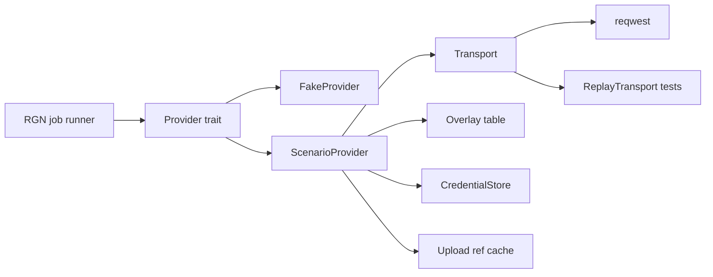

# Provider adapter (Scenario + fake)

## 1. Summary
The `pf-provider` crate implements the [ADR 0001](../architecture/adr/0001-provider-integration.md) adapter (#14). It has two implementations: **Scenario** over REST, and a deterministic **fake provider**, the default in dev and test builds (KQ-24, AGENTS §3.7). It owns credentials (KQ-05), the full **model capabilities** normaliser plus the **model overlay** (#15, #37), mask polarity conversion, error normalisation, the poll schedule, uploads (#20, R15) and the recording format. [region-edit](region-edit.md) (RGN) consumes it through generic types only.

## 2. Scope
Tier S ([feature-tiers](../feature-tiers.md)): "Localised edit of a masked region via Scenario", "Visible job status and cost; user-controlled retry" (provider side) and "Model capability discovery (controls reflect the model)" in full (#37). Only `edit_masked` is implemented. The other ADR operations exist in the request type but return `invalid_request(operation)` until their tier.

## 3. Goals
- Keep RGN and the UI free of Scenario concepts; swap fake ⇄ Scenario with no other code change. The controls RGN shows are exactly the selected model's inputs, conditional rules included (#37).
- The secret never leaves the Rust core and never appears in logs. CI never spends credits; real calls need an explicit manual mode.
- Masks reach every model in its **mask convention**, with a golden per convention and soft rule.

## 4. Non-goals
- Model browsing/search, text-to-image, reference images with roles (tier A). MCP or the TS SDK (#14). Webhooks.
- The poll loop and job persistence (RGN, R14). Mask padding, fit resampling and validation (RGN, R1). Job request composition, the spend cap and confirmation (#23), job and candidate commands (RGN, R4).
- Persisting jobs, candidates and settings (PRJ). Deleting provider-side uploads (OQ-PRV-06 → keep).

## 5. User stories
- As a DM preparing a session, I enter my Scenario key once and never manage uploads (#20). When something fails, I see *why* (auth, balance, offline, provider error) and decide whether to retry.
- As a developer, I run the whole loop offline with the fake provider and get the same candidates every time.

## 6. Functional requirements
| ID | Requirement (testable) |
|---|---|
| FR-PRV-01 | The `Provider` trait has exactly the nine ADR 0001 operations, with generic inputs and outputs, dispatched through an `AnyProvider` enum (OQ-PRV-14). Scenario types are `pub(crate)` in a `scenario` module. |
| FR-PRV-02 | Mode comes from `PF_PROVIDER=fake\|scenario`. Debug and test builds default to `fake`, release builds to `scenario` (OQ-PRV-20, #40). `provider_status` reports the mode. |
| FR-PRV-03 | Fake: three models, one per mask convention, whose capabilities are committed fixtures run through the real normaliser. The same request + seed gives byte-identical PNG candidates. Masked pixels get a seed-derived pattern; unmasked pixels are unchanged. |
| FR-PRV-04 | Fake cases are listed in [Appendix D](#appendix-d-fake-cases), including `bad_candidate`, `aspect_mismatch(pct)`, `offset(levels)`, `canceled` and `slow(n)` (R17). Set by `PF_FAKE_CASE` or `provider_fake_set_case`. Default `success`. Each case has a test. |
| FR-PRV-05 | The fake opens no network connection (tested with a transport that panics on use). |
| FR-PRV-06 | The key and secret are stored only in the OS credential store (`keyring`, #38) under target `pocket-forge/scenario`. Nothing goes to `PF_DATA_DIR`, the library, the repo or logs. |
| FR-PRV-07 | No command returns the secret. `provider_status` exposes `configured` plus the last 4 characters of the key id. |
| FR-PRV-08 | `Secret` redacts `Debug`/`Display` and has no `Serialize`. A log capture over a full fake + replay job (including every error case) contains neither the key, the secret nor an `Authorization` header. |
| FR-PRV-09 | The auth header is sent only to the API base host, never to signed or presigned URLs. |
| FR-PRV-10 | The normaliser maps every `inputs[]` entry to a generic control (int, float, enum, bool, string, seed, image, mask) with a `role` (`source \| mask \| prompt \| candidate_count \| seed \| reference \| other`; from the overlay row where Scenario doesn't say, R28) and min/max/step/allowed/default/required/cost-affecting, and both `required.conditional` and `conditionalValues` to generic `rules[]` ([Appendix C](#appendix-c-generic-shapes)). An unknown type → control omitted + warning; if that input is required, the model isn't offered. Unknown fields are ignored; malformed JSON → an error, never a panic. |
| FR-PRV-11 | Masked edit is offered only if an overlay row gives the model a mask convention **and** its capabilities list a mask input (#15). Each overlay row has a fixture test. |
| FR-PRV-12 | Mask conversion is **polarity only** (R1). Input: the canonical mask (L8, white = edit) at exactly the size of the sent image (the outer rect after fit), already padded and resampled by RGN; any other size → `invalid_request(mask)`. Output: a PNG of the same size in the row's convention, applying its `soft` rule (`pass-through` \| `threshold(128)`). `alpha_transparent_edit` masks are RGBA carrying the sent image's RGB. One golden per convention × soft rule. |
| FR-PRV-13 | Backstop for RGN's `input_too_large` pre-check (R20): in `estimate` and `submit`, before any network call, a sent image outside `input_px{min,max,multiple_of}` or a converted file over `max_bytes` → `invalid_request(image\|mask)`, with zero network calls. |
| FR-PRV-14 | Upload < 4 MB → `POST /assets` (base64, `hide: true`). ≥ 4 MB → `/uploads` multipart (parts ≥ 5 MB) + complete. Each converted file is uploaded **at most once per content hash** (`sha2`) per session; the in-memory ref cache is cleared on a mode or credential change (R15). |
| FR-PRV-15 | Re-upload: if estimate/submit reports a referenced asset as missing, PRV re-converts the caller's as-sent bytes, re-uploads once and retries once. New refs go into `provider.asset_refs`. A second failure → `invalid_request(image\|mask)`. No user-visible step (#20). |
| FR-PRV-16 | `estimate` uses `?dryRun=true` and never sets `ipDetection`. HTTP 269 → `Cost{amount, unit:"CU"}`; no cost field → `Unknown`. If the overlay row's `dry_run_assets` is `false` (set from a recorded free dry run), estimate uploads nothing and uploads wait for submit; if `true`, estimate uploads (FR-PRV-14 dedupes) (R15). |
| FR-PRV-17 | `submit` maps the generic request to the body through each control's `role` and input name (R28) and returns `provider{}` with `job_handle` set. It is never retried once request bytes were sent. Insufficient balance → its distinct error. |
| FR-PRV-18 | `status` maps Scenario states per [Appendix C](#appendix-c-generic-shapes). Progress is clamped to 0–1. Cost comes from `billing.cuCost` when present. |
| FR-PRV-19 | `poll_delay(elapsed, last_error)` is pure: 2 s for the first 30 s, then +2 s per poll up to 10 s. `rate_limited` → max(retry_after, schedule). Offline → 10 s, state `unknown`. `long_running(elapsed)` is true from 180 s. PRV runs no loop and has no total timeout; RGN's runner polls until terminal (R14). Polling never resubmits (OQ-PRV-05). |
| FR-PRV-20 | `cancel` → `POST /jobs/{id}/action`. "Not cancellable" → the ack `not_cancellable`, not an error. |
| FR-PRV-21 | `fetch_candidates`: job asset ids → `GET /assets/{id}` → download the signed URL. On 403/404, re-resolve once. Returns the bytes untouched + `provider_meta` (asset id, seed, inputs). |
| FR-PRV-22 | `balance` = plan remaining + one-shot remaining, plus the period end. No team id, or 401/403 → `unknown` (OQ-PRV-09). |
| FR-PRV-23 | Errors are normalised per the Appendix C error map. `estimate` and `submit` can return every normalised error. Each row has a test. Error text never contains request headers. |
| FR-PRV-24 | Idempotent calls (GET, upload, dry run) retry on `offline`, `timeout`, 429 and 5xx: at most 3 attempts, 1/2/4 s, honouring `Retry-After` (cap 30 s). Timeouts: 60 s per request, 120 s per upload part. |
| FR-PRV-25 | `list_models` returns masked-edit-capable models only. The last good list + capabilities are cached. Offline → cached data with `stale: true`. A corrupt cache is deleted and refetched. |
| FR-PRV-26 | The only provider-specific data on a job is the opaque `provider{}` ([Appendix B](#appendix-b-provider-on-the-job-record)), returned by `submit`/`estimate`/`fetch_candidates` for RGN to persist verbatim (R2). The generic KQ-17 fields come from PRV's generic outputs; the capability snapshot is the serialised generic capabilities. |
| FR-PRV-27 | Recordings follow [Appendix A](#appendix-a-recording-format). The recorder strips auth, replaces ids and signed URLs with placeholders, and binaries with generated-fixture refs. All recordings pass `check-hygiene.sh`. Recordings are `ScenarioProvider` replay only (R17). |
| FR-PRV-28 | Real calls need `PF_PROVIDER=scenario` + credentials. Real-call tests need cargo feature `real-call` + `PF_REAL_CALL=1`, and CI fails if either is set. The recorder spends only with `--allow-spend <CU>`. |
| FR-PRV-29 | Team and project ids are read and written only through PRJ's `settings_get/put` as the `provider` section of `<data-dir>/settings.json` (R8). PRV writes no settings file of its own. |
| FR-PRV-30 | `Capabilities::evaluate(values)` is pure and applies `rules[]`: it returns the visible controls, their effective allowed values and required flags, and per-control errors. RGN uses it at its command boundary (#37). |

## 7. UI/UX notes
- **Provider settings** (`app/src/features/provider/`): key and secret as password fields (cleared after Save), Save, Clear, Test connection, optional team and project id. Test ids `prv-settings-key|secret|team|project|save|clear|test`.
- **Status chip** in the header (`prv-header-chip`): `Fake provider` (always visible in fake mode) · `Scenario · ok` · `offline` · `auth error` · `not configured`, plus the balance (`1,234 CU` or `unknown`). States: *not configured* → the chip links to settings and RGN disables submit. *Offline* → cached models shown as stale. *Auth error* → link to settings. *Loading*: Test connection shows a spinner. Job states and controls are RGN's UI.

## 8. Data and file effects
Field tables live in [manifest-schema](../architecture/manifest-schema.md) (PRJ). PRV needs:

| What | Where | Recoverable |
|---|---|---|
| Key + secret | OS credential store, `pocket-forge/scenario` | Re-enter |
| `provider{team_id?, project_id?}` | `provider` section of `<data-dir>/settings.json`, PRJ's atomic writer (R8) | Corrupt → defaults + warning (PRJ) |
| Model list + capabilities | `<data-dir>/cache/provider/`, temp + rename | **Local cache**, rebuildable |
| Upload ref cache | memory, per session | Rebuilt by re-upload (#20) |
| `provider{}` on the job | `jobs/<id>/job.json`, opaque to PRJ/RGN, inner shape in Appendix B | With the project |
| Job inputs | `jobs/<id>/region.png` + `mask.png` as sent (after fit, before polarity conversion, R2); PRV gets the bytes from RGN and never opens project files | With the project |
| Fixtures | `fixtures/provider/<model>/<case>.json`; images from a committed generator (KQ-22) | Repo |

PRV writes nothing into the library.

## 9. Commands and events
| Command (pf-core) | Input → result | Errors |
|---|---|---|
| `provider_status` | — → {mode, configured, key_suffix?, connectivity} | — |
| `provider_credentials_set` | {key, secret}, trimmed, 1–256 chars → ok | `invalid_input`, `store_unavailable` |
| `provider_credentials_clear` | — → ok (idempotent) | `store_unavailable` |
| `provider_test_connection` | — → ok (one free `GET /models`) | `not_configured`, `auth`, `offline`, `timeout` |
| `provider_settings_get` / `_set` | {team_id?, project_id?} (≤ 64 chars, `[A-Za-z0-9_-]`) | `invalid_input`, PRJ settings errors passed through |
| `provider_list_models` | {operation} → [{id, name, operations}], stale | normalised errors (cache returned when offline) |
| `provider_get_capabilities` | {model_id} → capabilities + warnings (Appendix C) | `invalid_request(model_id)`, normalised |
| `provider_balance` | — → {remaining, unit, period_end} \| unknown | never fails (→ unknown) |
| `provider_fake_set_case` | {case} → ok | `not_fake_mode`, `invalid_input` |

- **Event** `provider:status-changed {connectivity}` fires when auth or offline is detected or clears.
- RGN gets the trait operations, `poll_delay`/`long_running` and `Capabilities::evaluate` as a Rust API. These are the only model and capability commands (R4); job and candidate commands are RGN's.

## 10. Provider interaction

- Lifecycle per ADR 0001: estimate → (RGN confirm) → submit → status (RGN polls with `poll_delay`) → fetch. Uploads happen inside estimate/submit only (R15); RGN never calls `upload`.
- Errors are normalised per the map in [Appendix C](#appendix-c-generic-shapes), which also holds the overlay rows, the status map and the generic shapes. Exact model ids are confirmed by free `GET /models` calls when recording.

## 11. Edge cases
| Case | Behaviour |
|---|---|
| Crash mid-save | Cache writes are temp + rename; settings use PRJ's writer. A crash after submit but before the handle is saved is RGN/PRJ's: the job becomes `lost` (R2), never auto-resubmitted. |
| Sync conflict / file locked | N/A: PRV writes no synced files. A locked cache → skip the cache write, warn. |
| Offline | Status `unknown`, poll delay 10 s. Cached models are marked stale. Estimate and submit fail fast with `offline`. |
| Provider error / timeout | Normalised (Appendix C). Bounded retries for idempotent calls only (FR-PRV-24). |
| Very large image | Rejected before upload (FR-PRV-13). Multipart at ≥ 4 MB. |
| Corrupt input / response | Bad mask size or PNG → `invalid_request`. Malformed provider JSON → `provider_failure`, no panic. |
| Model drift | A new input type → omitted + warning; a new required unknown input → model not offered (FR-PRV-10). |
| Credential store unavailable | `store_unavailable`, status `not configured`. No fallback file. |
| Undo across the boundary | N/A: provider calls aren't undoable. A spent job stays recorded. |

## 12. Performance budget
- Adapter overhead < 50 ms per call, excluding network. Capability normalisation and `evaluate` < 10 ms. Peak memory per job ≤ 3× (sent image + mask bytes). Candidates are downloaded up to 4 in parallel.
- Fake jobs: zero wall time under the fake clock in tests, ~2 s per job in dev.

## 13. Test plan
- **Unit (Rust):** the normaliser over every input type and `role` (R28), both conditional forms, malformed and drift fixtures (FR-10); `evaluate` rule tables (30); mask goldens per convention × soft rule, plus the wrong-size error (12); limit backstops with zero network (13); `poll_delay` under a fake clock (19); the error map (23); the retry policy (24); `Secret` redaction (08); fake determinism and every case (03–05).
- **Contract (Rust):** `ScenarioProvider` over `ReplayTransport` per recording: requests match (method, path, body shape, no auth on signed URLs) and so do the generic outputs. Covers both upload paths, upload once per hash (14), re-upload (15), dry run with and without assets (16), submit, the status sequence, cancel, fetch with an expired URL, and balance.
- **Integration:** the credential store on `windows-latest` with a throwaway target (06); the log capture (08); the cache stale/corrupt paths (25); settings through a fake PRJ settings store (29). **Thin e2e** (Playwright, mocked commands): settings save/clear/test, the chip states, the fake badge.
- **Fixtures:** a generated 512 px "room" image with disc and ramp masks, synthetic error recordings, and recorded free calls (`get-model`, `dry-run`) per overlay model. No personal art.
- **App walkthrough** (test agent, dev build, `PF_DATA_DIR` and `PF_LIBRARY_DIR` in `.pf-dev/`):
  1. Launch with no `PF_PROVIDER`. → The `Fake provider` chip is shown.
  2. Masked edit with case `success`. → Candidates change only inside the mask; the same seed gives identical candidates.
  3. `PF_FAKE_CASE=insufficient_balance` → a distinct balance error. `offline` → offline status; the job resumes after switching to `success`.
  4. `PF_PROVIDER=scenario`, enter a dummy key and secret. → Fields clear, the chip shows `configured ...abcd`. `cmdkey /list` lists `pocket-forge/scenario`. Enter a team id → it appears under `provider` in `.pf-dev/…/settings.json`.
  5. Test connection. → `auth error` (or `offline`), no crash.
  6. Clear. → The credential entry is gone. Searching `.pf-dev/` for the dummy secret finds nothing.
- **Manual acceptance (owner, KQ-24):** one real masked edit with a spend cap, then record it with `--allow-spend`.

## 14. Build split
| # | Slice | Shared files | Depends on |
|---|---|---|---|
| 1 | Trait, generic types, errors, `poll_delay`, FakeProvider + fake models + cases, context wiring (phase 2 skeleton) | none (crate created by skeleton) | skeleton |
| 2 | CredentialStore + settings + commands + settings UI + status chip | command registry, UI feature registry (append) | 1, PRJ `settings_get/put` |
| 3 | Transport, auth, error map, retry, normaliser + rules + `evaluate`, overlay, list/capabilities/cache, recorder (free calls) | none | 1 |
| 4 | Mask convert, upload + ref cache, estimate, submit, status, cancel, fetch, balance, re-upload; contract tests | none | 3 |
| 5 | Real-call mode + gated tests + owner's recorded paid fixtures | none | 2, 4 |

## 15. Open questions
Closed questions (✅) are in [Appendix E](#appendix-e-closed-open-questions).

| ID | Question | Options (pick in **bold**) | Blocking? | Affects |
|---|---|---|---|---|
| OQ-PRV-22 ✅ | Where the job handle lives. **Answered (R31): inside `provider{}`; job state alone tells whether a handle exists; no `has_handle()`.** / B. a top-level job field mirrored by PRV — A keeps one source of truth; B lets PRJ index it without PRV | No | [asset-project](asset-project.md) (manifest-schema) |

## Appendix A: recording format
`{format_version, provider, model, case, recorded_on, source: recorded|synthetic, exchanges: [{request: {method, path, query, body}, response: {status, headers (subset), body}}]}`. Ids become `<team-id>`/`<asset-N>`, URLs become `fake://asset/N`, and image bytes become `{"fixture": "<name>.png"}`.

## Appendix B: `provider{}` on the job record
`{v: 1, name: "scenario"|"fake", model: <provider model id>, job_handle?: <id>, asset_refs: {image?, mask?, hash_image?, hash_mask?}, request: <body as sent, redacted>, raw_status?: <last provider state>, cost_raw?: <billing object>}`. `asset_refs` is a disposable cache (#20). RGN persists the object verbatim on every transition and passes it back to `status`, `cancel` and `fetch_candidates`; nothing outside `pf-provider` reads its fields.

## Appendix C: generic shapes
- **Capabilities:** `{model_id, operations[], controls[{name, type, role, min, max, step, allowed[], default, required, cost_affecting}], rules[{if: {control, op: eq|in, value}, then: {control, required? | allowed? | hidden?}}], mask: {convention, soft}, input_px: {min, max, multiple_of}, max_bytes, seed: bool, prompt_required, slots[], warnings[]}`. `slots[]` lists extra image inputs; none are sent in tier S, and a required one means the model isn't offered.
- **Status map:** `queued`/`warming-up`/`pending` → `queued`; `in-progress`/`finalizing` → `running`; `success` → `succeeded`; `failure` → `failed`(hint); `canceled` → `canceled`; offline → `unknown`.
- **Error map:**

| Normalised error | Scenario signal |
|---|---|
| `auth` | 401, 403 on API routes |
| `insufficient_balance` | 402 or a `reason` naming credits/CU |
| `rate_limited(retry_after)` | 429 (+ `Retry-After`) |
| `invalid_request(field)` | 400/404/422, field from `details`; local limit checks (FR-PRV-13) |
| `provider_failure(hint)` | 5xx after retries; job `failure` + `hint`; malformed JSON |
| `offline` / `timeout` | connect/DNS error / request timeout |

- **Overlay rows** (Scenario docs, #15; each row also records the input name per `role` where Scenario doesn't mark it (source, mask, prompt, candidate count, R28), max px, `dry_run_assets`, doc URL and checked date):

| Model | Convention | `soft` |
|---|---|---|
| GPT Image 2 / 2.5 | `alpha_transparent_edit` | `pass-through` |
| Ideogram 4.5 / 4.5 Precise Edit | `white_edit` | `threshold(128)` |
| Ideogram V3 / Character | `black_edit` | `threshold(128)` |

The `soft` values are picks confirmed against Scenario's docs when each row is recorded.

## Appendix D: fake cases
| Case | Behaviour |
|---|---|
| `success` | queued → running → succeeded; candidates per FR-PRV-03 |
| `slow(n)` | `running` for n polls (default 5), then succeeds |
| `failure` | `failed` with a hint |
| `canceled` | provider-side `canceled` after one `running` poll |
| `auth` / `insufficient_balance` / `offline` | that normalised error on every call |
| `rate_limited_once` | one 429 with `retry_after`, then normal |
| `asset_missing_once` | the first submit reports a missing asset (exercises FR-PRV-15) |
| `estimate_unknown` | estimate returns `unknown` |
| `not_cancellable` | cancel acks `not_cancellable`; the job continues |
| `bad_candidate` | candidate 0 is an undecodable file; the rest are normal |
| `aspect_mismatch(pct)` | candidates are pct % wider than sent |
| `offset(levels)` | each candidate = the sent image + `levels` (clamped), with seed noise in the mask |

## Appendix E: closed open questions
| ID | Question | Answer | Affects |
|---|---|---|---|
| OQ-PRV-11 ✅ | OS credential store dependency | **A. `keyring`** (#38) | slice 2 |
| OQ-PRV-12 ✅ | Job fields PRV needs | **A. Opaque `provider{}` on the job; PRV owns its shape** (R2) | asset-project |
| OQ-PRV-13 ✅ | Where provider settings live | **`provider` section of `<data-dir>/settings.json`** (R8) | asset-project |
| OQ-PRV-14–18 ✅ | Dispatch, fake level, mask conversion location, team id, overlay format | **A for each, as written** (#40): `AnyProvider` enum; generic fake + `ReplayTransport`; conversion in `pf-provider` with `png`; optional team id; static Rust overlay table | — |
| OQ-PRV-19 ✅ | Who runs the poll loop | **A. RGN's runner; PRV gives `status` + `poll_delay`** (R14) | region-edit |
| OQ-PRV-20 ✅ | Default mode in release builds | **A. `scenario`; dev/test default to fake** (#40) | AGENTS §9 |
| OQ-PRV-21 ✅ | Glossary: *Provider asset ref*, *Balance* | **A. Added** (R29) | glossary |
