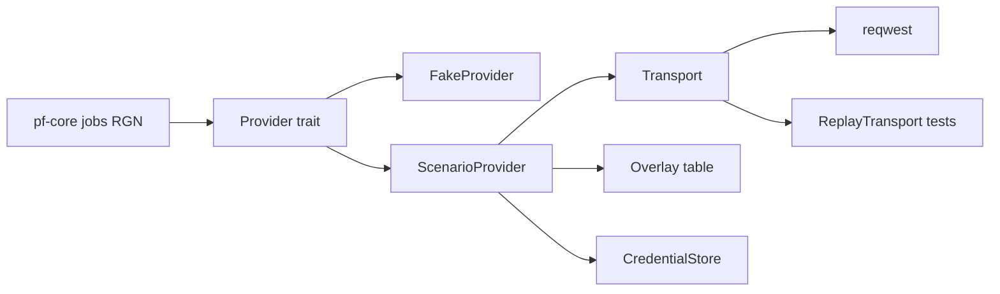

# Provider adapter (Scenario + fake)

## 1. Summary
The `pf-provider` crate implements the [ADR 0001](../architecture/adr/0001-provider-integration.md) adapter (#14). It has two implementations: **Scenario** over REST, and a deterministic **fake provider** that is the default in tests and dev (KQ-24, AGENTS §3.7). It owns credentials (KQ-05), model capabilities plus the per-model overlay (#15), error normalisation, the polling schedule, automatic uploads (#20) and the fixture recording format. [region-edit](region-edit.md) consumes it through generic types only.

## 2. Scope
Tier S ([feature-tiers](../feature-tiers.md)): "Localised edit of a masked region via Scenario" and "Visible job status and cost; user-controlled retry", provider side only. Only `edit_masked` is implemented and tested. The other ADR operations exist in the request type but return `invalid_request(operation)` until their tier.

## 3. Goals
- Keep RGN and the UI free of Scenario concepts. Swap fake ⇄ Scenario with no other code change.
- The secret never leaves the Rust core and never appears in logs.
- Masks reach every model in that model's documented convention, with a test per convention.
- CI never spends credits. Real calls only happen in an explicit manual mode.

## 4. Non-goals
- Model browsing/search and text-to-image (tier A). MCP or the TS SDK (#14). Webhooks.
- Job request composition, the spend cap and confirmation (#23), the job lifecycle UI: all RGN.
- Persisting jobs and candidates (PRJ). Deleting provider-side uploads (OQ-PRV-06 → keep).

## 5. User stories
- As a DM preparing a session, I enter my Scenario key once and never think about it again.
- I never manage uploads or provider assets. A missing upload is silently re-sent (#20).
- When something fails, I see *why* (auth, balance, offline, provider error) and decide whether to retry.
- As a developer, I run the whole loop offline with the fake provider and get the same candidates every time.

## 6. Functional requirements
| ID | Requirement (testable) |
|---|---|
| FR-PRV-01 | The `Provider` trait has exactly the nine ADR 0001 operations, with generic inputs and outputs. Scenario types are `pub(crate)` in a `scenario` module. |
| FR-PRV-02 | Mode comes from `PF_PROVIDER=fake\|scenario`. Debug and test builds default to `fake`, release builds to `scenario` (OQ-PRV-20). `provider_status` reports the mode. |
| FR-PRV-03 | Fake: the same request + seed gives byte-identical candidates. Masked pixels are replaced by a seed-derived pattern and unmasked pixels are left unchanged. |
| FR-PRV-04 | Fake cases: `success`, `slow(n)`, `failure`, `auth`, `insufficient_balance`, `rate_limited_once`, `offline`, `asset_missing_once`, `estimate_unknown`, `not_cancellable`. Set by `PF_FAKE_CASE` or `provider_fake_set_case`. Default `success`. |
| FR-PRV-05 | The fake opens no network connection (tested with a transport that panics on use). |
| FR-PRV-06 | The key and secret are stored only in the OS credential store under target `pocket-forge/scenario`. Nothing goes to `PF_DATA_DIR`, the library, the repo or logs. |
| FR-PRV-07 | No command returns the secret. `provider_status` exposes `configured` plus the last 4 characters of the key id. |
| FR-PRV-08 | `Secret` redacts `Debug`/`Display` and has no `Serialize`. A log capture over a full fake + replay job (including every error case) contains neither the key, the secret nor an `Authorization` header. |
| FR-PRV-09 | The auth header is sent only to the API base host, never to signed or presigned URLs. |
| FR-PRV-10 | The normaliser maps `inputs[]` to controls (int, float, enum, bool, string, seed, image, mask) with min/max/step/allowed/default/cost-affecting. It accepts both `required.conditional` and `conditionalValues`. An unknown type → control omitted + warning. Unknown fields are ignored, and malformed JSON → an error, never a panic. |
| FR-PRV-11 | Masked edit is offered only if an overlay row gives the model a mask convention **and** its capabilities list a mask input (#15). Each overlay row has a fixture test. |
| FR-PRV-12 | Masks are converted from canonical (8-bit, white = edit, region-sized) to the model's convention: `alpha_transparent_edit` (RGBA), `white_edit` or `black_edit` (L8). The output is a PNG of the same size. One golden test per convention. |
| FR-PRV-13 | Input over the capability limits (px, bytes) → `invalid_request(field)`, with zero network calls. |
| FR-PRV-14 | Upload < 4 MB → `POST /assets` (base64, `hide: true`). ≥ 4 MB → `/uploads` multipart (parts ≥ 5 MB) + complete. Returns an opaque provider asset ref. |
| FR-PRV-15 | Re-upload: if estimate/submit reports a referenced asset as missing, re-upload from the caller's local bytes once and retry once. New refs are returned for the job record. A second failure → `invalid_request`. No user-visible step (#20). |
| FR-PRV-16 | `estimate` uses `?dryRun=true` and never sets `ipDetection`. HTTP 269 → `Cost{amount, unit:"CU"}`. No cost field → `Unknown`. |
| FR-PRV-17 | `submit` maps the generic request to the body through the overlay's input names and returns a job handle. It is never retried once request bytes were sent. Insufficient balance → its distinct error. |
| FR-PRV-18 | Status map: `queued`/`warming-up`/`pending` → `queued`; `in-progress`/`finalizing` → `running`; `success` → `succeeded`; `failure` → `failed`(hint); `canceled` → `canceled`. Progress is clamped to 0–1. Cost comes from `billing.cuCost` when present. |
| FR-PRV-19 | `poll_delay(elapsed, last_error)` is pure: 2 s for the first 30 s, then +2 s per poll up to 10 s. `rate_limited` → max(retry_after, schedule). Offline → 10 s, state `unknown`. `long_running(elapsed)` is true from 180 s. Polling never resubmits (OQ-PRV-05). |
| FR-PRV-20 | `cancel` → `POST /jobs/{id}/action`. "Not cancellable" → an ack `NotCancellable`, not an error. |
| FR-PRV-21 | `fetch_candidates`: job asset ids → `GET /assets/{id}` → download the signed URL. On 403/404, re-resolve once. Returns bytes + metadata (asset id, seed, inputs). |
| FR-PRV-22 | `balance` = plan remaining + one-shot remaining, plus the period end. No team id, or 401/403 → `Unknown` (OQ-PRV-09). |
| FR-PRV-23 | Errors are normalised per the §10 table. Each row has a test. Error text never contains request headers. |
| FR-PRV-24 | Idempotent calls (GET, upload, dry run) retry on `offline`, `timeout`, 429 and 5xx: at most 3 attempts, 1/2/4 s, honouring `Retry-After` (cap 30 s). Timeouts: 60 s per request, 120 s per upload part. |
| FR-PRV-25 | `list_models` returns masked-edit-capable models only (tier S). The last good list + capabilities are cached. Offline → cached data with `stale: true`. A corrupt cache is deleted and refetched. |
| FR-PRV-26 | Each job yields a KQ-17 record: the final prompt, generic inputs, the provider request body (redacted), seed (or `none`), the capability snapshot, refs and cost. |
| FR-PRV-27 | Recordings follow the §8 format. The recorder strips auth, replaces ids and signed URLs with placeholders, and replaces binaries with generated-fixture refs. All recordings pass `check-hygiene.sh`. |
| FR-PRV-28 | Real calls need `PF_PROVIDER=scenario` + credentials. Real-call tests need cargo feature `real-call` + `PF_REAL_CALL=1`, and CI fails if either is set. The recorder spends only with `--allow-spend <CU>`. |

## 7. UI/UX notes
- **Provider settings** (`app/src/features/provider/`): key and secret as password fields (cleared after Save), Save, Clear, Test connection, optional team/project id. `data-testid="prv-settings-*"`.
- **Status chip** in the header: `Fake provider` (always visible in fake mode) · `Scenario · ok` · `offline` · `auth error` · `not configured`, plus the balance (`1,234 CU` or `unknown`).
- States: *not configured* → the chip links to settings, and RGN disables submit. *Offline* → cached models are shown as stale. *Auth error* → link to settings. Job states are RGN's UI.

## 8. Data and file effects
| What | Where | Recoverable |
|---|---|---|
| Key + secret | OS credential store, `pocket-forge/scenario` | Re-enter |
| Team id, project id | `<PF_DATA_DIR>/provider.json`, temp + rename (OQ-PRV-13) | Defaults if corrupt |
| Model list + capabilities | `<PF_DATA_DIR>/cache/provider/` | Rebuildable cache |
| Job provider fields (FR-PRV-26) | Job record, stored by PRJ (OQ-PRV-12) | With the project |
| Fixtures | `fixtures/provider/<model>/<case>.json`; images from a committed generator (KQ-22) | Repo |

PRV writes nothing into the library. **Recording format:** `{format_version, provider, model, case, recorded_on, source: recorded|synthetic, exchanges: [{request: {method, path, query, body}, response: {status, headers (subset), body}}]}`. Ids become `<team-id>`/`<asset-N>`, URLs become `fake://asset/N`, and image bytes become `{"fixture": "<name>.png"}`.

## 9. Commands and events
| Command (pf-core) | Input → result | Errors |
|---|---|---|
| `provider_status` | — → {mode, configured, key_suffix?, connectivity} | — |
| `provider_credentials_set` | {key, secret}, trimmed, 1–256 chars → ok | `invalid_input`, `store_unavailable` |
| `provider_credentials_clear` | — → ok (idempotent) | `store_unavailable` |
| `provider_test_connection` | — → ok (one free `GET /models`) | `auth`, `offline`, `timeout` |
| `provider_settings_get` / `_set` | {team_id?, project_id?} | `invalid_input`, `io` |
| `provider_list_models` | {operation} → [{id, name, operations}], stale | normalised errors |
| `provider_get_capabilities` | {model_id} → capabilities + warnings | `invalid_request(model_id)`, normalised |
| `provider_balance` | — → {remaining, unit, period_end} \| unknown | never fails (→ unknown) |
| `provider_fake_set_case` | {case} → ok | `not_fake_mode`, `invalid_input` |

- **Event** `provider:status_changed {connectivity}` fires when auth or offline is detected or clears.
- RGN gets the trait operations and `poll_delay`/`long_running` as a Rust API. Job commands and events are RGN's (OQ-PRV-19).

## 10. Provider interaction

- Lifecycle per ADR 0001: estimate → (RGN confirm) → submit → poll → fetch. Uploads happen inside estimate/submit, and the refs are returned for caching.
- **Overlay rows** (Scenario docs, #15): GPT Image 2/2.5 `alpha_transparent_edit`; Ideogram 4.5 / 4.5 Precise Edit `white_edit`; Ideogram V3 / Character `black_edit`. Each row records the source/mask/prompt/count input names, max px, doc URL and checked date. Exact ids are confirmed by free `GET /models` calls when recording.

| Normalised error | Scenario signal |
|---|---|
| `auth` | 401, 403 on API routes |
| `insufficient_balance` | 402 or a `reason` naming credits/CU |
| `rate_limited(retry_after)` | 429 (+ `Retry-After`) |
| `invalid_request(field)` | 400/404/422, field from `details` |
| `provider_failure(hint)` | 5xx after retries; job `failure` + `hint` |
| `offline` / `timeout` | connect/DNS error / request timeout |

## 11. Edge cases
| Case | Behaviour |
|---|---|
| Crash mid-save | Cache and settings writes are temp + rename. A crash after submit but before the handle is persisted is RGN/PRJ's: mark it `unknown`, never auto-resubmit. |
| Sync conflict / file locked | N/A: PRV writes no synced files. A locked cache → skip the cache write, warn. |
| Offline | Status `unknown`, polling continues at 10 s. Cached models are marked stale. Submit fails fast with `offline`. |
| Provider error / timeout | Normalised (§10). Bounded retries for idempotent calls only (FR-PRV-24). |
| Very large image | Rejected before upload above the model limit (FR-PRV-13). Multipart above 4 MB. |
| Corrupt input / response | A bad mask size or PNG → `invalid_request`. Malformed provider JSON → `provider_failure`, no panic. |
| Credential store unavailable | `store_unavailable`, status `not configured`. No fallback file. |
| Undo across the boundary | N/A: provider calls aren't undoable. A spent job stays recorded. |

## 12. Performance budget
- Adapter overhead < 50 ms per call, excluding network. Capability normalisation < 10 ms.
- Peak memory per job ≤ 3× (region + mask bytes). Candidates are downloaded with up to 4 in parallel.
- Fake jobs: zero wall time under the fake clock in tests, ~2 s per job in dev.

## 13. Test plan
- **Unit (Rust):** normaliser tables incl. malformed and drift fixtures (FR-10), the mask converters' goldens (12), `poll_delay` under a fake clock (19), the error map (23), the retry policy (24), `Secret` redaction (08), fake determinism and cases (03–05).
- **Contract (Rust):** `ScenarioProvider` over `ReplayTransport` per recording. It asserts the requests match the recording (method, path, body shape, no auth on signed URLs) and the generic outputs. It covers upload paths, re-upload (15), dry run, submit, the status sequence, cancel, fetch with an expired URL, and balance.
- **Integration:** the credential store on `windows-latest` with a throwaway target (06); the log capture (08); the cache stale/corrupt paths (25).
- **Thin e2e (Playwright, mocked commands):** settings save/clear/test, the status chip states, the fake badge.
- **Fixtures:** a generated 512 px "room" region + circle masks, synthetic error recordings, and recorded free calls (`get-model`, `dry-run`) per overlay model. No personal art.
- **App walkthrough** (test agent, dev build):
  1. Launch with no env set. → The `Fake provider` chip is shown.
  2. Run a masked edit with case `success`. → Candidates change only inside the mask. Re-running with the same seed gives identical candidates.
  3. `PF_FAKE_CASE=insufficient_balance` → a distinct balance error. `offline` → offline status, and the job resumes after switching to `success`.
  4. `PF_PROVIDER=scenario`, enter a dummy key and secret. → The fields clear, and the status shows `configured ...abcd`. `cmdkey /list` lists `pocket-forge/scenario`.
  5. Test connection. → `auth error` (or `offline`) is shown, with no crash.
  6. Clear. → The credential entry is gone. Searching `.pf-dev/` logs for the dummy secret finds nothing.
- **Manual acceptance (owner, KQ-24):** one real masked edit with a spend cap, then record it with `--allow-spend`.

## 14. Build split
| # | Slice | Shared files | Depends on |
|---|---|---|---|
| 1 | Trait, generic types, errors, `poll_delay`, FakeProvider + cases, context wiring (phase 2 skeleton) | none (crate created by skeleton) | skeleton |
| 2 | CredentialStore + settings + commands + settings UI + status chip | command registry, UI feature registry (append) | 1, OQ-PRV-11 |
| 3 | Transport, auth, error map, retry, normaliser + overlay, list/capabilities/cache, recorder (free calls) | none | 1 |
| 4 | Upload, mask convert, estimate, submit, status, cancel, fetch, balance, re-upload; contract tests | none | 3 |
| 5 | Real-call mode + gated tests + owner's recorded paid fixtures | none | 2, 4 |

## 15. Open questions
| ID | Question | Options (pick in **bold**) | Blocking? | Affects |
|---|---|---|---|---|
| OQ-PRV-11 | New dependency (§3.5) for the OS credential store | **A. `keyring` crate: Credential Manager now, Keychain later, same API** / B. raw `windows` calls behind our trait | Yes (gate) | slice 2 |
| OQ-PRV-12 | Job record fields PRV needs (FR-PRV-26) | **A. PRJ stores them as an opaque `provider` object on the job** / B. PRV keeps a side file | No | [asset-project](asset-project.md), RGN |
| OQ-PRV-13 | Where provider settings live | **A. `<PF_DATA_DIR>/provider.json`, per machine** / B. the library (synced, but leaks account ids into shared folders) | No | [asset-project](asset-project.md) |
| OQ-PRV-14 | Dispatch shape | **A. An `AnyProvider` enum, no new dependency** / B. `dyn Provider` + the `async-trait` crate (new dependency) | No | context seam |
| OQ-PRV-15 | Fake level | **A. Generic-level fake + `ReplayTransport` for Scenario contract tests** / B. fake HTTP only (more realistic, hard to script cases) | No | tests |
| OQ-PRV-16 | Mask conversion location | **A. `pf-provider`, using `png` (#32) directly** / B. pf-core via pf-imaging (keeps the crates leaf-pure but leaks conventions into the core) | No | §9 deps |
| OQ-PRV-17 | Team id for balance (unverified research) | **A. An optional setting; absent → `unknown`** / B. auto-discovery (no endpoint confirmed) | No | — |
| OQ-PRV-18 | Overlay format | **A. A static Rust table (compile-checked)** / B. a JSON file (editable, but needs schema checks) | No | — |
| OQ-PRV-19 | Seam: who runs the poll loop | **A. PRV gives `status` + `poll_delay`; RGN's job runner owns the loop and persistence** / B. a PRV `wait_for_job` loop with callbacks | No | [region-edit](region-edit.md) |
| OQ-PRV-20 | Default mode in release builds (§9 says fake outside manual runs) | **A. Release defaults to `scenario`; dev/test default to fake** / B. always fake unless `PF_PROVIDER` is set | No | AGENTS §9 |
| OQ-PRV-21 | Glossary candidates | **A. Add *Fake provider*, *Mask convention*, *Provider asset ref*, *Model overlay*, *Balance*** / B. keep them spec-local | No | glossary |
