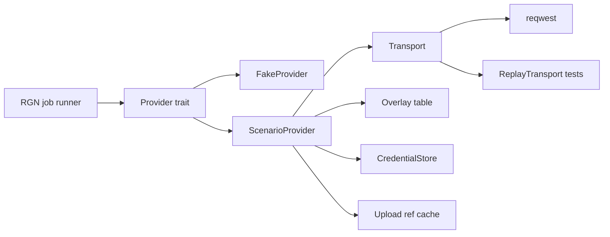

# Provider adapter (Scenario + fake)

## 1. Summary
The `pf-provider` crate implements the [ADR 0001](../architecture/adr/0001-provider-integration.md) adapter (#14). It has two implementations: **Scenario** over REST, and a deterministic **fake provider**, the default in dev and test builds (KQ-24, AGENTS §3.7). It owns credentials (KQ-05), the full **model capabilities** normaliser plus the **model overlay** (#15, #37), mask polarity conversion, error normalisation, the poll schedule, uploads (#20, R15) and the recording format. [region-edit](region-edit.md) (RGN) and [new-asset-generation](new-asset-generation.md) (GEN, the `generate` operation, #60) consume it through generic types only.

## 2. Scope
Tier S ([feature-tiers](../feature-tiers.md)): "Localised edit of a masked region via Scenario", "Visible job status and cost; user-controlled retry" (provider side) and "Model capability discovery (controls reflect the model)" in full (#37). Reference inputs for [reference-packs](reference-packs.md) (#51): FR-PRV-31–35. `edit_masked` and, for [new-asset-generation](new-asset-generation.md) (#52, #60), `generate` are implemented (FR-PRV-36–39). The other ADR operations exist in the request type but return `invalid_request(operation)` until their tier.

## 3. Goals
- Keep RGN and the UI free of Scenario concepts; swap fake ⇄ Scenario with no other code change. The controls RGN shows are exactly the selected model's inputs, conditional rules included (#37).
- The secret never leaves the Rust core and never appears in logs. CI never spends credits; real calls need an explicit manual mode.
- Masks reach every model in its **mask convention**, with a golden per convention and soft rule.

## 4. Non-goals
- Model browsing/search (tier A). Text-to-image beyond GEN's `generate` operation (#60). Choosing, preparing and recording references (REF; PRV only maps and uploads them, FR-PRV-31–35). MCP or the TS SDK (#14). Webhooks.
- The poll loop and job persistence (RGN, R14). Mask padding, fit resampling and validation (RGN, R1). Job request composition, the spend cap and confirmation (#23), job and candidate commands (RGN, R4).
- Persisting jobs, candidates and settings (PRJ). Deleting provider-side uploads (OQ-PRV-06 → keep).

## 5. User stories
- As a DM preparing a session, I enter my Scenario key once and never manage uploads (#20). When something fails, I see *why* (auth, balance, offline, provider error) and decide whether to retry.
- As a developer, I run the whole loop offline with the fake provider and get the same candidates every time.

## 6. Functional requirements
| ID | Requirement (testable) |
|---|---|
| FR-PRV-01 | The `Provider` trait has exactly the nine ADR 0001 operations, with generic inputs and outputs, dispatched through an `AnyProvider` enum (OQ-PRV-14). Scenario types are `pub(crate)` in a `scenario` module. |
| FR-PRV-02 | Mode comes from `PF_PROVIDER=fake\|scenario`. Debug and test builds default to `fake`, release builds to `scenario` (OQ-PRV-20, #40). `provider_status` reports the mode. |
| FR-PRV-03 | Fake: three edit models, one per mask convention (plus two generate models, FR-PRV-39), whose capabilities are committed fixtures run through the real normaliser. The same request + seed gives byte-identical PNG candidates. Masked pixels get a seed-derived pattern; unmasked pixels are unchanged. |
| FR-PRV-04 | Fake cases are listed in [Appendix D](#appendix-d-fake-cases), including `bad_candidate`, `aspect_mismatch(pct)`, `offset(levels)`, `canceled`, `slow(n)` (R17), `submit_failure` and `submit_timeout` (R48, R49). Set by `PF_FAKE_CASE` or `provider_fake_set_case`. Default `success`. Each case has a test. |
| FR-PRV-05 | The fake opens no network connection (tested with a transport that panics on use). |
| FR-PRV-06 | The key and secret are stored only in the OS credential store (`keyring`, #38) under target `pocket-forge/scenario`. Nothing goes to `PF_DATA_DIR`, the library, the repo or logs. |
| FR-PRV-07 | No command returns the secret. `provider_status` exposes `configured` plus the last 4 characters of the key id. |
| FR-PRV-08 | `Secret` redacts `Debug`/`Display` and has no `Serialize`. A log capture over a full fake + replay job (including every error case) contains neither the key, the secret nor an `Authorization` header. |
| FR-PRV-09 | The auth header is sent only to the API base host, never to signed or presigned URLs. |
| FR-PRV-10 | The normaliser maps every `inputs[]` entry to a generic control (int, float, enum, bool, string, seed, image, mask) with a `role` (`source \| mask \| prompt \| candidate_count \| seed \| reference \| background \| other`; from the overlay row for the requested operation where Scenario doesn't say, R28, #60) and min/max/step/allowed/default/required/cost-affecting, and `required.conditional` (a list, a map, or the map wrapped as `{values: {input: [values]}}` as real models send it) and `conditionalValues` to generic `rules[]` ([Appendix C](#appendix-c-generic-shapes)). `required.ifDefined` / `ifNotDefined` on a source or mask input is met by construction (the adapter always sends both); on any other input it is a warning and the control is optional. Inputs the overlay fills (`fixed`, `size_inputs`, `aspect_input`) never become controls, and rules on them are dropped. An unknown type → control omitted + warning; if that input is required, the model isn't offered. Unknown fields are ignored; malformed JSON → an error, never a panic. |
| FR-PRV-11 | Masked edit is offered only if an overlay row gives the model a mask convention **and** its `inputs[]` hold a mask input (`maskFrom`) and a source input (#15). Scenario's `capabilities[]` list is not read: the real models list `txt2img`/`img2img` and never `inpaint` (recorded 2026-11-08). Each overlay row has a fixture test over its recorded `get-model`, and a test that removing the mask input withdraws the offer. (#60) This holds for `edit_masked` only: `generate` reads `capabilities[]` for `txt2img` (FR-PRV-36). |
| FR-PRV-12 | Mask conversion is **polarity only** (R1). Input: the canonical mask (L8, white = edit) at exactly the size of the sent image (the outer rect after fit), already padded and resampled by RGN; any other size → `invalid_request(mask)`. Output: a PNG of the same size in the row's convention, applying its `soft` rule (`pass-through` \| `threshold(128)`). `alpha_transparent_edit` masks are RGBA carrying the sent image's RGB. One golden per convention × soft rule. |
| FR-PRV-13 | Backstop for RGN's `input_too_large` pre-check (R20): in `estimate` and `submit`, before any network call, a sent image outside `input_px{min,max,multiple_of}` or a converted file over `max_bytes` → `invalid_request(image\|mask)`, with zero network calls. |
| FR-PRV-14 | Upload < 4 MB → `POST /assets {name, image: data URL, hide: true}` → `asset.id`. ≥ 4 MB → multipart per the Appendix C *Upload flow*: `POST /uploads` (parts of 5 MB, `assetOptions.hide`); `PUT` each presigned part (no auth, FR-PRV-09); `POST /uploads/{id}/action {action: "complete"}`; poll `GET /uploads/{id}` until it names its asset (`entityId`), waiting 1 s doubling to 8 s, at most 60 s, inside the calling estimate or submit. `failed` → `provider_failure(errorMessage)`; a timeout, or a finished upload with no `entityId` → `provider_failure` naming the last status. Each converted file is uploaded **at most once per content hash** (`sha2`) per session; the in-memory ref cache is cleared on a mode or credential change (R15). |
| FR-PRV-15 | Re-upload: if estimate/submit reports a referenced asset as missing, PRV re-converts the caller's as-sent bytes, re-uploads once and retries once. New refs go into `provider.asset_refs`. A second failure → `invalid_request(image\|mask)`. No user-visible step (#20). |
| FR-PRV-16 | `estimate` uses `?dryRun=true` and never sets `ipDetection`. HTTP 269 → `Cost{amount, unit:"CU"}`; no cost field → `Unknown`. If the overlay row's `dry_run_assets` is `false` (set from a recorded free dry run), estimate uploads nothing and uploads wait for submit; if `true`, estimate uploads (FR-PRV-14 dedupes) (R15). |
| FR-PRV-17 | `submit` maps the generic request to the body through each control's `role` and input name (R28), then adds the overlay row's `fixed` values and sets its `size_inputs` to the sent size (for `generate`, to the requested output, FR-PRV-37). A source on an array input is sent as `[ref]`. A model with no candidate-count input gets no count control and returns **one result per job**; RGN sends `candidate_count: 1` (R72). It returns `provider{}` with `job_handle` set. It is never retried once request bytes were sent. Insufficient balance → its distinct error. **Unconfirmed submit** (R102, R106): after the request is sent, any answer that isn't a clear refusal (the transfer interrupted after the connection opened, any 5xx, a 2xx without `jobId` or with an unreadable body) → `timeout`, because the job may exist and be billed (RGN → `lost`, FR-RGN-23). A connect failure stays `offline`. |
| FR-PRV-18 | `status` maps Scenario states per [Appendix C](#appendix-c-generic-shapes). Progress is clamped to 0–1. Cost comes from `billing.cuCost` when present. |
| FR-PRV-19 | `poll_delay(elapsed, last_error)` is pure: 2 s for the first 30 s, then +2 s per poll up to 10 s. `rate_limited` → max(retry_after capped at 30 s, schedule) (R102). Offline → 10 s, state `unknown`. `long_running(elapsed)` is true from 180 s. PRV runs no loop and has no total timeout; RGN's runner polls until terminal (R14). Polling never resubmits (OQ-PRV-05). |
| FR-PRV-20 | `cancel` → `POST /jobs/{id}/action`. "Not cancellable" → the ack `not_cancellable`, not an error. |
| FR-PRV-21 | `fetch_candidates`: job asset ids → `GET /assets/{id}` → download the signed URL. On 403/404, re-resolve once. Returns the bytes untouched + `provider_meta` (asset id, seed, inputs). |
| FR-PRV-22 | `balance` = plan remaining + one-shot remaining, plus the period end. No team id, or 401/403 → `unknown` (OQ-PRV-09). |
| FR-PRV-23 | Errors are normalised per the Appendix C error map. `estimate` and `submit` can return every normalised error. Each row has a test. Error text never contains request headers. |
| FR-PRV-24 | Idempotent calls (GET, upload, dry run) retry on `offline`, `timeout`, 429 and 5xx: at most 3 attempts, 1/2/4 s, honouring `Retry-After` (cap 30 s; a huge value never panics, R102). Timeouts: 60 s per request, 120 s per upload part. A transport error after the connection opened (reset, body read error) is *interrupted*: retried like `offline` on idempotent calls, then `offline`; on submit and cancel, which are sent once, it is `timeout` (FR-PRV-17, R106). |
| FR-PRV-25 | `list_models{operation}` returns the models offering that operation: `edit_masked` per FR-PRV-11, `generate` per FR-PRV-36 (#60). It returns one entry per model, whose `operations[]` lists every operation the model offers (R76). An operation no overlay row has (upscale, …) returns an empty list with no network call. The last good list + capabilities (per model and operation) are cached (cache v3; `capabilities` keyed by the model id for `edit_masked`, `<model>@generate` for `generate`; an older version is dropped and refetched, R76). Offline → cached data with `stale: true`. A corrupt cache is deleted and refetched. |
| FR-PRV-26 | The only provider-specific data on a job is the opaque `provider{}` ([Appendix B](#appendix-b-provider-on-the-job-record)), returned by `submit`/`estimate`/`fetch_candidates` for RGN to persist verbatim (R2). The core asks `pf_provider::has_job_handle(provider)` whether a handle is saved (polling can go on without a new submit) and reads no field itself (R106). The generic KQ-17 fields come from PRV's generic outputs; the capability snapshot is the serialised generic capabilities. |
| FR-PRV-27 | Recordings follow [Appendix A](#appendix-a-recording-format). The recorder strips auth, replaces ids and signed URLs with placeholders, and binaries with generated-fixture refs. All recordings pass `check-hygiene.sh`. Recordings are `ScenarioProvider` replay only (R17). |
| FR-PRV-28 | Real calls need `PF_PROVIDER=scenario` + credentials. `pnpm dev:real` sets it with the usual `.pf-dev/` isolation, prints a REAL PROVIDER banner and refuses to run under CI. While Scenario is active, the UI shows the real-credits badge (§7). Real-call tests need cargo feature `real-call` + `PF_REAL_CALL=1`; CI fails if either is set, and `check-hygiene.sh` fails if a workflow mentions them. The recorder (`pf-record`) has free cases (`get-model`, `dry-run`, and `dry-run-generate` for every model with a generate row, R76) and one paid case (`masked-edit`): it needs `--allow-spend <CU>`, is refused when the estimate is unknown or over the cap, prints a mask-polarity verdict per candidate and keeps candidates outside tracked files. Owner runbook: [real-provider](../guides/real-provider.md). |
| FR-PRV-29 | Team and project ids are read and written only through PRJ's `settings_get/put` as the `provider` section of `<data-dir>/settings.json` (R8). PRV writes no settings file of its own. |
| FR-PRV-30 | `Capabilities::evaluate(values)` is pure and applies `rules[]`: it returns the visible controls, their effective allowed values and required flags, and per-control errors. RGN uses it at its command boundary (#37). |
| FR-PRV-31 | (#51) Each `slots[]` entry (derived from a control with `role: reference`, R31) has `name`, `role` (`style\|structure\|identity` from the overlay row's `slot_roles`, else null), `min` (1 if required, else 0), `max` (`file` → 1; `file_array` → the input's `max`, else its `maxLength` (what real models send), else the overlay row's `slot_max`, else 1 with a warning), `cost_affecting` (from `costImpact`) and `array` (`file_array` → true: the body sends a list, R49). One fixture test per overlay row. |
| FR-PRV-32 | (#51) A model with a required reference slot **is offered** (amends FR-PRV-10/11/25 and Appendix C). It is no longer blocked; meeting `min` is the caller's job (FR-REF-18). |
| FR-PRV-33 | (#51) `JobRequest.references[]` = `{slot, role?, bytes, hash}`, bytes as sent (PNG/JPEG/WebP). In `estimate` and `submit`, before any network call: an unknown slot, a count outside `min`–`max`, a file over `max_bytes` or an unsniffable format → `invalid_request(reference)` with zero network calls (backstop, as FR-PRV-13). The body sets each slot's input to its asset refs, in request order: an array for `file_array`, one ref for `file`. Slots with no references are omitted. |
| FR-PRV-34 | (#51) References are uploaded with purpose `reference` through FR-PRV-14 (at most once per `hash` per session) and covered by the re-upload of FR-PRV-15. With `dry_run_assets: true`, estimate uploads them too. Their refs go into `provider{}.asset_refs.references` (Appendix B). |
| FR-PRV-35 | (#51) Fake slots: `fake-white-edit` gains `style_refs` (`file_array`, max 3, not cost-affecting); `fake-black-edit` gains `style_refs` (max 2, cost-affecting: +1 CU per ref in the fake estimate) and `identity_ref` (`file`, optional); `fake-alpha-edit` has none. Fake candidates mix the ordered reference hashes into the seed pattern, so different references give different candidates. With no references, candidates are byte-identical to before (FR-PRV-03 goldens unchanged). The fake exposes the last request's reference hashes to tests. |
| FR-PRV-36 | (#60, R76) **Operation `generate`.** `get_capabilities(model_id, operation)` normalises the model through its overlay row for that operation (one row per model and operation; roles, `fixed` values, size inputs and slot roles may differ per operation). `generate` is offered only if the model has a generate row **and** its Scenario `capabilities[]` lists `txt2img`. Its source and mask inputs are dropped: never controls, never sent, and `required.ifDefined` on them never applies. A generate job sends no source and no mask (`region_png`/`mask_png` empty) and reuses estimate, submit, status, cancel and fetch on the same route (`POST /generate/custom/{modelId}`). A model with no row for the operation → `invalid_request(operation)` (the fake: `invalid_request(model_id)`). The 5 pf-core call sites pass `edit_masked`; `provider_get_capabilities` takes an optional `operation`, default `edit_masked` (R76). |
| FR-PRV-37 | (#60, R76) **`output_size`** (generate only): `{mode: wh, min, max, step}` from the row's width input (`min`/`max`/`step`; the row's `input_px` where the model lists none), or `{mode: aspect, allowed[]}` = the row's ratio input's `w:h` values (non-ratio values such as `auto` and `source` are dropped). A row whose size input the model doesn't list → a warning and generate not offered. The inputs behind it are never controls. `JobRequest.output` is `{mode: wh, w, h}` or `{mode: aspect, aspect}`; estimate and submit check it before any network call (`wh`: both sides within `min`–`max` and multiples of `step`; `aspect`: an allowed ratio; missing or the wrong mode → `invalid_request(output)`, zero network calls), and the body sets the row's size inputs or ratio input from it. |
| FR-PRV-38 | (#60, OQ-GEN-05/07) **`structure` and `background`** (generate only): `structure` is `{slot}` when the row names a sketch slot and the model lists it, else null; the sketch is the caller's first reference in that slot (sent in request order, FR-PRV-33). It is null on every real row until a paid check confirms one. Controls the row marks `background` get that role; whether `transparent` is offered is read from their allowed values. |
| FR-PRV-39 | (#60, R76) **Fake generate models**: `fake-gen-wh` (`wh` 64–2048 step 16, count 1–4, `background` `opaque`/`transparent`, one `refs` slot ≤ 4 that is also the sketch slot, cost-affecting: +1 unit per image) and `fake-gen-aspect` (ratios 1:1, 3:4, 4:3, 2:3; no count; `style_refs` ≤ 2, style), plus `fake-gen-refs` (as `fake-gen-wh` with `refs` ≤ 12, so a sketch + 8 references fit; PRM §13 step 7). Their capabilities are committed fixtures through the real normaliser. Candidates are a deterministic pattern from the seed, the final prompt and the ordered reference hashes (sketch included), at the requested size (`aspect`: long side 1024); `transparent` → RGBA with an opaque disc and alpha 0 around it. No count input → `candidate_count` must be 1, else `invalid_request(candidate_count)`. Every Appendix D case applies; jobs survive an app restart (R48). |

## 7. UI/UX notes
- **Provider settings** (`app/src/features/provider/`): key and secret as password fields (cleared after Save), Save, Clear, Test connection, optional team and project id. Test ids `prv-settings-key|secret|team|project|save|clear|test`.
- **Status chip**, a status-bar segment (`prv-status-chip`, ui-guidelines): `Fake provider` (always visible in fake mode) · `Scenario · ok` · `offline` · `auth error` · `not configured`, plus the balance (`1,234 CU` or `unknown`). States: *not configured* → the chip links to settings and RGN disables submit. *Offline* → cached models shown as stale. *Auth error* → link to settings. *Loading*: Test connection shows a spinner. Job states and controls are RGN's UI.
- **Real-credits badge** (`prv-status-real`, `data-cap-set`), next to the chip, shown only in Scenario mode: `Real credits · cap 12 / 50 CU`, or `Real credits · no spend cap yet` until RGN's spend cap is set. It updates on `rgn:spend` (FR-PRV-28).

## 8. Data and file effects
Field tables live in [manifest-schema](../architecture/manifest-schema.md) (PRJ). PRV needs:

| What | Where | Recoverable |
|---|---|---|
| Key + secret | OS credential store, `pocket-forge/scenario` | Re-enter |
| `provider{team_id?, project_id?}` | `provider` section of `<data-dir>/settings.json`, PRJ's atomic writer (R8) | Corrupt → defaults + warning (PRJ) |
| Model list + capabilities | `<data-dir>/cache/provider/`, temp + rename | **Local cache**, rebuildable |
| Upload ref cache | memory, per session | Rebuilt by re-upload (#20) |
| `provider{}` on the job | `jobs/<id>/job.json`, opaque to PRJ/RGN, inner shape in Appendix B | With the project |
| Job inputs | `jobs/<id>/region.png` + `mask.png` as sent (after fit, before polarity conversion, R2); PRV gets the bytes from RGN and never opens project files | With the project |
| Reference inputs | bytes prepared by REF (FR-REF-21/22), recorded as hashes on the job (`references[]`, FR-REF-25); PRV never opens pack or project files | Hashes with the project; the files are the user's |
| Fixtures | `fixtures/provider/<model>/<case>.json`; images from a committed generator (KQ-22) | Repo |

PRV writes nothing into the library.

## 9. Commands and events
| Command (pf-core) | Input → result | Errors |
|---|---|---|
| `provider_status` | — → {mode, configured, key_suffix?, connectivity} | — |
| `provider_credentials_set` | {key, secret}, trimmed, 1–256 chars → ok | `invalid_input`, `store_unavailable` |
| `provider_credentials_clear` | — → ok (idempotent) | `store_unavailable` |
| `provider_test_connection` | — → ok (one free `GET /models`) | `not_configured`, `auth`, `offline`, `timeout` |
| `provider_settings_get` / `_set` | {team_id?, project_id?} (≤ 64 chars, `[A-Za-z0-9_-]`) | `invalid_input`, PRJ settings errors passed through |
| `provider_list_models` | {operation} → [{id, name, operations}] (every operation each model offers, R76), stale | normalised errors (cache returned when offline) |
| `provider_get_capabilities` | {model_id, operation? (default `edit_masked`, R76)} → capabilities + warnings (Appendix C) | `invalid_request(model_id\|operation)`, normalised |
| `provider_balance` | — → {remaining, unit, period_end} \| unknown | never fails (→ unknown) |
| `provider_fake_set_case` | {case} → ok | `not_fake_mode`, `invalid_input` |

- **Event** `provider:status-changed {connectivity}` fires when auth or offline is detected or clears.
- RGN gets the trait operations, `poll_delay`/`long_running` and `Capabilities::evaluate` as a Rust API. These are the only model and capability commands (R4); job and candidate commands are RGN's (GEN's for `generate`, through RGN's runner).

## 10. Provider interaction

- Lifecycle per ADR 0001 (both operations): estimate → (RGN/GEN confirm) → submit → status (RGN polls with `poll_delay`) → fetch. Uploads happen inside estimate/submit only (R15); RGN never calls `upload`.
- Errors are normalised per the map in [Appendix C](#appendix-c-generic-shapes), which also holds the overlay rows, the status map and the generic shapes. Exact model ids are confirmed by free `GET /models` calls when recording.

## 11. Edge cases
| Case | Behaviour |
|---|---|
| Crash mid-save | Cache writes are temp + rename; settings use PRJ's writer. A crash after submit but before the handle is saved is RGN/PRJ's: the job becomes `lost` (R2), never auto-resubmitted. |
| Sync conflict / file locked | N/A: PRV writes no synced files. A locked cache → skip the cache write, warn. |
| Offline | Status `unknown`, poll delay 10 s. Cached models are marked stale. Estimate and submit fail fast with `offline`. |
| Provider error / timeout | Normalised (Appendix C). Bounded retries for idempotent calls only (FR-PRV-24). |
| Very large image | Rejected before upload (FR-PRV-13). Multipart at ≥ 4 MB. |
| Corrupt input / response | Bad mask size or PNG → `invalid_request`. Malformed provider JSON → `provider_failure`, no panic. |
| Model drift | A new input type → omitted + warning; a new required unknown input → model not offered (FR-PRV-10). |
| Credential store unavailable | `store_unavailable`, status `not configured`. No fallback file. |
| Undo across the boundary | N/A: provider calls aren't undoable. A spent job stays recorded. |

## 12. Performance budget
- Adapter overhead < 50 ms per call, excluding network. Capability normalisation and `evaluate` < 10 ms. Peak memory per job ≤ 3× (sent image + mask bytes). Candidates are downloaded up to 4 in parallel.
- Fake jobs: zero wall time under the fake clock in tests, ~2 s per job in dev.

## 13. Test plan
- **Unit (Rust):** the normaliser over every input type and `role` (R28), both conditional forms, malformed and drift fixtures (FR-10); slot `min`/`max`/`role` per overlay row and a required slot offered (31, 32); reference backstops with zero network (33); fake reference determinism (35); `evaluate` rule tables (30); mask goldens per convention × soft rule, plus the wrong-size error (12); limit backstops with zero network (13); `poll_delay` under a fake clock (19); the error map (23); the retry policy (24); `Secret` redaction (08); fake determinism and every case (03–05); generate (`fr_gen_*`, R76): the generate rows against the recordings (exactly the 7 `txt2img` models; output size, count, transparency, slots, null sketch slot per row), ratio parsing, source/mask/size inputs never controls, the output backstop with zero network, and the fake generate models (size, determinism, alpha disc, cost, cases, restart) (36–39).
- **Contract (Rust):** `ScenarioProvider` over `ReplayTransport` per recording: requests match (method, path, body shape, no auth on signed URLs) and so do the generic outputs. Covers both upload paths (multipart: pending → validating → imported + `entityId`; slow validation with backoff; `failed` + `errorMessage`; timeout; finished without an id), upload once per hash (14), re-upload (15), a body with style + identity references and their upload dedupe (33, 34; synthetic two-slot model, since the real Character has one identity file), the real Character's single required identity, generate bodies (GPT size/count/background/references, V3 ratio + style references; no source or mask upload) and `list_models{generate}` over every recorded `get-model` (36–38; synthetic until the owner's `dry-run-generate` recordings), dry run with and without assets (16), submit, the status sequence, cancel, fetch with an expired URL, and balance.
- **Integration:** the credential store on `windows-latest` with a throwaway target (06); the log capture (08); the cache stale/corrupt paths (25); settings through a fake PRJ settings store (29). **Thin e2e** (Playwright, mocked commands): settings save/clear/test, the chip states, the fake badge.
- **Fixtures:** a generated 512 px "room" image with disc and ramp masks, synthetic error recordings, and the owner's recorded free calls (`get-model`, `dry-run`, 2026-11-08) per overlay model; the multipart upload stays synthetic until a real > 4 MB upload is recorded. The fake generate models' `get-model` fixtures (`fake-gen-wh`, `fake-gen-aspect`, `fake-gen-refs`) are synthetic. No personal art.
- **App walkthrough** (test agent, dev build, `PF_DATA_DIR` and `PF_LIBRARY_DIR` in `.pf-dev/`):
  1. Launch with no `PF_PROVIDER`. → The `Fake provider` chip is shown.
  2. Masked edit with case `success`. → Candidates change only inside the mask; the same seed gives identical candidates.
  3. `PF_FAKE_CASE=insufficient_balance` → a distinct balance error. `offline` → offline status; the job resumes after switching to `success`.
  4. `PF_PROVIDER=scenario`, enter a dummy key and secret. → Fields clear, the chip shows `configured ...abcd`. `cmdkey /list` lists `pocket-forge/scenario`. Enter a team id → it appears under `provider` in `.pf-dev/…/settings.json`.
  5. Test connection. → `auth error` (or `offline`), no crash.
  6. Clear. → The credential entry is gone. Searching `.pf-dev/` for the dummy secret finds nothing.
- **Manual acceptance (owner, KQ-24):** per [real-provider](../guides/real-provider.md): free recording, then `pf-record --case masked-edit --allow-spend <CU>` per convention (V3 = black, 4.5 = white, GPT = alpha). The polarity verdict is read before the overlay's `soft` and convention picks are marked confirmed.

## 14. Build split
| # | Slice | Shared files | Depends on |
|---|---|---|---|
| 1 | Trait, generic types, errors, `poll_delay`, FakeProvider + fake models + cases, context wiring (phase 2 skeleton) | none (crate created by skeleton) | skeleton |
| 2 | CredentialStore + settings + commands + settings UI + status chip | command registry, UI feature registry (append) | 1, PRJ `settings_get/put` |
| 3 | Transport, auth, error map, retry, normaliser + rules + `evaluate`, overlay, list/capabilities/cache, recorder (free calls) | none | 1 |
| 4 | Mask convert, upload + ref cache, estimate, submit, status, cancel, fetch, balance, re-upload; contract tests | none | 3 |
| 5 | Real-call mode + gated tests + owner's recorded paid fixtures | none | 2, 4 |
| 6 | (#51) Reference slots, required slot offered, references in estimate/submit + uploads, fake slots (FR-PRV-31–35) | none | 4 (REF slice 2) |
| 7 | (#60) `generate` operation, per-operation overlay rows, `output_size` / `structure` / `background`, fake generate models, `dry-run-generate` (FR-PRV-36–39; done as GEN slice 1, R76) | none | 4, 6 |

## 15. Open questions
Closed questions (✅) are in [Appendix E](#appendix-e-closed-open-questions).

| ID | Question | Options (pick in **bold**) | Blocking? | Affects |
|---|---|---|---|---|
| OQ-PRV-22 ✅ | Where the job handle lives. **Answered (R31): inside `provider{}`; job state alone tells whether a handle exists; no `has_handle()`.** R106 adds PRV's `pf_provider::has_job_handle`, so the core still reads no `provider{}` field (FR-PRV-26). / B. a top-level job field mirrored by PRV — A keeps one source of truth; B lets PRJ index it without PRV | No | [asset-project](asset-project.md) (manifest-schema) |

## Appendix A: recording format
`{format_version, provider, model, case, recorded_on, source: recorded|synthetic, exchanges: [{request: {method, path, query, body}, response: {status, headers (subset), body}}]}`. Ids become placeholders: `<asset-N>` (`id` under asset, `assetId(s)`, `entityId`); `<job-N>`, `<upload-N>`, `<team-id>`, `<project-id>`; `<user-N>` (`ownerId`, `userId`, `authorId`, `creatorId`, `createdBy`, `updatedBy`). Email-like strings become `<email>`, signed URLs `fake://asset/N`, and image bytes `{"fixture": "<name>.png"}`. A failed call is saved as `<case>.failed.json` and never replaces a committed recording. `source: synthetic` marks hand-shaped recordings (error cases, multipart upload, the two-slot references body).

## Appendix B: `provider{}` on the job record
`{v: 1, name: "scenario"|"fake", model: <provider model id>, job_handle?: <id>, asset_refs: {image?, mask?, hash_image?, hash_mask?, references?: [{slot, hash, ref}]}, request: <body as sent, redacted>, raw_status?: <last provider state>, cost_raw?: <billing object>}`. A `generate` record has no `image`/`mask` refs (references only) and its `request` carries the size or ratio sent. `asset_refs` is a disposable cache (#20). RGN persists the object verbatim on every transition and passes it back to `status`, `cancel` and `fetch_candidates`; nothing outside `pf-provider` reads its fields.

## Appendix C: generic shapes
- **Capabilities:** `{model_id, operations[], controls[{name, type, role, min, max, step, allowed[], default, required, cost_affecting}], rules[{if: {control, op: eq|in, value}, then: {control, required? | allowed? | hidden?}}], mask: {convention, soft}, input_px: {min, max, multiple_of}, max_bytes, seed: bool, prompt_required, slots[], warnings[], output_size?, structure?}`. `output_size` (generate only, FR-PRV-37): `{mode: wh, min, max, step}` or `{mode: aspect, allowed[]}`; `structure` (generate only, FR-PRV-38): `{slot}` or null. Control roles include `background` (FR-PRV-38). `slots[{name, role, min, max, cost_affecting, array}]` (R49) lists the reference inputs (FR-PRV-31); a required slot no longer blocks the model (FR-PRV-32).
- **Job request** (generate, FR-PRV-37): `operation: generate`, no `region_png`/`mask_png`, `output: {mode: wh, w, h} | {mode: aspect, aspect}`; the rest as for edits.
- **Status map:** `queued`/`warming-up`/`pending` → `queued`; `in-progress`/`finalizing` → `running`; `success` → `succeeded`; `failure` → `failed`(hint); `canceled` → `canceled`; offline → `unknown`.
- **Upload flow** (docs.scenario.com Uploads, checked 2026-11-08): create returns `{upload: {id, status, parts[{number, url, expires}]}}`; complete takes `{action: "complete"}` only. The Upload object has `status` ∈ `pending | validating | validated | imported | complete | failed`, `entityId` (the asset id once imported), `errorMessage` and `jobId`; it has no `assetId`. `pending`/`validating`/`validated` → keep polling; an `entityId` → done; `imported`/`complete` with no `entityId` → `provider_failure`; `failed` → `provider_failure(errorMessage)`. The poll is bounded (FR-PRV-14); it is not the job poll of FR-PRV-19.
- **Error map:**

| Normalised error | Scenario signal |
|---|---|
| `auth` | 401, 403 on API routes |
| `insufficient_balance` | 402 or a 4xx `reason` naming credits/CU (never a 429) |
| `rate_limited(retry_after)` | 429 (+ `Retry-After`, capped at 30 s), also when its text mentions credits (R102) |
| `invalid_request(field)` | 400/404/422, field from `details`; local limit checks (FR-PRV-13) |
| `provider_failure(hint)` | 5xx after retries (not on submit, see `timeout`); job `failure` + `hint`; malformed JSON |
| `offline` / `timeout` | connect/DNS error, or an interrupted idempotent call / request timeout; on submit also an interrupted transfer, any 5xx or a 2xx without `jobId` (FR-PRV-17, R106) |

- **Overlay rows** (Scenario docs + the owner's recordings of 2026-11-08, #15). Each row also records:
  - the input name per `role` where Scenario doesn't mark it (source, mask, prompt, candidate count, seed, R28);
  - `input_px`, `max_bytes`, `dry_run_assets`, `slot_roles` and `slot_max` (FR-PRV-31);
  - **`fixed`**: inputs always sent with a set value, never shown as controls;
  - **`size_inputs`**: (width, height) inputs set to the sent size (generate: the requested output), never shown as controls;
  - (#60) **`operation`**: the row's operation (one row per model and operation); for `generate` also **`aspect_input`** (the ratio input, never a control) and **`structure_slot`** (the sketch slot, FR-PRV-38);
  - the doc URL and the checked date.

  The table below lists the `edit_masked` rows; the `generate` rows come after the dry-run costs.

| Model id(s) | Convention / `soft` | Source · mask | Count input | `fixed` / `size_inputs` | `slot_roles` (#51), real counts |
|---|---|---|---|---|---|
| `model_openai-gpt-image-2`, `-2-5-flare`, `-2-5-sunburst` | `alpha_transparent_edit` / `pass-through` (mask `backgroundBehavior: transparent`) | `referenceImages[0]` · `mask` (`maskFrom: referenceImages`) | `numOutputs` 1–10 | — / `width`,`height` = sent size (16–3840, step 16) | none |
| `model_ideogram-v4-5` | `white_edit` / `threshold(128)` | `referenceImages[0]` · `mask` (`maskFrom: referenceImages`) | `numOutputs` 1–8 | `aspectRatio: "auto"` / — | none (its `referenceImages` is the source) |
| `model_ideogram-v4-5-precise-edit` | `white_edit` / `threshold(128)` | `image` (required) · `mask` (optional) | `numOutputs` 1–8 | — / — | `referenceImages` → style, max 4 (`maxLength`) |
| `model_ideogram-v3-balanced`, `-v3-quality`, `-v3-turbo` | `black_edit` / `threshold(128)` | `image` · `mask` (required if `image`) | **none → 1 per job** (R72) | — / — | `styleReferenceImages` → style, max 4 (`maxLength`) |
| `model_ideogram-character` | `black_edit` / `threshold(128)` | `image` · `mask` (required if `image`) | **none → 1 per job** (R72) | — / — | `characterReferenceImage` → identity, `file`, required (min 1, max 1); no style references |

- The `soft` values and the conventions are picks from Scenario's docs. They are confirmed by the paid masked-edit polarity check (FR-PRV-28), one per convention.
- 4.5's `aspectRatio` also allows `"source"`. `"auto"` passed the recorded dry run. If the first paid edit returns a different aspect from the sent crop, the row switches to `"source"`.
- `input_px.max` (Ideogram 4096, Precise Edit 8192) and `min` 256 come from research. The recordings list no pixel limits. GPT's 16–3840 comes from its `width`/`height` inputs.
- No model with no count input is offered more than one candidate per job (R72).
- **Real dry-run costs**, observed 2026-11-08: `?dryRun=true` → 269 for all 9 rows. The run sent a 512 × 512 source with a disc mask, `numOutputs: 1` where the model lists it, other controls at their defaults, and for Character one identity reference. Indicative only; RGN shows the live estimate.

| Model | CU | Defaults that drive cost |
|---|---|---|
| Ideogram 3 (Turbo) | 4 | — |
| Ideogram 3 (Balanced) | 7 | — |
| Ideogram 3 (Quality) | 10 | — |
| Ideogram 4.5 Precise Edit | 12 | `quality: medium` |
| GPT Image 2 / 2.5 Flare / 2.5 Sunburst | 12 | `quality: auto`, 512 × 512 |
| Ideogram Character | 25 | `renderingSpeed: Default` |
| Ideogram 4.5 | 40 | `quality: high` |

- **Generate rows** (#60, from the recorded `get-model` files of 2026-11-08; R76). Source and mask inputs are dropped (FR-PRV-36). Character and 4.5 Precise Edit list only `img2img`, so they have no generate row.

| Model id(s) | `output_size` (from) | Count input | `background` | Sketch slot | Reference slots |
|---|---|---|---|---|---|
| `model_openai-gpt-image-2` | `wh` 16–3840, step 16 (`width`, `height`) | `numOutputs` 1–10 | `auto`, `opaque` (no transparent) | none until the paid check (candidate: first `referenceImages`) | `referenceImages` ≤ 10, no role, cost-affecting |
| `model_openai-gpt-image-2-5-flare`, `-2-5-sunburst` | same | `numOutputs` 1–10 | `auto`, `opaque`, `transparent` | none until the paid check | `referenceImages` ≤ 16, no role, cost-affecting |
| `model_ideogram-v4-5` | `aspect`, 23 ratios (`aspectRatio`; `auto`, `source` dropped) | `numOutputs` 1–8 | — | none until a paid check | `referenceImages` ≤ 5, no role, not cost-affecting |
| `model_ideogram-v3-balanced`, `-v3-quality`, `-v3-turbo` | `aspect`, 15 ratios (`aspectRatio`) | **none → 1 per job** (R72) | — | none | `styleReferenceImages` ≤ 4, style |

- Ideogram's `magicPrompt` / `magicPromptOption` may rewrite the prompt provider-side; it is an ordinary control and the job records the prompt as sent. Ideogram `resolution` is an ordinary control (GEN FR-GEN-11).
- Generate dry-run costs are not recorded yet: the owner's free `pf-record --case dry-run-generate` fills them in (FR-PRV-28).

## Appendix D: fake cases
Every case applies to the fake generate models too (FR-PRV-39); for them `offset(levels)` shifts the generated pattern and `asset_missing_once` re-uploads the references.

| Case | Behaviour |
|---|---|
| `success` | queued → running → succeeded; candidates per FR-PRV-03 |
| `slow(n)` | `running` for n polls (default 5; `slow` alone = 5), then succeeds |
| `failure` | `failed` with a hint |
| `canceled` | provider-side `canceled` after one `running` poll |
| `auth` / `insufficient_balance` / `offline` | that normalised error on every call |
| `rate_limited_once` | one 429 with `retry_after`, then normal |
| `asset_missing_once` | the first submit reports a missing asset (exercises FR-PRV-15) |
| `estimate_unknown` | estimate returns `unknown` |
| `not_cancellable` | cancel acks `not_cancellable`; the job continues |
| `bad_candidate` | candidate 0 is an undecodable file; the rest are normal |
| `aspect_mismatch(pct)` | candidates are pct % wider than sent (default 10, capped at 400) |
| `offset(levels)` | each candidate = the sent image + `levels` (default 32, clamped to ±255), with seed noise in the mask |
| `submit_failure` | (R48) submit fails with `provider_failure` before the job is accepted: no job, no spend (FR-RGN-23 → `failed`). Other calls are normal. |
| `submit_timeout` | (R48) submit times out (`timeout`) and the fake keeps no job (FR-RGN-23 → `lost`). |

## Appendix E: closed open questions
| ID | Question | Answer | Affects |
|---|---|---|---|
| OQ-PRV-11 ✅ | OS credential store dependency | **A. `keyring`** (#38) | slice 2 |
| OQ-PRV-12 ✅ | Job fields PRV needs | **A. Opaque `provider{}` on the job; PRV owns its shape** (R2) | asset-project |
| OQ-PRV-13 ✅ | Where provider settings live | **`provider` section of `<data-dir>/settings.json`** (R8) | asset-project |
| OQ-PRV-14–18 ✅ | Dispatch, fake level, mask conversion location, team id, overlay format | **A for each, as written** (#40): `AnyProvider` enum; generic fake + `ReplayTransport`; conversion in `pf-provider` with `png`; optional team id; static Rust overlay table | — |
| OQ-PRV-19 ✅ | Who runs the poll loop | **A. RGN's runner; PRV gives `status` + `poll_delay`** (R14) | region-edit |
| OQ-PRV-20 ✅ | Default mode in release builds | **A. `scenario`; dev/test default to fake** (#40) | AGENTS §9 |
| OQ-PRV-21 ✅ | Glossary: *Provider asset ref*, *Balance* | **A. Added** (R29) | glossary |
