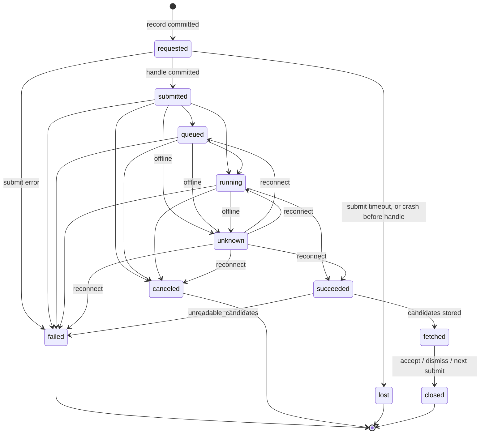

# Region edit and patch layers

## 1. Summary
MVP scenario steps 2–5. The user marks a **region** with EDT's region tool, paints a **mask** in it, writes the **final prompt** and picks a model. The controls shown are exactly the **model capabilities** (#37). The **job** runs estimate → confirm → submit → poll → fetch (ADR 0001) inside the **spend cap** (#23). The user compares the **candidates** in place and accepts one. Rust bakes the **feather** and **colour match** into a **patch layer** (ADR 0004, KQ-23) and a **revision** is written. The **original** is never touched.

## 2. Scope
Tier S ([feature-tiers](../feature-tiers.md)): localised edit of a masked region via Scenario · region extraction with context · candidate comparison · accept as a patch layer · visible job status and cost, with user-controlled retry · editing the final prompt · model capability discovery, controls reflect the model (#37).

## 3. Goals
- Only the region plus its **context margin** is sent, unresampled whenever it fits the model's input limits.
- Cost is visible before and after a job. Spend is bounded and never surprises the user.
- An accepted patch shows no visible seam at 100 % zoom (FR-RGN-32). Mask to accepted patch takes under 5 minutes.
- No job, candidate or accepted state is lost to a crash, a closed project or a closed app.

## 4. Non-goals
- Prompt drafting or rewriting (#9). Art recipes, reference images, text-to-image, free move/scale/rotate of a patch layer (tier A). Several active jobs per asset project (#40). Splitting a region into several jobs (OQ-IMG-06 C).
- Owned elsewhere: the region tool, mask painting, compare and picker (EDT) · storage, trash, conflicts, settings, the decoded original (PRJ) · the wire format, uploads, the **model overlay** and `poll_delay` (PRV) · `compose_rect` and export (EXP).

## 5. User stories
- As a DM preparing a session, I drag a box around one room, paint the floor and type "turn this room into a kitchen", so only that room changes.
- I see only the settings the chosen model really has, the estimated cost and my session total before I spend anything. A large job asks twice.
- I watch the job, can cancel it, and find it still running after I close and reopen the app.
- I flip before/after for each candidate in place, star the ones I like, accept one and can undo it. When a result is poor I retry, maybe with a new prompt. Nothing resubmits by itself.

## 6. Functional requirements
| ID | Requirement (testable) |
|---|---|
| FR-RGN-01 | `rgn_region_fit` takes the `{inner}` rect from EDT's region tool (`onRegionChange`, FR-EDT-27, R18), snaps it to integer image px and clamps it to the image. Below 16×16 → `region_too_small`; fully outside → `out_of_bounds`. EDT draws only the validated result. |
| FR-RGN-02 | Context margin: default 128 px, 0–512 (#40). Outer rect = region + context margin, clamped to the image (may be asymmetric). An outer side > 4096 → `region_too_large` (OQ-CNV-04). |
| FR-RGN-03 | Mask (R1): EDT's region-sized mask is padded with 0 to the outer rect, then resampled by the fit scale (box filter), then validated: 8-bit, exactly the sent size, ≥ 1 px > 0. Else `mask_invalid(size\|depth\|empty)`. Context pixels are always 0. |
| FR-RGN-04 | Region pixels = `compose_rect(current layer stack, outer rect)` (FR-EXP-01, #40) on PRJ's decoded original. With no patch layers they equal a crop of the original bit for bit. Picking the region tool calls `project_prefetch_original`; until the original is ready → `original_unavailable` (R11). |
| FR-RGN-05 | Fit with `input_px{min,max,multiple_of}` (R20): if a side > `max`, downscale with Lanczos3 by `max ÷ longest side` and round each sent side down to `multiple_of`. Otherwise grow the context margin on sides with room until each side is ≥ `min` and a multiple of `multiple_of`; with no room, resample to the nearest valid size. The panel shows "sent unresampled" or "patch N.N× softer" (outer ÷ sent, 1 decimal). Recomputed on every region, margin or model change. |
| FR-RGN-06 | Before any provider call, RGN checks the sent px and encoded bytes against the capabilities and fails with `input_too_large(field, limit)` (R20). PRV's `invalid_request` is the backstop. |
| FR-RGN-07 | The model picker lists `provider_list_models` (masked-edit capable; PRV already drops models with a required unknown input or a required extra image slot, FR-PRV-10/11/25). Offline → the cached list, marked stale. |
| FR-RGN-08 | Controls (#37) are rendered from `provider_get_capabilities` per [Appendix A](#appendix-a-capability-driven-controls): each `controls[]` entry of a known type maps to one control with its range, step, allowed values and default. The source, mask and prompt are bound by `role`, never by input name (R28). No control outside the capabilities is ever shown. The capability `warnings[]` (e.g. an omitted unknown type) are listed in the panel warning. |
| FR-RGN-09 | The prompt input is the final prompt: sent byte for byte with nothing added (#9) and recorded on the job. If `prompt_required`, submit is disabled while it is empty. |
| FR-RGN-10 | If the capabilities have `seed: true`, the seed is "random" or pinned. The seed actually used is recorded on the job (KQ-17). |
| FR-RGN-11 | The last model and control values are kept per asset project in the **draft**. A new region starts with an empty prompt. A remembered value the current capabilities reject resets to the default, with a notice. |
| FR-RGN-12 | An **estimate** is requested 500 ms after the last change to a cost-affecting input: model, sent size, or any control marked `cost_affecting` (R15). Other edits, the prompt included, don't re-estimate. It shows the cost in provider units, or "unknown". |
| FR-RGN-13 | Submit carries the estimate id, which hashes the cost-affecting inputs. A mismatch → `estimate_stale` and the panel re-estimates. |
| FR-RGN-14 | Session spend = Σ cost of the jobs submitted since app start (actual when known, else the estimate; a `lost` job counts its estimate). Spend + estimate > cap → `over_spend_cap`. The dialog shows spend, estimate and cap and offers an explicit "raise cap" field. |
| FR-RGN-15 | An estimate above the per-job threshold needs a second explicit confirmation. An unknown cost always needs one (ADR 0001). |
| FR-RGN-16 | No cap or threshold set → the first submit asks for both (#40). They are stored in PRJ's settings section `spend` (R8). |
| FR-RGN-17 | Before the provider `submit`, the job record (state `requested`), the region PNG and the mask PNG as sent (after fit, before polarity conversion) are committed (R2). When submit returns, PRV's opaque `provider{}`, which holds the **job handle** (OQ-PRV-22), is committed with state `submitted`; the state alone tells whether a handle exists. `provider{}` is persisted verbatim on every later transition. At most one active job per asset project (#40): a second submit → `job_active`. |
| FR-RGN-18 | The job strip (the active job's entry in the iteration tracker, FR-RGN-40) shows state, progress %, elapsed time and cost (estimate, then actual). A "still running" notice appears when `long_running` is true (FR-PRV-19). Every transition emits `rgn:job-state`. |
| FR-RGN-19 | Cancel is offered in `submitted`, `queued` and `running`. On a provider ack → `canceled`. If not cancellable, the panel says so and the job continues. |
| FR-RGN-20 | A failed job shows the normalised error and hint; `insufficient_balance` gets its own message. Nothing is ever resubmitted automatically. |
| FR-RGN-21 | Retry pre-fills the panel from the job (region, margin, its draft mask, prompt, model, controls; a new random seed unless pinned), then estimate → confirm again. |
| FR-RGN-22 | On project open the job runner resumes non-terminal jobs from their job files (the manifest index is rebuilt, R2): `submitted`, `queued`, `running`, `unknown` → poll; `succeeded` → fetch; `requested` → `lost`, with a possible-charge notice (#40). |
| FR-RGN-23 | Submit outcome: a normalised error before the provider accepted the job → `failed`, no spend. A `timeout` on submit → `lost` with the same notice. Offline mid-job → `unknown`; on reconnect the next status decides the exit ([Appendix B](#appendix-b-job-states)). Never resubmitted. |
| FR-RGN-24 | Each candidate is stored untouched as returned, as `results/NNN <slug>/NN.<ext>` of its iteration (FR-RGN-39, #44), with its index and provider metadata (R10). One that won't decode is `invalid`; the others stay usable. All invalid → `failed` with `unreadable_candidates`. Aspect differing from the sent one by > 1 % → a warning badge, resized to the outer rect (#40). |
| FR-RGN-25 | For the selected candidate Rust bakes a preview (resize to the outer rect, colour match, feather, alpha) and registers it with `register_transient_image` (FR-EDT-31); `rgn_candidate_preview` returns `{key, rect}` (R16). EDT's compare toggles before/after. Picker thumbnails use `edt_image_open` with `max_side` 256 (FR-EDT-32). |
| FR-RGN-26 | Blend controls: feather 0–256 px, default 48 (0 = the painted edge only); colour match default on (KQ-23). If < 1 % of the outer rect is unmasked, colour match is skipped with a notice. |
| FR-RGN-27 | Accept is one PRJ commit (R4): the baked RGBA patch (cropped to alpha > 0) as a new patch layer (scale 1, rotation 0, opacity 1, visible) with its job, candidate, feather and colour match; candidate statuses (FR-RGN-28); the job `closed`; a revision with reason `accept` and label = the first 40 chars of the prompt. The original's hash is unchanged. Flatten outside the mask equals the pre-accept flatten. |
| FR-RGN-28 | Statuses (R10): star toggles `starred` (kept forever). Discard → `discarded`, file to the **trash**. On accept or dismiss, the other `new` candidates → `dismissed`; unstarred ones go to the trash (`trash_id` set), starred ones stay ([schema §4.7](../architecture/manifest-schema.md#47-candidate-manifest-candidates)). A job ends on accept, dismiss or the next submit in its project (`resolved_at` set). One that ends with nothing accepted or starred also trashes its region and mask PNGs (R9). Accepted jobs keep them forever. A trashed result leaves `results/` for `.pforge/trash/`, and an iteration folder left empty is removed; star or restore puts the file back (FR-PRJ-31, OQ-RGN-16). |
| FR-RGN-29 | Re-tune (#40) re-bakes from the untouched candidate into a **new** layer id and file, replacing the layer in the stack, plus a revision with reason `retune` (R3). The old file stays referenced by its revision. |
| FR-RGN-30 | Accept and re-tune each push one entry onto EDT's undo stack (FR-EDT-23): undo = `project_restore_revision(parent)` (reason `restore`), redo = restore the later revision (R3). Candidate and job records are unchanged. Undo never deletes a file. |
| FR-RGN-36 | **Re-pick** (#41, R32): when the project's most recent job is `closed` with an accept and the current layer stack holds no layer from it (e.g. after undo of that accept), the picker shows its candidates again. Accepting one works as FR-RGN-27 (new layer, `accept` revision); a trashed candidate file is restored from the trash in the same commit. The job stays `closed` and earlier `accepted` candidates keep their status. Not available once a newer job exists or after the trash purge (`repick_unavailable`). No provider call, no spend. |
| FR-RGN-31 | Every capability here is a `pf-core` command (§9) that works without the UI, with inputs validated at the boundary. A failed command leaves the asset project unchanged. |
| FR-RGN-32 | No visible seam: with the fake case `offset(12)` on the seam fixture, after the bake the mean edge step across the mask boundary is ≤ 0.5 levels/px and the residual offset ≤ 0.1 levels (ADR 0004 measured 0.28 and 0.03). |
| FR-RGN-33 | Rules (#37): on every control change the panel calls `rgn_controls_evaluate`, which runs PRV's pure `Capabilities::evaluate` (FR-PRV-30). Hidden controls are neither shown nor sent; a value outside the effective allowed set resets to the default with a notice; required controls are marked and submit is disabled, naming them. Estimate and submit re-evaluate at the boundary: `invalid_control(name, reason)`. |
| FR-RGN-34 | Sent values = visible controls that are required or changed by the user; untouched optional controls are omitted so the provider applies its default. The job records the sent values and the capability snapshot (KQ-17). |
| FR-RGN-35 | The job runner owns the poll loop (R14): PRV `status` + `poll_delay`, a commit per transition, until the job is `fetched` or terminal, also after its project is closed while the app runs. Quitting the app stops it; FR-RGN-22 resumes it. |
| FR-RGN-37 | Conflict or lock during a job (R12, #39): candidate bytes and job updates go to PRJ's pending-write spool and are replayed after resolution; polling continues. User writes fail with `conflict` / `locked` and work again once resolved. |
| FR-RGN-38 | Read-only project (R12): view, region and mask painting work; no estimates are requested; submit is disabled with the reason; accept, star, discard, dismiss and re-tune fail fast with `read_only`. (Was a second FR-RGN-36; renumbered to remove the duplicate.) |
| FR-RGN-39 | (#44) **Iteration** = a job that returned candidates; it gets one folder `results/NNN <slug>/` when its candidates are stored. `NNN` = 1 + the highest iteration number in the project, three digits (more when needed). `<slug>` = the final prompt lower-cased, every run of characters other than letters and digits turned into one space, trimmed, cut at a word boundary to ≤ 32 chars, then FR-PRJ-44 rules; empty → `edit`. A taken folder name (e.g. after a sync conflict) gets ` (2)`. Failed, canceled and lost jobs get no number and no folder. |
| FR-RGN-40 | (#44, #45) The **iteration tracker** (bottom strip) lists the project's iterations newest first, plus the active job before it has candidates: `NNN`, slug, state, kept / returned count, cost, and a ✓ on the one with the accepted patch in the current stack. Selecting an iteration shows its non-trashed candidates in EDT's picker; the newest is selected by default. Older iterations allow compare, star and discard; accept follows FR-RGN-36 (`repick_unavailable` otherwise, OQ-RGN-15). |

## 7. UI/UX notes
- Slots per [ui-guidelines](../architecture/ui-guidelines.md). **Generate** section of the right panel (`app/src/features/region-edit/`), top to bottom: Region (size, margin slider, fit label) · Model (picker, capability controls per Appendix A, capability warnings) · Prompt · Cost (estimate, session spend / cap, balance or "unknown", OQ-PRV-09) · Submit · blend controls (while a candidate is selected).
- **Iteration tracker** (bottom strip, FR-RGN-40): one chip per iteration; the active job's chip is the job strip (state, progress, elapsed, cost, Cancel / Retry / Dismiss). Under it, EDT's picker shows the selected iteration's candidates, wired to `onSelect` (preview), `onAccept`, `onStar`, `onDiscard` (R19). The job state also gets a status bar segment.
- **Confirm dialog:** estimate, spend after this job, cap, threshold or unknown-cost warning, and "N unstarred candidates of the previous job go to the trash" when that applies. Enter never confirms an over-threshold job.
- **States:** *empty* "Drag a box to start a region edit" · *loading* spinner, submit disabled · *job running* strip active, submit disabled, view usable · *error* inline message + hint + Retry · *offline* models stale, no estimate, submit disabled · *provider unavailable* (`auth`) "Set up provider" opens PRV's credential screen · *read-only* FR-RGN-38.
- Test ids: `rgn-panel-{margin,model,prompt,estimate,submit,warning}`, `rgn-control-input` (+ `data-record-id` = input name), `rgn-confirm-{ok,cap}`, `rgn-job-{cancel,retry,dismiss}`, `rgn-blend-{feather,colour}`, `rgn-tracker-item` (+ `data-record-id` = job id). Candidate buttons are EDT's `edt-picker-*` (R19).

## 8. Data and file effects
PRJ owns storage, names and the atomic commit; fields are defined once in [manifest-schema](../architecture/manifest-schema.md). RGN needs:
- **Job** (R2): `.pforge/jobs/<id>/job.json` + `region.png` + `mask.png` as sent. The job file is authoritative. RGN needs `iteration{n, dir}` (FR-RGN-39), `fit`, `region{inner,outer,margin}`, the draft mask id, final prompt, sent control values, `seed{requested, returned}`, capability snapshot, estimate, actual cost, state with timestamps, `resolved_at`, error, and PRV's opaque `provider{}` (it holds the job handle; no top-level handle field, OQ-PRV-22). Recoverable: yes, the source of truth.
- **Candidate** (R10): `results/NNN <slug>/NN.<ext sniffed>` (`NN` = index + 1), untouched, visible in Explorer; `index`, `provider_meta`, status, `starred`. Kept when accepted or starred, else trashed (FR-RGN-28) and purged after 30 days (#18).
- **Patch layer:** write-once RGBA PNG plus its placement (ADR 0003), source job + candidate, feather and colour match (with the fitted gain/offset). Re-bakeable from the candidate.
- **Revision:** reasons `accept`, `retune`, `restore` (R24), optional `label`. Display labels `r<seq>`.
- **Settings:** `spend{cap, threshold}` in `<data-dir>/settings.json` (PRJ, R8), per machine. **Memory only:** session spend, previews (transient keys), the job runner; reset per session. The model cache is PRV's.

## 9. Commands and events
| Command | Input → result | Errors (plus `read_only`, `locked`, `conflict` on every write) |
|---|---|---|
| `rgn_region_fit` | project, inner, margin, model → `{inner, outer, margin, sent_w, sent_h, scale}` | `region_too_small`, `out_of_bounds`, `region_too_large`, `unknown_model` |
| `rgn_controls_evaluate` | model id, control values → per control `{visible, allowed, required, error?}` | `unknown_model` |
| `rgn_job_estimate` | draft `{region, mask_id, model_id, final_prompt, controls, seed}` → `{estimate_id, cost\|unknown, spend, cap, needs[threshold\|unknown_cost\|set_cap]}` | `mask_invalid`, `invalid_control`, `input_too_large`, `original_unavailable`, every normalised PRV error |
| `rgn_job_submit` | draft, estimate_id, confirmations → job id | `estimate_stale`, `over_spend_cap`, `confirmation_missing`, `job_active`, the estimate's errors |
| `rgn_job_cancel` | job id → `canceled\|not_cancellable` | `not_found`, `offline` |
| `rgn_job_retry_draft` | job id → a pre-filled draft | `not_found`, `source_missing` |
| `rgn_job_dismiss` | job id → trashed count | `job_active`, `not_found` |
| `rgn_candidate_preview` | job, candidate, blend → `{key, rect}` | `invalid_candidate`, `original_unavailable` |
| `rgn_candidate_accept` | job, candidate, blend → `{layer_id, revision_id}` (also a re-pick, FR-RGN-36) | `invalid_candidate`, `original_unavailable`, `repick_unavailable` |
| `rgn_candidate_star` / `_discard` | job, candidate, flag → ok | `not_found` |
| `rgn_patch_retune` | layer id, blend → `{layer_id, revision_id}` | `source_missing`, `original_unavailable` |
| `rgn_iterations_list` | — → `[{job_id, n, dir, slug, state, kept, returned, cost, accepted_in_stack}]` newest first | `no_project` |
| `rgn_spend_get` / `_set` | — / `{cap, threshold}` → `{spend, cap, threshold}` | `invalid_value` |

- **Uses:** `provider_list_models`, `provider_get_capabilities` (PRV); PRJ store calls `read_project`, `decoded_original`, `record_job`, `update_job`, `add_candidates`, `set_star`, `discard_candidate`, `accept_candidate`, `resolve_job`, `replace_patch_layer`, `settings_get/put`; PRJ commands `project_prefetch_original` (R11) and `project_restore_revision` (undo); EDT's `register_transient_image` (FR-EDT-31). Resume is a job-runner call made by `project_open`, not a command.
- **Events:** `rgn:job-state {job_id, state, progress, cost, error?}` · `rgn:candidate-ready {job_id, candidate_id, status}` · `rgn:spend {spend, cap}`.

## 10. Provider interaction
- **Operations** (ADR 0001): `estimate`, `submit` (`edit_masked`), `status`, `cancel`, `fetch_candidates`, `balance`. PRV uploads inside estimate/submit, once per content hash per session (R15). RGN never sees Scenario fields.
- **Mask:** RGN sends the canonical mask (255 = edit). PRV converts to the model's **mask convention** and applies the overlay row's `soft: pass-through | threshold(128)`; alpha-convention masks carry the source RGB (R1).
- **Capabilities used** (PRV Appendix C): `mask`, `input_px`, `max_bytes`, `seed`, `prompt_required`, `controls[]`, `rules[]` via `evaluate`, `warnings[]` (#37).
- **Retries:** PRV retries idempotent calls only. RGN runs the poll loop (FR-RGN-35). Submit is never retried. Expired candidate URLs are re-resolved by PRV.

## 11. Edge cases
| Case | Behaviour |
|---|---|
| Crash mid-save | Accept is one commit: old or new state. The layer PNG is written first; an orphan goes to the trash on open (FR-PRJ-20). A crash before the handle is saved → `lost` + possible-charge notice (FR-RGN-22). |
| Project or app closed mid-job | Polling continues while the app runs (FR-RGN-35); after an app restart it resumes on project open. |
| Sync conflict / locked / read-only | FR-RGN-37, FR-RGN-38. Paid candidates are spooled, never dropped. |
| Offline / provider error / timeout | §7 *offline*; mid-job FR-RGN-23. Errors show the normalised error + hint and offer Retry. A submit timeout → `lost`. |
| Capabilities changed since the draft | Re-read on model pick; the snapshot is taken at submit; invalid remembered values reset (FR-RGN-11). |
| Large image, image edge, odd candidate | 16k uses the decoded original, outer rect ≤ 4096². At an edge the margin is clamped and colour match fits on the context that exists. Corrupt or odd-sized candidates: FR-RGN-24. |
| Undo across the boundary | FR-RGN-30. A job keeps its own mask copy, so mask undo doesn't change it. |

## 12. Performance budget
- Typical (≤ 23.5 MP map, 1–2k region) / worst (16k map, 4096² outer): fit + extraction ≤ 50 ms / ≤ 200 ms · encode region + mask ≤ 300 ms / ≤ 1.5 s · bake a preview ≤ 150 ms / ≤ 1 s · accept (bake + commit + revision) ≤ 1 s / ≤ 3 s.
- Extra memory during a job, beyond PRJ's decoded original: ≤ 64 MiB typical, ≤ 400 MiB worst.
- Mask to accept: ≤ 8 clicks plus typing the prompt (the 5-minute goal).

## 13. Test plan
- **Rust unit** (`fr_rgn_NN_*`): clamping and caps (01, 02); mask pad → resample → validate (03); fit with `input_px` (05); byte pre-check (06); required rules and boundary checks (33, 34); estimate hash (13); spend with cap, threshold, unknown and `lost` (14–16); every transition in Appendix B (17, 22, 23, 35); statuses, input retention and trashed results leaving `results/` (28); iteration numbering, slug and folder collisions (39); seam metric (32).
- **Vitest** (`FR-RGN-NN …`): the panel renders exactly `fixtures/rgn/capabilities-all-types.json` (every type, `hidden`/`allowed`/`required` rules, a warning) (07, 08, 33); debounced estimate only on cost-affecting changes (12); confirm-dialog logic; fit label.
- **Integration** (pf-core + **fake provider**, cases per R17): full loop to an accepted revision; reopen pixel-identical; original hash unchanged (27); resume after recreating the core context mid-`running` (22); `canceled`, `not_cancellable`, `failure`, `insufficient_balance`, `estimate_unknown`, `offline` → reconnect, `slow(n)`, `bad_candidate`, `aspect_mismatch(2)`; prompt received = typed (09); undo/redo of accept and re-tune (30); undo accept → re-pick another candidate, incl. one from the trash, no provider call (36); spool replay after a conflict (37); `read_only` (38); a kill between candidate files and the manifest, then re-fetch into the same folder (39). Vitest: tracker ordering, selection and the ✓ marker (40). **Thin e2e** (Playwright, mocked commands, KQ-33): region → controls → prompt → estimate → confirm → progress → pick → accept; over-cap dialog; cancel.
- **Fixtures** (generated, KQ-22): a synthetic "rooms" battlemap 4200×5600 (16384² for perf, not committed), the seam fixture (texture noise; fake `offset(12)`), a fixture mask, the capabilities fixture above. No recordings: those are Scenario replay only (R17).
- **Walkthrough** (dev build, fake provider, `PF_DATA_DIR=.pf-dev/data`, `PF_LIBRARY_DIR=.pf-dev/library`):

| # | Step | Expected |
|---|---|---|
| 1 | Create a Maps project from the rooms fixture, open it, press `R`, drag a box around a room | Size, margin, "sent unresampled" |
| 2 | Paint the floor, type a prompt, pick each fake model in turn | Controls match each fake model's capabilities, warnings shown; estimate in CU |
| 3 | Set the cap below the estimate, submit | Over-cap dialog; raise the cap, confirm |
| 4 | Quit mid-`running`, reopen | The job resumes and finishes; candidates appear |
| 5 | Before/after, star #2, feather 96, accept #1 | Patch in place, FR-RGN-32 metric passes; #2 starred; `results/001 <slug>/` holds `01` and `02`, the rest in `.pforge/trash/`; tracker shows `001` ✓; revision `r1` |
| 6 | Undo, redo, re-tune feather to 32, close, reopen | `r2` restore, `r3` restore, `r4` retune; layer and blend values intact |
| 6b | Undo the re-tune and the accept, pick #2, accept | `r5`, `r6` restores; no new estimate or spend; patch from #2; revision `r7` |
| 7 | Retry with a new prompt | Pre-filled panel; a new estimate is required |
| 8 | Submit it, then select `001` in the tracker | `002 <new slug>/` appears; `001`'s kept candidates show; Accept on them → `repick_unavailable` |

## 14. Build split
| # | Slice | Shared files (AGENTS §9) | Depends on |
|---|---|---|---|
| 1 | Region fit, mask pipeline, extraction | command registry (append) | skeleton, PRJ decoded original, EXP slice 1 |
| 2 | Capability rules, estimate, spend guard | command registry (append), settings `spend` (via PRJ) | PRV fake + capabilities |
| 3 | Job runner: submit, poll, cancel, resume, retry draft, spool | command registry (append), job fields (add only, via PRJ) | 2, PRJ store API |
| 4 | Candidate fetch into iteration folders, preview bake, blend | candidate fields (add only) | 3, pf-imaging blend, EDT transient keys |
| 5 | Accept, statuses, dismiss, re-tune, undo entries | patch layer fields (add only) | 4, PRJ revisions + trash |
| 6 | Generate section with Appendix A controls, iteration tracker with job strip, confirm dialog (mocked commands, parallel to 2–5) | UI feature registry (append) | EDT region tool, mask hand-off, picker |

## 15. Open questions
| ID | Question | Options (tradeoff) | Blocking? |
|---|---|---|---|
| OQ-RGN-15 | The tracker shows older iterations. May the user accept a candidate from one? | **A. No, keep R32: older iterations are compare, star and discard only; no new semantics** / B. yes, any kept candidate: natural with the tracker, but reopens #41 and R32 | No |
| OQ-RGN-16 | Does a trashed result leave `results/`? | **A. Yes, it moves to `.pforge/trash/`: `results/` shows only what was kept; same trash as everything else (#18)** / B. it stays until the 30-day purge: browsable rejects and fewer file moves, but `results/` fills with rejects | No (slice 5) |

Answered ones are in [Appendix C](#appendix-c-closed-open-questions).

## Appendix A: capability-driven controls
Rendered from PRV's generic `controls[]` (FR-PRV-10, PRV Appendix C). Each control carries PRV's `role` (R28); RGN binds the source, mask and prompt by role, never by input name.

| Control type (`role`) | UI control | Notes |
|---|---|---|
| `image` (`source`), `mask` (`mask`) | none | filled with the region and mask PNGs; never shown |
| `string` (`prompt`) | Prompt textarea | FR-RGN-09 |
| `seed` (`seed`) | Random / pinned number | FR-RGN-10 |
| `int` / `float` with min and max | slider + number field | step snapping |
| `int` / `float` missing a bound | number field | the known bound enforced |
| `enum` | select | the effective allowed values from `evaluate` |
| `bool` | toggle | — |
| `string` (`other`) | single-line text field | sent as typed |
| extra image (`slots[]`, `reference`) | none | not sent in tier S; a required slot → PRV doesn't offer the model |
| unknown type | none (PRV omits it) | named in the panel warning |

Numeric rows also cover `candidate_count`. Defaults prefill every control. `rules[]` act through `evaluate` (FR-RGN-33): `hidden` hides and drops a control, `allowed` narrows its choices, `required` marks it. Changing a `cost_affecting` control re-estimates (FR-RGN-12).

## Appendix B: job states
Terminal: `failed`, `canceled`, `lost`, `closed` (R2). `fetched` waits for accept or dismiss; the next submit dismisses it. A re-pick (FR-RGN-36) keeps a job `closed`; it is not a transition. Dismissing a terminal job only sets `resolved_at` (FR-RGN-28). Every transition is committed.

## Appendix C: closed open questions
| ID | Question | Answer |
|---|---|---|
| OQ-RGN-01 | How is a region created? | ✅ Drag a box first, with EDT's region tool (R18) |
| OQ-RGN-02 | Region source pixels | ✅ `compose_rect` of the current layers (#40) |
| OQ-RGN-03 | Default context margin | ✅ 128 px, 0–512 (#40) |
| OQ-RGN-04 | Spend defaults | ✅ None; ask on first submit (#40) |
| OQ-RGN-05 | Where spend settings live | ✅ PRJ's `settings.json`, section `spend` (R8) |
| OQ-RGN-06 | Concurrent jobs | ✅ One active job per asset project (#40) |
| OQ-RGN-07 | Candidate aspect differs | ✅ Resize, warn above 1 % (#40) |
| OQ-RGN-08 | Re-tune after accept | ✅ Yes, new layer + `retune` revision (#40, R3) |
| OQ-RGN-09 | Store job inputs | ✅ Yes, `jobs/<id>/`, trashed per R9 (#40, R2) |
| OQ-RGN-10 | Crash before the handle is saved | ✅ `lost` + possible-charge notice (#40) |
| OQ-RGN-11 | Input constraints beyond max px | ✅ PRV exposes `input_px`; RGN fits to it (R20) |
| OQ-RGN-12 | Glossary terms | ✅ Added (R27) |
| OQ-RGN-13 | Accept another candidate after undoing an accept | ✅ B as a re-pick that keeps `closed` terminal (#41, R32, FR-RGN-36) |
| OQ-RGN-14 | Which control is the source, mask, prompt or candidate count | ✅ PRV's `role` field; RGN binds by role (R28) |
